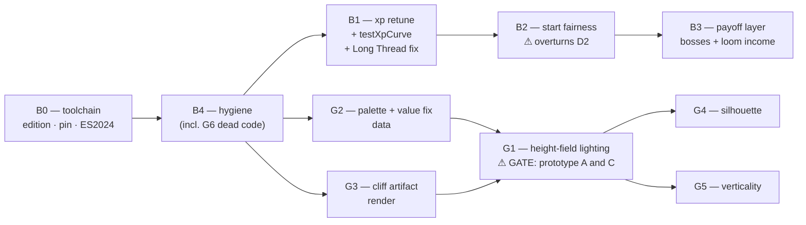

# NIGHTWARD — Batch B & G Proposal
### "The Reachable Run" (gameplay) + "Depth" (graphics)

> **STATUS (2026-08-19): Batch G G1–G6 SHIPPED** on `feat/g-terrain-depth`, unmerged and
> awaiting a playtest verdict — see the dated entry at the top of `ROADMAP.md` for what
> actually landed and where it diverged from this document. **Batch B is unchanged: still
> proposal-only here, with B0–B3 built on the separate unmerged `feat/b-reachable-run`.**
>
> Where G shipped differently from the plan below: G1 took Option C (multiply-blend shade
> overlay) without building the Option A prototype, so the mandated A-vs-C gate was
> **collapsed into a relief-on/relief-off gate** (`R` key, `?norelief`) — the verdict the
> user still owes is "keep it or not", not "A or C". G1's normal-field build was moved off
> the bake path after measurement. G6 grew to include the per-tile AO pass.
>
> **Original status:** PROPOSAL. Not approved, not started, nothing implemented.
> Written 2026-08-11 against `main` @ `99b23eb` (clean tree, all 7 feature branches
> fully merged). This document exists to be argued with before any code is written.
>
> **Revision 2 (2026-08-11)** — updated after an external toolchain/architecture review.
> Material changes: a new **B0** toolchain-hygiene milestone; **G1 no longer pre-decides
> Canvas2D over a GPU shader** and now mandates prototyping both at the gate; **Q7's
> answer changed**; risk register updated. The review, and which of its points were
> accepted vs. rejected and why, is recorded in **§14** — read that before re-raising
> any of it.
>
> **Revision 3 (2026-08-11)** — updated after a second review that re-ran the repo checks.
> Material changes: **R1's risk rating is inverted** (the Gauntlet cannot see B1 at all —
> B1 now owns a new curve test); a **Long Thread runaway** discovered in the B1×B3
> interaction, folded into B1; **G1 gains an Option C** (multiply-blend shade overlay)
> which delivers Option B's moving light without a shader, so the A-vs-B framing in
> revision 2 was a false dichotomy; B0.4 dropped as moot. Recorded in **§15**.
>
> **Document map** — per `docs/GDD.md` §"Document map": `GDD.md` is what the game IS,
> `ROADMAP.md` is the dated build log, `WORKFLOW.md` is process, and `<ID>-*.md` briefs
> like this one are written while work is in flight and deleted once folded back into
> the GDD. This file is a *pre-brief*: a proposal covering two batches. If approved it
> should be split into per-milestone briefs at activation (the project's standing
> anti-staleness rule) and this file deleted.

---

## 0. How to read this document

**If you are reviewing and have 5 minutes:** read §1 and §12 (open questions).

**If you are reviewing seriously:** read §1–§7 for the findings and evidence, then §8
for the plan. Every number in §3–§7 was measured against the running game, not read off
a doc — §2 lists exactly what was run and §13 has the repro commands.

**If you are implementing:** §8 is the work. §10 is what will bite you. §11 is the
definition of done. Do not start without reading `docs/plans/WORKFLOW.md` — this project
has a hard evidence gate that exists because two milestones shipped with fabricated test
results.

**A note on trust.** This project's history includes implementers reporting "all green"
Gauntlet runs that never happened, and tests that were tautologies (`ok(true, ...)` after
a real assertion; a mob-stat test that asserted `hp >= base*0.9` on a hand-built fixture
that could never fail). Nothing in this document is asserted on the basis of a previous
session's claim. Where this doc says "verified," a command was run and its output read.

---

## 1. Executive summary

NIGHTWARD is in good engineering health and poor design health, and the two problems are
unrelated to each other.

**The engineering is solid.** Typecheck clean, build green, 23/23 Rust tests, and the
in-game "Gauntlet" regression suite genuinely passes 72 functions / 1249 assertions with
zero page errors when driven from headless Chrome. `GDD.md` is an accurate description of
the code. Simulation performance has enormous headroom (250 simultaneous foes costs 2.3%
of the frame budget). This is a well-architected, data-driven codebase and the plan below
does not propose re-architecting anything.

**Problem 1 — the game contains roughly three batches of content and a fifteen-minute
window that exposes maybe a fifth of it.** The L1 milestone (2026-07-31) bolted a hard
real-time run cap onto a progression curve that had been designed, over many months, for
an open-ended session. Nobody re-derived the numbers afterward. The result: the entire
silver equipment tier is mathematically unobtainable, the star tier is off by three
orders of magnitude, 11 of 32 buildings can never be built, the Waystone (and therefore
the whole territory-expansion pillar) sits behind loot RNG, and the Loom's keystones cost
5–9 points in a run that yields about 4.

**Problem 2 — the terrain art has structure at 1 pixel and at 32 pixels and nothing in
between or above.** Large regions render as uniform slabs with staircase silhouettes, and
`heightClass` — the field that is supposed to make mountains read as mountains — drives
only a 7-pixel dark band. Mountains are currently *darker* than the grass beside them,
which the eye reads as a pit rather than a peak.

**The proposal:** two batches. **Batch B "The Reachable Run"** is mostly data edits that
re-scope existing content onto the clock that already exists. **Batch G "Depth"** is one
significant rendering change (light a real height field) plus five small ones. Neither
batch adds content. That is deliberate: this game does not need more systems, it needs
the systems it has to be visible to a player inside one run.

**Revision 3, for the five-minute reader — three things changed and all three matter:**

1. **The Gauntlet cannot see B1.** No test references `CFG.xp`; the xp fixtures are
   `Math.max(…, 50e6)` floors that any cheaper curve still clears. B1 is *easier* than
   budgeted and *completely unguarded*. It now carries its own curve test (§B1.a).
2. **B1 breaks the Loom, and the old sequencing hid it.** The Long Thread keystone grants
   `floor(totalLevels/4)` points; B1 roughly triples that (7 → ~17 on a 132-rank tree),
   forcing the opening. Its advertised "skills cap at 80" is not implemented at all. Both
   fixes move into B1 (§B1.b).
3. **G1's shader-vs-bake debate was the wrong question.** A third option — a
   multiply-blended shade overlay reusing the foam/glow pattern that already ships — gets
   the moving light that justified the shader, with no shader, no render target and no
   WebGL risk. The gate now compares A vs C (§G1, §15).

---

## 2. Verified current state

Everything in this table was executed on 2026-08-11 against `main` @ `99b23eb`.

| Check | Command | Result |
|---|---|---|
| Typecheck | `npx tsc --noEmit` | **clean** |
| Build (incl. wasm) | `npm run build` | **green** — 682.18 kB JS (209 kB gzip), 53.23 kB wasm |
| Rust core | `cargo test` w/ `CARGO_TARGET_DIR` set | **23/23 passed** |
| Gauntlet | headless Chrome + raw CDP, `?gl&seed=1234`, `__nw.regression.run()` | **72 functions / 1249 assertions, 0 fail, 0 page errors** |
| rAF actually running | `__nw.frames` sampled across a wall-clock gap | 2 → 94 over 1.5 s — **renders** |
| L1 lifespan end-to-end | compressed `state.lifespanTargetMin`, waited | aged to target, `gameOver: true`, `gameOverCause: 'old_age'`, **"THE DREAM FADES"** shown, scorecard written to `localStorage['nw.leaderboard']`, `legit: true` |
| Seeded run length | `?seed=1234` | target **14.83 min** (death at age 164.25) — inside the documented 14–16.5 window |
| Branch state | `git rev-list --left-right --count main...<branch>` | all 7 branches: **0 commits not in main** — all stale, safe to delete |

**Simulation performance under horde load** — the ROADMAP flags `testHordeScale` as
"config-assertion theater" that never actually spawns a wave, so the `maxAlive: 250` gate
was unproven. It is now proven, and it is fine:

| Live foes | ms per sim step | % of the 33.3 ms budget @30 Hz |
|---:|---:|---:|
| 1 | 0.087 | 0.3% |
| 50 | 0.173 | 0.5% |
| 100 | 0.335 | 1.0% |
| 200 | 0.617 | 1.9% |
| 250 | **0.755** | **2.3%** |

Linear scaling, no cliff. **The sim is not and will not be the bottleneck.**

**Not verified:** render-side frame pacing on a real GPU. The headless environment only
offers SwiftShader (CPU rasterisation), which produced 7.6 fps and is meaningless as a
predictor. Someone should open the game in a real browser and watch the frame counter
during a night-3 wave. This is the one performance question this document cannot answer.

---

## 3. Finding 1 — content vs. the fifteen-minute clock

### 3.1 The run's actual xp budget

A run is `CFG.lifespan.baseRunMinutes` = 15 minutes = 900 seconds. A day/night cycle is
`daySec 240 + nightSec 100` = 340 s, so **a run spans 2.65 cycles — two nights, sometimes
three.**

Best-case gathering throughput, computed from `FEATURES` rows as `xp / gatherSec × 60`,
**ignoring all walking between nodes** (so these are ceilings no player reaches):

| Node | skill | xp | sec | xp/min at the node | levelReq |
|---|---|---:|---:|---:|---:|
| Tree | woodcutting | 25 | 2.6 | 577 | 1 |
| Stone Outcrop | mining | 20 | 2.8 | 429 | 1 |
| Copper Vein | mining | 30 | 3.2 | 563 | 1 |
| Sunleaf | foraging | 15 | 1.6 | 563 | 1 |
| Berry Bush | foraging | 12 | 1.8 | 400 | 1 |
| Iron Vein | mining | 55 | 3.8 | 868 | **10** |
| Moonbell | foraging | 34 | 2.0 | 1020 | **8** |
| Wispflower | foraging | 38 | 2.0 | 1140 | **8** |
| Ancient Oak | woodcutting | 65 | 5.0 | 780 | **12** |
| Storm Crystal | mining | 70 | 4.5 | 933 | **15** |

Note in passing that **most world features are already above the level a run can reach** —
the world is populated with nodes the player cannot harvest.

Combining these with horde sizes (`baseCount 25`, `perNight 18` → 25 foes on night 1, 43
on night 2) and regular-enemy xp (range 6–280, ~40 typical), a **realistic** whole-run
budget, assuming a competent player who splits time between fighting, gathering, building
and crafting, is approximately:

- **combat: ~3,000 xp**
- **best single gathering skill: ~1,500 xp**
- **smithing: ~1,000 xp** (smithing xp comes only from crafting bars, so it is
  bottlenecked on ore throughput, not on crafting time)

These are estimates and should be treated as such — but they are estimates with an order
of magnitude of slack in them, and the conclusion below survives being wrong by 3×.

### 3.2 What the curve costs

The live curve is `CFG.xp = { base: 400, growth: 1.32, maxLevel: 50 }`, i.e. xp from level
L to L+1 is `400 × 1.32^(L-1)`. Cumulative cost to *reach* a level:

| Level | Total xp | Gates at this level |
|---:|---:|---|
| 5 | 2,545 | Copper Blade, Ember Charm |
| 6 | 3,759 | Copper Armour |
| 10 | **13,958** | **Iron Bar**, Moon Charm |
| 12 | 25,249 | Iron Axe, Iron Pick |
| 15 | 59,696 | Iron Sword |
| 16 | 79,199 | Iron Armour, Ward Amulet, Night Charm |
| 18 | 138,924 | Fire Brand, Frost Edge |
| 20 | **242,989** | **Silver Bar**, Storm Caller, Silver Charm |
| 22 | 424,312 | Silver Sword, Void Blade |
| 24 | 740,249 | Silver Armour |
| 30 | **3,921,169** | **Star Bar**, Star Charm |
| 33 | 9,020,189 | Star Sword |
| 35 | 15,717,705 | Star Armour |
| 50 (cap) | 1,011,654,239 | — |

Against a ~1,000–3,000 xp per-skill run budget: **a player finishes a good run somewhere
around level 5–7.** Copper. That is the whole craftable game.

### 3.3 The loot escape hatch (this part is good design)

Iron is *not* actually dead, because it drops. Verified from `ENEMIES` loot tables:

| Source | HP | Drop |
|---|---:|---|
| Towerhunter | 55 | `iron_bar` ×1–2 @ 30% |
| Brute Warlord | 260 | `iron_bar` ×1–3 @ 60%, `sword_copper` @ 12%, `star_ore` ×1–2 @ 20% |
| Craggin Titan | 500 | `iron_bar` ×2–4 @ 50%, `armor_copper` @ 20%, **`star_bar` ×1–2 @ 15%** |
| Shade King | 180 | `star_ore` ×1–3 @ 40%, `ring_silver` @ 8% |
| Cindermaw (boss) | 900 | `iron_bar` ×1–3 @ 70%, `armor_iron` @ 12%, `ring_iron` @ 30% |
| Nullmaw (boss) | 1200 | `iron_bar` ×2–5 @ 100%, `sword_iron` @ 25%, `armor_iron` @ 20%, `ring_iron` @ 35%, `amulet_iron` @ 35% |
| Thornwarden (boss) | 700 | `sword_iron` @ 15%, `charm_moon` @ 35% |

So **iron is reachable by fighting rather than by crafting**, which is a genuinely nice
implicit design: the night horde is your smithy. Worth preserving deliberately rather
than by accident.

### 3.4 Silver is hard-blocked

`silver_bar` has **zero drop sources anywhere in the game.** Its only producer is one
recipe at smithing L20 = 242,989 xp. Meanwhile `silver_ore` drops from four enemies
(25–35%) and one world feature — and cannot be smelted, because smelting it *is* the L20
recipe. Silver ore is therefore soul-feed fodder only (18 xp via W7's soul-feeding, which
at least keeps it from being literal garbage).

Consequences: `sword_silver`, `armor_silver`, `amulet_silver`, `ring_silver` (craft path),
`charm_silver`, and every building requiring `silver_bar` are unreachable by any play
pattern.

`star_ore` has the same shape — drops from two enemies, only consumable via the L30
recipe. Dead. `star_bar` itself does drop (Craggin Titan, 15%), which is the only reason
the star towers are not *completely* impossible.

### 3.5 Buildings

Of the **32** building rows in `data/buildings.ts` (buildings have no skill-level gate —
they are gated purely on materials):

| Tier | Count | Reachable in a run? |
|---|---:|---|
| Copper-tier materials (log/stone/plank/copper_bar/sunleaf/fine_log/charcoal) | ~11 | yes |
| Requires `iron_bar` | ~10 | yes, via loot |
| Requires `silver_bar` and/or `star_bar` | **11** | **no** (star: only via a 15% drop off one 500 HP mob) |

The single most consequential entry: **the Waystone costs 4 `iron_bar`.** The Waystone is
the anchor of the entire territory-expansion pillar described in GDD §8 — the chained
build frontier, the decay cascade, the "vast map covered in buildings" endgame the user
named as the goal. It sits behind loot RNG on night 2.

### 3.6 The Loom

40 nodes, 132 total allocatable ranks. Keystone prerequisite depth, computed by walking
the `req` graph:

| Keystone | Branch | Points to reach |
|---|---|---:|
| The Long Thread | field | 5 |
| Glass Echo | war | 8 |
| Deep Roots | ward | 9 |
| Night Market | field | 9 |

Point income is `1 per night survived` + `CFG.loom.pointsPerBossKill = 2`. A 15-minute run
yields **2 nights + maybe 1 boss ≈ 4 points.** So the player allocates ~3% of the tree and
**cannot reach three of the four keystones.** The only reachable one, The Long Thread, is
the one whose payoff ("+1 point per 4 total skill levels, skill cap raised to 80") is a
long-run scaling perk in a game with no long run.

The Loom is supposed to be the thing that makes each run *a build*. Right now it is four
small stat nudges.

### 3.7 Bosses, echoes and relics

Time-to-kill, computed from `CFG.combat` (envelope `0.22 + 0.12 + 0.30 = 0.64 s`) and the
D5 damage-roll band midpoint (~0.9×):

| Weapon | base dmg | ~dps | Thornwarden (700 hp) | Nullmaw (1200 hp) |
|---|---:|---:|---:|---:|
| Fists | 4 | 5.6 | 124 s | 213 s |
| Copper sword | 10 | 14.1 | **50 s** | 85 s |
| Iron sword | 16 | 22.5 | 31 s | 53 s |
| Silver | 22 | 30.9 | 23 s | 39 s |
| Star | 30 | 42.2 | 17 s | 28 s |

Fifty seconds of unbroken melee with the realistically-attainable weapon, while the boss
hits for `dmgBase 20` into a 100 HP pool. In a 900-second run. Which means the **Echoes
(5) and boss relics (5) — the roguelite payoff layer, an entire shipped milestone each —
are realistically never seen by a player.**

Note the pleasant cascade here: fixing the xp curve (§8, B1) puts an iron sword in the
player's hands early, which drops Thornwarden to 31 s, which makes echoes and relics
reachable, which gives the Loom its boss-kill point income. Several of these problems are
one problem.

---

## 4. Finding 2 — the run's starting difficulty is a real-world-clock lottery

[`src/main.ts:476`](../../src/main.ts#L476):

```ts
// D2: set initial clock phase to real time-of-day once; game then runs at
// its own speed — no per-tick nudge toward wall clock.
const cy = CFG.time.daySec + CFG.time.nightSec;
state.clock = net.snap.timeOfDay * cy;
```

`timeOfDay` is the fraction of the real local 24-hour day. The cycle is 340 s with day =
clock 0–240 and night = clock 240–340. Therefore:

| Local wall-clock time at page load | Run starts | Preparation time before night 1 |
|---|---|---|
| 00:05 | dawn | ~239 s (the full day) |
| 12:00 | midday | ~120 s |
| 16:50 | dusk-1 | **~6 s** |
| 16:56 – 23:59 (**29.4% of the day**) | **mid-night, hordes already spawning** | **none** |
| 23:59 | 1 s before dawn | none — *and see §5* |

I hit the mid-night start on both of my test boots. A player who opens the tab in the
evening starts inside a horde with a flint axe, no hall and no walls.

This was decision **D2**, recorded 2026-07-16, and it was reasonable *then*: runs were
unbounded, so the starting phase was flavour that washed out over a long session. **L1
changed the premises.** A run is now 15 minutes, 2.65 cycles, and scored on a leaderboard.
The starting phase is now a large fraction of the run and it is decided by what time
somebody hits reload.

It also contradicts **GDD pillar 4** ("Determinism from seed... two players on the same
seed diverge only because their *live* inputs differ") for the input that now decides
the score.

---

## 5. Finding 3 — a free night, worth 500 points and a Loom point

[`src/game/systems/hordes.ts:73`](../../src/game/systems/hordes.ts#L73):

```ts
onDawn() {
  const { state, toast } = this.ctx;
  state.nightsSurvived++;
  ...
```

Unconditional. `state.nightsSurvived` is initialised to 0 and this is its only writer.
Combined with §4: **boot the tab at 23:59 local, wait one second for dawn, and collect
+1 night survived** — which is `CFG.legacy.weights.nightSurvived = 500` legacy score plus
one Loom point, for a night that was never fought.

Verified empirically. A run that lasted seven seconds and did nothing at all produced this
scorecard:

```json
{"v":2,"nightsSurvived":1,"buildingsBuilt":0,"enemiesKilled":0,"bossesSlain":0,
 "goldHoarded":0,"loomPointsEarned":0,"age":16,"causeOfDeath":"old_age",
 "legit":true,"legacyScore":1500}
```

1500 points — 500 for the phantom night, 1000 for the `oldAgeBonus`. On a board whose
whole purpose is comparing runs.

---

## 6. Smaller findings

1. **Stale comment in the master balance file.** [`config.ts:214`](../../src/game/data/config.ts#L214)
   still reads *"STUBS ONLY (2026-07-17) — not yet wired; implementation per
   S1-survival-pressure.md"* above the entire `vitals` block. S1 shipped and wired all of
   it, and L1 now reads these values to modulate aging. This will mislead the next
   implementer, in the one file the project designates as the place to look for truth
   about numbers.

2. **Dead data fields.** `BiomeDef.hazard` has no consumer (already honestly recorded in
   GDD §15). `Recipe.station` is declared, set to `null` on all 45 rows, and read by
   nothing.

3. **Dead code in the renderer.** `ChunkMap.bakeSubpix()` is ~170 lines that never runs —
   `subpixFactor()` hardcodes `return 1`. Reading it, it would look *worse* than what
   ships (it replaces the procgen tile art with flat mid-tone fills plus per-pixel noise).
   It is a trap for anyone who opens `chunkmap.ts` looking for the rendering path.

4. **Seven stale branches** (`c1-echoes`, `feat/g1-visual-upgrade`, `feat/n2a-veil-lens`,
   `s1-survival`, `sync/world-engine-through-r1.5`, `u1-lens-ui`, `u2-grimdark`) — all
   fully merged, zero divergence from `main`.

5. **`everGod` bypass** — already documented as an accepted gap in GDD §11.4. No action
   proposed; a local single-player board has nothing to enforce against.

---

## 7. Finding 4 — the graphics

### 7.1 How terrain is actually rendered today

Worth stating precisely, because the fix depends on it.

1. **Material art** is generated once per material at boot:
   `WorldArt` constructor → `makeTileVariants(m.art, seed, i, 4)`. Each `MaterialDef.art`
   is `{ ramp: RGB[3], detail: Detail, accents?: RGB[] }`, where `Detail` is one of eleven
   fixed noise styles (`'none' | 'grass' | 'flowers' | 'speckle' | 'waves' | 'forest' |
   'cracks' | 'pebbles' | 'sparkle' | 'wet' | 'furrows'`). **Four 32×32 variants per
   material.**
2. **`ChunkMap.bake(cx, cy)`** paints a 16×16-tile chunk into one 512×512 canvas:
   - ground pass — `drawImage(art.tile(material, tx, ty))` per tile, variant picked by
     `hash2(tx, ty, ...)`
   - **dual-grid feather pass** — where a neighbour "outranks" a tile (higher
     `heightClass`, ties broken on material id), draw a strip of the *neighbour's own
     texture* across the shared edge
   - **cliff pass** — where `heightClass(tile) > heightClass(south neighbour)`, fill a
     7 px (or 10 px if the drop is ≥2 classes) band of `darken(ramp[0], 35)` at the tile's
     bottom, plus a 2 px `lighten(ramp[2], 30)` lip
   - **AO pass** — 3% darkening per higher-heightClass orthogonal neighbour, capped at 15%
   - **feature pass** — y-sorted walk, single-tile features and upscaled mega-clusters,
     each with a soft radial contact shadow
3. Canvas → `Texture`, `scaleMode = 'nearest'`, one `Sprite` per chunk. Foam and fire-glow
   are separate per-chunk overlay sprites on their own cadences.

This is a clean pipeline. The problem is not its structure.

### 7.2 The three problems, from actual screenshots

Captured at `?gl&seed=1234` with daylight forced (`state.clock = 60`), 1280×800, camera
teleported to tiles of each type. Saved to `Desktop/nightward-shots/`.

**(a) Detail exists at 1 px and at 32 px, and nowhere else.**
`detail` noise is per-pixel; variant shuffling is per-tile. There is no structure at 4 px,
none at 100 px, none at 400 px. So a 26-tile snow field renders as ~500×500 screen pixels
of *the same beige* with television static on it. This is the single most visible defect
and it is worst on exactly the terrain the user complained about — mountain and snow,
which are the largest contiguous regions and have zero features placed on them.

**(b) Nothing communicates height, including "mountain."**
`heightClass` (0 water / 1 ground / 2 hill / 3 mountain-snow) is real data, correctly
authored, and its entire visual contribution is a 7–10 px dark band on south edges plus
15%-max AO. In the mountain screenshot the mountain slab is *darker* than the grass
adjoining it — and the eye reads darker-than-surroundings as **recessed**. The mountains
look like pits. The snow beside them is `passable: false` but reads as a walkable plaza.
Region outlines are unsmoothed 32 px staircases.

**(c) An artifact that reads as a bug.**
The cliff pass fires on any downward `heightClass` step, including `sand (1) → water (0)`.
On a shoreline it paints `lighten(sandRamp[2], 30)` as a 2 px bright tan line at the
bottom of each sand tile that borders water — producing **detached horizontal tan bars
apparently floating on the sea.** Clearly visible in `shot-forest.png` at four places
along the shore. Nobody reads these as a cliff ledge; they read as a rendering fault.

**What already works and should not be disturbed:** the forest screenshot is markedly the
best of the five, for instructive reasons — trees supply vertical silhouette and
mid-frequency structure, and the water/sand/forest boundary has real hue *and* value
contrast. The mega-cluster feature system, the contact shadows, and the foam overlay are
all pulling their weight. The fix is not to replace this pipeline.

---

## 8. THE PLAN

Two batches. Independent of each other except where noted; either could ship alone.

### BATCH B — "The Reachable Run"

Goal: **every system the game contains should be visible to a player inside one run.**
No new content. Almost entirely data edits, which is exactly what the data-driven
architecture (GDD pillar 2) was built for.

---

#### B0 — Toolchain hygiene (do this first)
**Effort:** half session · **Risk:** low · **Type:** build config
**Added in revision 2 at the reviewer's suggestion (§14).**

None of this changes the game. It settles toolchain questions *before* new Rust and new
rendering code gets written against them, which is cheaper than settling them after.

1. **Make the Rust edition an explicit decision.** `rust/nightward-core/Cargo.toml` says
   `edition = "2021"` on a `rustc 1.97.0` toolchain; Edition 2024 stabilised in 1.85
   (Feb 2025). For *this* crate the practical wins are modest — the honest ones are
   tighter `unsafe` hygiene (relevant only if SIMD or raw memory access ever lands in
   the chunk baker) and the RPIT lifetime-capture rules. It is a one-line change with
   no expected breakage. **Recommendation: adopt 2024, run `cargo test`, done.** If it
   stays at 2021, write the reason in `Cargo.toml` so the question stops recurring.
   *(Note: the reviewer's stated motivations for this were largely incorrect — see §14
   item 1. The recommendation survives; the reasoning is replaced.)*

2. **Tighten the wasm-bindgen version constraint.** `Cargo.toml` says `wasm-bindgen =
   "0.2"`; `Cargo.lock` (which **is** git-tracked) resolves `0.2.126`. Builds are
   therefore already deterministic for anyone who clones this repo — the reviewer's
   "fresh clone could pull a different 0.2.x" concern is not correct (§14 item 2). The
   real exposure is narrower: a careless `cargo update` moves it silently, and CI has no
   guard. Change to `"0.2.126"` and add a `cargo tree` or lockfile-diff check to CI if
   anyone cares enough. **Low stakes, five minutes.**

3. **Bump the TypeScript target from ES2022 to ES2024** in `tsconfig.json` (and `lib`).
   Vite 6, Node 24 and every browser this ships to support it. Cheap, low value, no
   reason not to. **Do not** expect it to help the wasm memory-view problem — see §14
   item 5, that claim was wrong.

4. ~~**Verify — do not add — `wasm-opt`.**~~ **DROPPED as moot in revision 3.** Confirmed
   both halves: `wasm-pack build --release` runs `wasm-opt` by default, and
   `rust/nightward-core/Cargo.toml` already carries `[profile.release] opt-level = "s"`,
   `lto = true` with no `[package.metadata.wasm-pack]` override disabling the pass. The
   53.23 kB artifact is optimised. Nothing to do. *(One genuinely open micro-question, not
   worth a milestone: wasm-pack's default `wasm-opt` pass is `-O3`, which optimises for
   speed over size. For a web payload `-Oz` may be the better trade — a five-minute
   experiment for whoever is next in that file, not a plan item.)*

**Explicitly rejected for B0:** enabling `strict: true` (§14 item 4) and
`wasm-bindgen-rayon` (§14 item 3).

---

#### B1 — Retune the progression curve
**Effort:** 1 session · **Risk:** medium (touches everything) · **Type:** ~~data + test
fixtures~~ **data + a new test + a real code fix** *(revision 3 — see §B1.a and §B1.b;
this is no longer a pure data edit, and it now touches `rules.ts` and `systems/loom.ts`)*

Change `CFG.xp` from `{ base: 400, growth: 1.32, maxLevel: 50 }` to approximately
**`{ base: 60, growth: 1.12, maxLevel: 40 }`**.

| Gate | Now | Proposed | Meaning in a 15-min run |
|---|---:|---:|---|
| L5 Copper Blade | 2,545 | **287** | first minutes |
| L6 Copper Armour | 3,759 | 381 | first minutes |
| L10 Iron Bar | 13,958 | **886** | early-mid run |
| L15 Iron Sword | 59,696 | 1,944 | mid run |
| L20 Silver Bar | 242,989 | **3,806** | a good run's reward |
| L24 Silver Armour | 740,249 | 6,276 | a very good run |
| L30 Star Bar | 3,921,169 | **12,875** | a perfect run's flex |
| L35 Star Armour | 15,717,705 | 23,071 | aspirational, rarely seen |

This single change:
- unblocks silver **without adding a single drop source or content row** (§3.4 dissolves)
- makes the Waystone craftable rather than loot-dependent, which reactivates the entire
  territory pillar (§3.5)
- puts an iron sword in the player's hands early, dropping Thornwarden from 50 s to 31 s,
  which makes echoes and relics reachable, which feeds the Loom's boss-point income (§3.7)

Keep the loot-drop paths from §3.3 exactly as they are — "the night horde is your smithy"
is good and should now be a *parallel* route rather than the only one.

**Watch out for:** `soulgear` has its own separate curve (`xpBase 250, growth 1.085,
cap 100`), already retuned in L1; **do not touch it in the same commit.**

##### B1.a — the Gauntlet cannot see this change (revision 3)

Revision 2 asserted that B1 would break many fixtures and budgeted for rewriting them.
**That is wrong, and the truth is more dangerous.** Measured against `regression.ts`:

- The only xp-granting fixtures are `regression.ts:1273` and `:1286`, both
  `state.player.xp[rec.skill] = Math.max(..., 50000000)`. That is a *floor*. A cheaper
  curve still clears every gate, so they keep passing unchanged.
- `regression.ts:377` asserts `'500 XP grants at least level 2'` — post-B1, 500 xp is
  ~level 6. Still passes.
- `grep -n "CFG.xp\|xpToNext\|xpProgress" src/game/systems/regression.ts` returns
  **nothing**. No test pins the curve.

So B1 is **cheaper** than budgeted and **completely unguarded**. The failure mode is not
"the suite goes red," it is "the suite stays green while the game's core progression
changes underneath it." R1 is re-rated accordingly in §10.

**B1 therefore owns a new test** — `testXpCurve` — that pins the cumulative xp to reach
the gate levels that matter (5, 10, 15, 20, 30) against the recipe levelReqs that consume
them, so the curve and the content it gates can never drift apart silently again.

While there: `regression.ts:376-377` is a **tautology pair** — `skillLevel >= beforeLevel`
after adding xp is trivially true, and the `|| newLevel > 0` disjunct makes 377 pass
almost unconditionally. This is the third instance of the pattern that has twice burned
this project, and it is sitting in the exact test B1 depends on. Fix it in B1.

##### B1.b — the Long Thread runaway (revision 3)

**B1 silently breaks the Loom, and the plan's own sequencing hides it.** The Long Thread
keystone grants `floor(totalLevels / 4)` points across the **8** skills in `skills.ts`
([`loom.ts:56`](../../src/game/systems/loom.ts#L56)):

| | total skill levels | Long Thread grant |
|---|---:|---:|
| today | ~28 | 7 points |
| post-B1 (from §3.1's own budget: combat ~18, mining ~13, smithing ~11, rest 3–8) | **~71** | **17 points** |

On a 132-rank tree, against B3's proposed 6–8 points of base income. And Long Thread is
the *only* keystone reachable at depth 5 (§3.6). So post-B1 the opening is forced: rush
Long Thread, it repays its 5-point cost threefold, and **B3's stated goal — "one keystone
is a real choice" — fails by construction.**

Two related defects found in the same code:

1. **"Skills cap at 80" is not implemented.** `levelFromXp` hard-caps on `CFG.xp.maxLevel`
   ([`rules.ts:40`](../../src/game/rules.ts#L40)) with no `longThread` awareness —
   `longThread` appears in `loom.ts`, `state.ts` and `systems/loom.ts` and **never in
   `rules.ts`**. The keystone advertises a cap it cannot raise. B1 proposes
   `maxLevel: 40`, which turns a dead effect into a visible lie (says 80, caps at 40).
2. [`loom.ts:48`](../../src/game/data/loom.ts#L48)'s comment reads *"+1 loom point per 4
   total levels **instead of 5**"* — there is no per-5 baseline anywhere. Long Thread is
   the only skill-level→points path in the game.

**All of this belongs in B1's commit, not B3's**, because B1 is what makes it bite.

**Reviewers: §12 Q1 is about these exact numbers.**

---

#### B2 — Fix the start-of-run lottery and the free night
**Effort:** half session · **Risk:** low mechanically, **high politically** (overturns D2)

Two changes in one commit:

1. **Start every run at dawn** — `state.clock = 0` instead of `net.snap.timeOfDay * cy`
   ([main.ts:476](../../src/main.ts#L476)). Every run then gets the same 240 s of
   preparation, and the leaderboard compares like with like.
2. **Only count nights actually fought** — track that the player entered a night before
   `onDawn()` credits surviving it ([hordes.ts:75](../../src/game/systems/hordes.ts#L75)).
   A `nightsEntered` counter, or gate the increment on the dusk transition having fired
   this cycle.

**This overturns decision D2**, which is why it is flagged rather than assumed. D2 said
"real clock sets the run's STARTING phase only," and it was the *right* call for an
unbounded run. The counter-argument is in §4: with a bounded, scored run it becomes
"your difficulty depends on what time you hit reload."

If the real-clock flavour is worth keeping (it is a genuinely nice touch, and pillar 7's
"bridge" is built on exactly this kind of hidden coupling), it can move to something
non-competitive — ambient palette, the seeded lifespan roll, domain mood. **Reviewers:
§12 Q2.**

---

#### B3 — Make the payoff layer land
**Effort:** 1 session · **Risk:** medium (balance) · **Type:** data + light system work

The roguelite promise is "each run is a build." Currently a run is four small stat nudges.

- **Loom income** to roughly 2/night + 2/boss, so ~6–8 points are available and *one*
  keystone is a real choice. Alternatively reduce keystone prerequisite depth. Either is a
  data edit; the first is `CFG.loom`, the second is `req` arrays in `data/loom.ts`.
  **Revision 3: tune this only after B1's Long Thread fix has landed (§B1.b).** Setting
  base income against an unfixed Long Thread tunes against a keystone that is handing out
  ~17 points by itself, and any number chosen here will be wrong.
- **Boss tuning** so a domain lord is a genuine mid-run objective rather than a
  theoretical one. Post-B1 the numbers are already much closer (31 s with iron); this may
  need nothing more than a look at `hpBase`/`dmgBase` and a verification pass.
- Verify the echo-grant and relic-drop paths actually fire end-to-end once a boss is
  killable — the ROADMAP records that `worldbosses.hurt()` was missing its
  `scoreboard.onKill()` call for the entire life of the project until L1 found it. That
  code path has had very little real exercise.

**Reviewers: §12 Q3.**

---

#### B4 — Hygiene
**Effort:** 30 minutes · **Risk:** none

- Delete the 7 merged branches (local + `origin`).
- Fix the stale `vitals` comment in `config.ts` (§6.1).
- Either wire or delete `BiomeDef.hazard` and `Recipe.station` (§6.2).
- Delete `ChunkMap.bakeSubpix()` and `subpixFactor()` (§6.3) — **do this before Batch G
  starts**, so nobody implements against dead code. **Three edits, not two** (revision 3):
  there is a live call site at [`chunkmap.ts:79`](../../src/game/world/chunkmap.ts#L79) —
  `this.chunks.set(key, sf > 1 ? this.bakeSubpix(cx, cy, sf) : this.bake(cx, cy))` — whose
  ternary must collapse to the `bake()` branch. It is unreachable only because
  `subpixFactor()` hardcodes `return 1`.

---

### BATCH G — "Depth"

Goal: **make terrain read as landscape.** Square 32 px tiles stay square — that decision
is load-bearing across the wasm chunk arrays, the fire CA's neighbour math, collision and
the baker, and it was already litigated and settled (ROADMAP, R1.5 gate). Nothing here
changes the grid. This is entirely about what gets painted onto it.

Batch G has the project's standing **prototype-first gate** on all G-briefs (the W1
lesson: build the smallest representative sample, get the verdict, *then* build the
pipeline).

---

#### G1 — Light a real height field  ← **the big shift**
**Effort:** 1–2 sessions + prototype gate · **Risk:** medium-high (changes how everything
looks) · **Type:** rendering
**Revised in revision 2 — the implementation is now an open question decided at the gate,
not a pre-made decision. See §14 item 6.**
**Revised again in revision 3 — the gate compares Option A against a new Option C
(multiply-blend shade overlay), not Option B. C reuses the shipped foam/glow overlay
pattern and gets the moving light that was Option B's entire justification, without a
shader. B is demoted to a stretch. See §15 finding 4.**

Today the baker paints colour and never lights it. **The change: derive a height field
from `heightClass` plus fbm detail, compute surface normals from its gradient, and light
the terrain directionally.**

```
h(x, y)  = heightClass(x, y) * K  +  fbm(worldX, worldY) * A
n        = normalize(-dh/dx, -dh/dy, 1)
L        = normalize(-0.5, -0.7, 0.6)          // light from top-left, per GDD §13
shade    = 0.75 + 0.5 * clamp(dot(n, L), 0, 1)
pixel   *= shade
```

That maths is the milestone. **How it is executed is genuinely undecided** and the
prototype gate exists to decide it. Revision 1 of this document pre-committed to
option A below and was rightly criticised for it.

##### Option A — Canvas2D, baked into the chunk texture
After the ground pass in `ChunkMap.bake()`, sample the height field at **¼ resolution**
(~18×18 per chunk, 1-tile margin so border gradients are right), bilinearly upsample the
*shade* term, then one `getImageData` → multiply → `putImageData` over the 512×512 chunk
canvas. ~60 lines plus an fbm helper (`engine/noise.ts` exists).

##### Option B — a PixiJS v8 `Filter` running on the GPU
Bake a per-chunk **height texture** alongside the colour texture, and light it in a
fragment shader every frame instead of baking the result in.

##### Option C — a multiply-blended shade overlay sprite ← **added in revision 3, recommended**

**Revision 2's A-vs-B framing was a false dichotomy.** It claimed only a GPU shader can
move the light with the day/night cycle. That is not true, and the machinery to disprove
it already ships in this repo.

`chunkmap.ts` already gives every chunk **secondary overlay sprites with blend modes** —
`interface Glow` at [`chunkmap.ts:34`](../../src/game/world/chunkmap.ts#L34), created by
`makeGlow()` with `view.blendMode = 'add'` at
[`chunkmap.ts:231`](../../src/game/world/chunkmap.ts#L231), redrawn live on its own
cadence by `tickGlow()`. Foam pioneered the pattern; fire glow extended it. **Option C is
the third user of a proven pattern, not new architecture.**

```
per chunk, once:
  height[]  = heightClass * K + fbm(worldX, worldY) * A     // 64×64 samples, 1-texel margin
  normals[] = sobel3x3(height)                              // cached Float32Array, never recomputed
per relight (on the day/night cycle, not per frame):
  shade[i]  = 0.75 + 0.5 * clamp(dot(normals[i], L(timeOfDay)), 0, 1)
  → ImageData → canvas → Texture (scaleMode 'linear') → Sprite, blendMode 'multiply'
```

- **Moving light is effectively free.** Normals are cached; a relight is one dot product
  per texel. 64×64 × ~25 loaded chunks ≈ **102k dot products for a full world relight** —
  sub-millisecond, and it can be amortised one chunk per frame. Option B's headline
  advantage evaporates.
- **R3 is eliminated, exactly as in Option B.** The shade layer is a separate texture from
  the colour bake, so fire/feature rebakes never touch it.
- **The GPU does the upsample.** Set the shade texture's `scaleMode` to `'linear'` (the
  tile art stays `'nearest'`) and bilinear filtering is free in hardware — no manual
  upsample loop, no `putImageData` over 512×512.
- **No shader authoring, no render targets, no `?gl` risk.** Verified: `multiply` is a
  *basic* Pixi v8 blend mode (the WebGL renderer supports NORMAL/ADD/MULTIPLY/SCREEN
  natively) — it does **not** need the `pixi.js/advanced-blend-modes` import that the
  exotic modes require.

##### Honest comparison

| | A — Canvas2D bake | B — Pixi Filter | **C — multiply overlay** |
|---|---|---|---|
| Where the cost lands | per chunk bake, main thread | every frame, GPU | per relight, main thread, ~µs |
| Fire-rebake hitching (**R3**) | real risk, needs a cache | eliminated | **eliminated** |
| Resolution | ¼-res, manual upsample | per-pixel native | **any; GPU bilinear** |
| **Light moves with the cycle** | **no** | yes | **yes** |
| Renderer coupling | none | needs `?gl` verification | **none** |
| Shader authoring | none | **GLSL *and* WGSL, both by hand** | **none** |
| New architecture | none | per-chunk height render target | **none — reuses foam/glow** |
| Honest effort | medium | highest | **lowest** |

Two corrections to revision 2's cost accounting, both verified this pass:

- **Option A's `getImageData` is worse than "a per-bake cost."** It is a GPU→CPU pixel
  readback (documented as "several ms" at this size), and Chrome's heuristic **demotes a
  canvas to CPU rasterisation** after repeated `getImageData` calls — which would slow the
  `drawImage` ground pass *itself*, not just the lighting step. `willReadFrequently: true`
  avoids the demotion by disabling GPU acceleration for that canvas up front. Either way
  Option A has an acceleration cliff that must be measured, and `chunkmap.ts` already
  calls `getImageData` on these canvases in `debugPixel`/`glowPixel`.
- **Option B's WebGL failure mode is silent.** Pixi v8 *skips* a filter that lacks a
  `glProgram` and renders as though it were not there. A WGSL-only filter looks correct on
  WebGPU and invisibly does nothing on `?gl` — no error, no warning. Add a `?gl` screenshot
  to acceptance or this ships broken for half the users.

##### Resolution — G1 as specified does not fix problem (a)

Option A's stated sampling is *"¼ resolution (~18×18 per chunk)"* — that is **1 sample per
32 px tile** (16 tiles + 1-tile margin each side). But §7.2(a)'s complaint is *"no
structure at 4 px, none at 100 px, none at 400 px."* A 1-sample-per-tile field supplies
the 100 px and 400 px scales and **nothing below 32 px**, so the missing middle stays
missing.

**Use 64×64 per chunk (8 px per texel).** 4096 texels/chunk is still trivial, and it
reaches down into the mid frequencies that are actually absent. This applies to all three
options.

##### Algorithm detail — use Sobel, not a 2-tap difference

The `n = normalize(-dh/dx, -dh/dy, 1)` in the maths block above implies a forward
difference. **Do not ship that.** `heightClass` contributes hard step discontinuities, and
a 2-tap forward difference is asymmetric — it biases the gradient one texel toward +x/+y
and paints a directional seam along every cliff. Use a symmetric **3×3 Sobel** (or Scharr,
slightly better on diagonals); it is the standard height-map→normal-map operator and costs
nothing extra at this resolution.

**Gate procedure (mandatory, per the project's prototype-first convention):**
1. Build **A and C** on the same three sample chunks — mountain, snow, shore. Option B is
   demoted to a stretch: it is now strictly more work than C for no remaining advantage.
2. Capture before/after screenshots of each, plus a moving-light capture for C.
3. Measure bake-time delta for A (including whether the canvas gets CPU-demoted) and
   relight cost for C, **on the `?gl` WebGL path**.
4. Present both to the user. **Then** pick one and build the pipeline.

Do not skip this, and do not let the prototype quietly become the shipped implementation
without the verdict.

##### Why the milestone is worth doing either way
It fixes all three §7.2 problems at once:
- the **fbm term** supplies the missing mid- and large-scale structure, so a snow field
  stops being a slab (problem **a**)
- the **heightClass term** makes mountains bulge toward the light instead of sitting flat,
  and makes them read as *raised* (problem **b**)
- **every material gets consistent lighting**, which is most of what "looks coherent" means

**The most likely bug, in all three options:** the fbm term must be sampled in **world**
coordinates, not chunk-local, or chunk seams appear. Neither B nor C makes this go away —
a per-chunk height texture and a per-chunk shade texture have exactly the same border
problem, and both need a 1-texel margin so the gradient at the edge is computed from real
neighbouring data rather than clamped. Test by walking across a chunk boundary; it is a
hard acceptance item (§11.11).

---

#### G2 — Palette pass and the value inversion
**Effort:** half session · **Risk:** low · **Type:** **data-only** (`materials.ts`)

- **Re-ramp mountain and snow so they are light on top and dark on the faces.** Currently
  mountain is `#4a4f5a → #5a5f6b → #737887`, darker than the grass beside it, which reads
  as a pit (§7.2b). This is a three-hex-code fix for one of the loudest complaints.
- **Harmonise all 24 material ramps from one palette.** The nine originals are muted and
  coherent; the eight realm-warped materials added later are raw saturated hues
  (`#cc00cc` magenta, `#00cccc` cyan, `#cc9900`) that will read as programmer art next to
  them — and worse once G1's lighting makes everything else look considered.
- **Widen ramps from 3 stops to 5** so `makeTileVariants` has room to shade.

Independent of G1 and worth doing first — it is cheap, it is data, and it makes the G1
prototype easier to judge.

---

#### G3 — Fix the floating-plank artifact and make ledges read
**Effort:** half session · **Risk:** low · **Type:** rendering

- **Skip the cliff pass when the drop is into water** (`heightClass 0`). That boundary
  already has the foam overlay, which is the correct treatment. This alone removes the
  tan bars hanging in the sea (§7.2c).
- **Widen the genuine cliff band** from 7–10 px to 14–20 px and give it vertical
  striation, so a real ledge reads as a rock face rather than a shadow.

---

#### G4 — Silhouette smoothing
**Effort:** 1 session · **Risk:** medium · **Type:** rendering

Round the 32 px staircase at material boundaries at bake time (corner-cut / marching-
squares-style masking). Note that the existing **dual-grid feather pass blends *texture*
across borders but never reshapes the *outline*** — which is why the staircase survives
despite the feathering. This is a different pass, not a tweak to that one.

Sequence **after G1**: relief shading changes what the edges look like, and it would be
wasteful to tune silhouette smoothing against pre-lighting art.

---

#### G5 — Verticality on the peaks
**Effort:** 1 session · **Risk:** low · **Type:** data + light art work

Mountain and snow have **no entries in any feature `density` map** — they are literally
empty texture fields with nothing standing on them. Add rock spires / peaks by reusing the
existing **mega-cluster** machinery (`FeatureDef.mega`), which already produces big chunky
grid-aligned sprites with correct y-sorting and seam-free cross-chunk drawing.

Also add **scale variation to trees** — currently every tree renders at identical size,
which is a large part of why forests read as wallpaper.

---

#### G6 — Delete dead render code
Folded into **B4**. Do it before Batch G starts.

---

## 9. Sequencing



**Recommended order:** `B0 → B4 → B1 → (G2 + G3) → B2 → G1 (gated) → B3 → G4 → G5`

Rationale: toolchain decisions first, so new Rust and new rendering code is written
against settled config rather than retrofitted. Then hygiene, so nobody builds on dead
code. B1 is the highest-value single change in either batch. G2 and G3 are cheap,
data-heavy, touch different files from B1 and can ride along in the same session. B2 needs
its decision made before it can be written. G1 gets its own worktree and its own gate.
B3 wants B1 already in, because B1 changes the boss-kill maths that B3 is tuning against.

**Revision 3 amendments to the sequencing:**

- **B1 grew and B3 shrank.** The Long Thread fix (§B1.b) moves *out* of B3 and *into* B1,
  because B1 is what makes it bite. B3 keeps boss tuning and base Loom income, and can now
  tune against a keystone that isn't a runaway.
- **The G1 gate compares A and C, not A and B** (§15 finding 4). Budget is *lower* than
  revision 2 implied, not higher: Option C reuses the shipped foam/glow overlay pattern, so
  neither prototype requires new architecture. B stays available as a stretch if the user
  wants per-pixel native resolution later.
- **B1 is no longer a pure data edit.** It now carries a new Gauntlet test and a real code
  fix in `rules.ts`/`systems/loom.ts`. This changes the parallelisation picture below:
  B1 now touches `rules.ts` and `systems/loom.ts` as well.

**Parallelisation:** B and G touch almost disjoint file sets (B: `config.ts`, `recipes.ts`,
`loom.ts`, `hordes.ts`, `main.ts`, `regression.ts` · G: `materials.ts`, `chunkmap.ts`,
`art.ts`, `sprites.ts`). Two implementers could run them concurrently in separate
worktrees. `main.ts` and `regression.ts` are the collision points.

---

## 10. Risks

| # | Risk | L | Impact | Mitigation |
|---|---|---|---|---|
| R1 | ~~B1's curve change breaks many Gauntlet fixtures at once~~ **INVERTED in revision 3: the Gauntlet cannot see B1 at all.** The xp fixtures are `Math.max(…, 50e6)` floors that a cheaper curve still clears, and no test references `CFG.xp`/`xpToNext`/`xpProgress`. The suite stays green while core progression changes underneath it | Likelihood of breakage **Low**; likelihood of *silent* regression **High** | High | B1 owns a new `testXpCurve` pinning cumulative xp at gate levels 5/10/15/20/30 against the recipe `levelReq`s that consume them (§B1.a). Also fix the `regression.ts:376-377` tautology pair while in there |
| R2 | B1 makes the game *too* fast and progression stops feeling earned | Medium | Medium | The numbers are a starting point, not a result. Playtest gate before merge; `NW.CFG` is live-editable so tuning needs no rebuild |
| R1b | **B1 × B3 — the Long Thread runaway** (§B1.b). B1 roughly triples the keystone's grant (7 → ~17 pts on a 132-rank tree), forcing the opening and defeating B3's stated goal | **High** if unaddressed | High | Fix lands in B1, not B3. Re-derive the grant against the post-B1 curve; also implement or delete the unimplemented "skills cap at 80" |
| R3 | **G1 Option A only** — per-bake ImageData pass causes hitching when fire spreads across chunks. **Worse than revision 2 stated**: `getImageData` is a GPU→CPU readback, and repeated calls trip Chrome's heuristic to **CPU-demote the whole canvas**, slowing the `drawImage` ground pass itself | Medium | **High** | Measure at the gate, including whether the canvas gets demoted. `willReadFrequently: true` avoids the demotion by disabling GPU accel up front — a trade, not a fix. **Options B and C both eliminate this risk; it is the main reason A is no longer the default** |
| R3b | **G1 Option B only (stretch)** — a full-screen filter every frame regresses framerate, especially on the `?gl` WebGL fallback | Medium | Medium | Measure frame time on the WebGL path at the gate, not after. Pixi `FilterOptions.resolution` can trade quality for speed if needed |
| R3c | **G1 Option B only (stretch)** — the WGSL and GLSL programs drift apart, so WebGPU and WebGL render differently. **The failure is silent**: Pixi v8 *skips* a filter lacking a `glProgram` and renders as if it were absent, so a WGSL-only filter looks correct on WebGPU and invisibly does nothing on `?gl` | Medium | **Medium** | Pixi v8 requires both authored by hand (§14 item 6). Screenshot both paths on the same seed as a hard acceptance item — a missing `?gl` screenshot is how this ships broken |
| R3d | **G1 Option C only** — the shade overlay is a second sprite per chunk, so chunk teardown must destroy it or it leaks texture memory as the player walks | Medium | Medium | `dispose()` at [`chunkmap.ts:212-218`](../../src/game/world/chunkmap.ts#L212) already destroys `foam` and `glow`; the shade layer must be added to the same block. Watch loaded-chunk texture count across a long walk |
| R4 | G1's fbm sampled in chunk-local instead of world coords → visible chunk seams. **Applies to all three options** — a per-chunk height texture or shade texture has the same border problem | **High** | Low | Named here so it gets caught in review. Sample in world coords with a 1-texel margin; test explicitly by walking across a chunk border |
| R5 | G1 changes the whole look and the user dislikes it | Medium | High | That is exactly what the prototype gate is for. Three sample chunks, verdict, then pipeline |
| R6 | B2 is rejected on flavour grounds, leaving the leaderboard unfair | Medium | Medium | The free-night fix (§5) is separable and should ship regardless of the D2 decision |
| R7 | Someone reports "all green" without running anything | **Historically certain** | High | WORKFLOW's hard evidence gate: raw console output pasted, and the reviewer re-runs the suite headlessly regardless |
| R8 | OneDrive locks a worktree directory during cleanup | Medium | Low | Known issue; `git worktree list` is the reliable check, retry `rm -rf` after a few seconds |

---

## 11. Definition of done (per `docs/plans/WORKFLOW.md`)

No milestone here is "complete" without all of:

1. `npm run typecheck` clean, `npm run build` green, `cargo test` passing if Rust changed.
2. **Full raw Gauntlet output pasted** — not a summary, not a claim. Currently 72
   functions / 1249 assertions. Any change to that count must be explained.
3. The suite **re-run independently by the reviewer** via headless Chrome + raw CDP.
   This is not optional and is not a sign of distrust of any particular implementer; it
   is standing policy earned by two consecutive milestones shipping fabricated evidence.
4. **New tests must not be tautologies.** A test that cannot fail is worse than no test.
   Specifically check: does the assertion exercise the real code path, or a hand-built
   fixture that trivially satisfies it? Does it pin *every* input the path reads?
5. Any known gap signed off by the user **before** merge, not disclosed after.
6. For G-milestones: **before/after screenshots**, and the prototype gate passed for G1.
7. `GDD.md` updated for anything that changes what the game *is*; `ROADMAP.md` gets the
   dated history entry.

**Added in revision 3:**

8. **B1 does not merge without `testXpCurve`.** The suite currently cannot detect a change
   to `CFG.xp` at all (§B1.a). "Gauntlet green" is therefore *not* evidence that B1 is
   correct, and must not be reported as though it were. B1's evidence is the new test plus
   a played run.
9. **B1 does not merge without the Long Thread numbers re-derived** against the shipped
   curve (§B1.b), and without "skills cap at 80" either implemented or deleted. A keystone
   that advertises an effect the engine does not have is a bug regardless of balance.
10. **G1 acceptance requires a `?gl` WebGL screenshot**, not only the default WebGPU path.
    Option B fails silently there (R3c), and Options A and C should be confirmed identical
    across both paths rather than assumed.
11. **G1 acceptance requires a cross-chunk-boundary screenshot** — the walk-across-a-seam
    test for R4. This is the single most likely defect in every option.

---

## 12. Open questions for reviewers

These are the decisions this document deliberately does not make.

**Q1 — Are B1's curve numbers right?**
`base 60 / growth 1.12 / cap 40` is derived from an estimated run xp budget (§3.1) that
has real uncertainty in it. The *shape* argument — copper immediately, iron mid-run, silver
as a reward, star as a flex — matters more than the specific constants. Does the shape look
right? Should star tier be reachable at all in a perfect run, or should it be explicitly
aspirational content that exists to be seen and not had?

**Q2 — Should the run still start at a real-clock-derived day phase?**
§4 argues no, for a bounded scored run. The counter-argument: it is a genuinely
characterful piece of the "your world is your connection" concept, and the fix costs some
of that. Is there a third option — e.g. real clock chooses the *starting phase* but the run
is always given a fixed preparation window before its first night?

**Q3 — Is a 40-node Loom the right size for a 15-minute run?** *(sharpened in revision 3)*
B3 proposes raising point income so one keystone is reachable. The alternative is that the
tree is simply too big for the run and should be cut to ~15 nodes with all four keystones
at depth 3–4. That is a bigger change and arguably a better one. Which?

**Revision 3 adds a third possibility that the Long Thread finding (§B1.b) makes hard to
ignore.** Post-B1, Long Thread alone grants ~17 points — more than B3's entire proposed
base income. So the tree is not uniformly too big; it is *badly shaped*. One keystone is a
points faucet and the other three are unreachable walls. Cutting the tree to ~15 nodes
would fix reachability but leave the faucet. Fixing the faucet without resizing would leave
three dead keystones. **The honest options are: (a) resize the tree AND retune Long Thread,
(b) delete Long Thread's point grant entirely and make it a pure cap-raiser, or (c) accept
that Long Thread is the "tree access" keystone by design and rebalance the other three
around being expensive terminal picks.** This document does not pick one. Whoever writes
B3's brief must.

**Q4 — Should silver get a drop source as well as the B1 curve fix?**
B1 unblocks silver via the crafting curve. Should `silver_bar` *also* drop, mirroring the
iron pattern from §3.3? Consistency argues yes; scarcity argues no.

**Q5 — Is "delete it" right for the unreachable star towers, if B1 is rejected?**
If the curve stays as-is, 11 buildings are permanently dead content. Dead content is worse
than no content. Would you rather cut them than leave them unbuildable?

**Q6 — Is G1 worth the risk of changing the entire look?**
It is the highest-variance item in this document. The conservative path is G2+G3+G4+G5
only — real improvements, much smaller blast radius, but they leave the "giant uniform
slab" problem substantially unsolved because that problem is fundamentally about missing
large-scale structure, and only G1 supplies it.

**Q7 — Should G1's lighting be a GPU shader rather than a Canvas2D bake?** *(answer
changed again in revision 3 — **the question itself was wrong**. It is not shader-vs-bake.
**Option C**, a multiply-blended shade overlay reusing the shipped foam/glow pattern, gets
the moving light that was the shader's whole justification, with none of its cost. The
gate now compares **A vs C**; B is a stretch. See §8/G1 and §15 finding 4. The text below
is revision 2's answer, kept for the record.)*
Revision 1 answered "no, Canvas2D" and pre-committed. That was wrong to decide in advance
— **the answer is now "prototype both at the gate and decide on evidence"** (§8/G1,
§14 item 6). The case for the shader is stronger than revision 1 allowed, chiefly because
**only a shader lets the light direction move with the day/night cycle**. The case against
is that it costs more, not less: Pixi v8 needs both a GLSL and a WGSL program authored by
hand, plus a per-chunk height render target. The reviewer who raised this was right about
the direction and wrong about the cost.

**Q8 — Adopt Rust Edition 2024, or write down why not?** *(new in revision 2)*
See B0.1. The crate is on `edition = "2021"` with a 1.97 compiler. The concrete benefit to
*this* crate is small and the migration cost is near zero. Either is defensible; leaving it
undecided is not, because the question will keep coming back.

**Q9 — Does anything here justify multi-threaded WASM?** *(new in revision 2)*
Raised by the reviewer for parallel chunk baking, and rejected in §14 item 3 on a hard
deployment constraint: `wasm-bindgen-rayon` needs `SharedArrayBuffer`, which needs
COOP/COEP response headers, which **GitHub Pages cannot set**. If the deploy target ever
moves off Pages, this reopens. Anyone arguing for it should address the headers first.

---

## 13. Explicitly NOT in scope

Listed so that reviewers can push back if they disagree, and so scope does not creep.

- **More content.** No new items, enemies, buildings, biomes or systems. The game already
  contains more than a run can show. Adding to that pile makes §3 worse.
- **Promoting the Kuwahara painterly filter** past prototype. It is Canvas2D at ⅕
  resolution and explicitly a "screenshot mode." Related to Q7.
- **The local agent** (`nightward-agent`). Permanent stretch goal per GDD §15.
- **Grid inventory / paper-doll** (old W8). Deferred indefinitely and correctly.
- **Changing the tile grid.** Square 32 px stays. Settled at the R1.5 gate.
- **Rebuilding the 360° rig.** Settled twice. Do not.
- **Re-adding sub-tile features.** One feature per tile is a standing rule from the X2
  revert ("dual-footed trees").
- **A backend / real leaderboard.** No.
- **Persistence beyond finished-run scorecards.** Pillar 3.

---

## 14. Review log

### Review 1 — external toolchain/architecture review, 2026-08-11

Adjudicated by re-checking each claim against the repo. Verdicts below are evidence-based;
the evidence is inline. **Do not re-raise a rejected item without addressing the reason.**

| # | Claim | Verdict |
|---|---|---|
| 1 | Rust Edition 2024 unused | **Accepted (reasoning replaced)** → B0.1 |
| 2 | wasm-bindgen "dangerously unpinned" | **Partly accepted, severity wrong** → B0.2 |
| 3 | `wasm-bindgen-rayon` for parallel baking | **Rejected** — deployment blocker |
| 4 | `strict: true` would de-risk B1 | **Rejected** — wrong failure mode |
| 5 | ES2024 + `ArrayBuffer.prototype.resize` | **Bump accepted, rationale rejected** → B0.3 |
| 6 | G1 should be a shader, don't pre-decide | **Accepted — best point in the review** → G1, Q7 |
| 7 | `fire_step` allocates 3 Vecs/tick | **Accepted, count wrong** — it is 2, at 10 Hz |
| 8 | `wasm-opt` missing from the build | **Mostly rejected** → B0.4 |

**1 — Rust Edition 2024.** Confirmed: `edition = "2021"`, `rustc 1.97.0`. Adopted into
B0.1. But three of the four stated benefits do not hold: **`gen` blocks are not stable** —
Edition 2024 reserves the keyword, it does not deliver the feature, so the "zero-allocation
iterator for `fire_step`" is not available; the **`!` type claim is incorrect** (Edition
2024 changes never-type *fallback* in inference, and `#[wasm_bindgen]` does not emit `!`
for `-> ()` functions); **`externref` is not a Rust-edition feature** at all. The RPIT
lifetime-capture change is real. Net: right conclusion, mostly wrong reasons — which is
why B0.1 states its own.

**2 — wasm-bindgen pinning.** `Cargo.toml` declares `"0.2"`, but **`rust/nightward-core/
Cargo.lock` is git-tracked** and resolves `0.2.126`. Cargo honours a committed lockfile, so
"any fresh clone could silently pull a different 0.2.x" is **false** — a fresh clone gets
0.2.126. The genuine exposure is only an unguarded `cargo update`. Downgraded from HIGH to
a five-minute hygiene item.

Also rejected within this item: *"your `Core` struct spends most of its time across the
boundary."* This is **factually wrong about this codebase**. The two-language rule (GDD
pillar 6) mandates batched, zero-copy typed-array uploads with O(1) crossings per frame —
one `Float32Array` of network params, one materials upload, chunk arrays on activation.
Measured sim cost at 250 foes is 0.755 ms/step, 2.3% of budget (§2). There is no
boundary-overhead problem for `externref` to solve.

**3 — `wasm-bindgen-rayon`. Rejected on a hard constraint the review missed.** Multi-
threaded WASM requires `SharedArrayBuffer`, which requires cross-origin isolation
(`Cross-Origin-Opener-Policy: same-origin` + `Cross-Origin-Embedder-Policy: require-corp`).
**GitHub Pages cannot set custom response headers**, and static-Pages hosting with zero
backend is GDD pillar 5 / a ROADMAP non-negotiable. This is unshippable on the current
deploy target regardless of merit. Recorded as Q9 in case the target ever moves.

**4 — `strict: true`. Rejected as proposed.** Confirmed `strict: false`,
`noImplicitAny: false`, TS 5.9.3. But the stated justification — *"the plan's R1 risk is
exactly the failure mode that strict typing catches at compile time"* — is **wrong**. R1 is
that B1 changes xp *values*, so fixtures granting N xp stop clearing level gates. That is a
runtime numeric outcome. No type system detects it; only the Gauntlet does, which is why
the Gauntlet exists. Enabling strict mode on an 18.9k-line loose-mode codebase mid-batch
also adds a large diff of unrelated churn on top of the exact files B1 is rewriting. Not
opposed in principle as separate future work — opposed as part of this batch, and
definitely not sold on this reasoning.

**5 — ES2024.** Bump accepted (B0.3), it is free. The `ArrayBuffer.prototype.resize`
rationale is **wrong**: that API resizes JS-created resizable `ArrayBuffer`s. A
`WebAssembly.Memory`'s buffer is not one, and `memory.grow()` **detaches** existing views
regardless. The cached-views-keyed-on-buffer-identity pattern in `world/core.ts` is
required by the WASM memory model and ES2024 does not remove the need for it.
`Promise.withResolvers()` is real and useful — in the Node CDP driver scripts, which are
not compiled by this `tsconfig.json` and so are unaffected by the target.

**6 — G1 as a shader. Accepted; the most valuable point in the review.** Revision 1
pre-decided Canvas2D and, worse, asked Q7 ("should this be a shader?") while having already
answered it in §8. That is exactly the kind of pre-commitment the project's prototype-first
gate exists to prevent. G1 now mandates prototyping both.

Two supporting claims are nonetheless **incorrect and should not be repeated**:
- *"PixiJS v8 compiles WGSL to GLSL for the WebGL fallback automatically."* It does not.
  Verified in the installed `pixi.js@8.19.0` type definitions: `Shader` takes **separate
  `glProgram` and `gpuProgram` fields**, and its own docs say *"The sole distinction lies
  in whether a glProgram or a gpuProgram is employed."* Supporting both backends means
  **authoring and maintaining both shader sources by hand.** The review's "~25 lines WGSL +
  10 lines JS, less code than Canvas2D" is therefore an underestimate; Option B is
  *more* work than Option A, not less.
- *"Filter operates in screen space with world-coord uniforms — seams impossible."* Not so.
  The height field still has to be produced per chunk with correct world-space sampling and
  border margins. R4 applies to both options.

The strongest argument for the shader is one the review did not make: **only a GPU pass
lets the light direction move with the day/night cycle.** Baked lighting freezes the sun
for the whole run. That, not line count, is the real case for Option B.

**7 — `fire_step` allocations.** Confirmed in principle, wrong in detail: the tick
allocates **two** `Vec`s (`active` at lib.rs:478, `deltas` at lib.rs:488), not three, at
10 Hz. Agreed this is a micro-optimisation, agreed it is not a plan-level issue, agreed
that if fire ever shows up in a profile the fix is to hoist both into reusable buffers on
`Core`. No plan change.

**8 — `wasm-opt`.** True that `scripts/wasm.mjs` never mentions it. Misleading as a
finding: **`wasm-pack build --release` runs `wasm-opt` by default**, and no
`[package.metadata.wasm-pack]` override disables it. The 53.23 kB artifact is therefore
almost certainly already optimised. B0.4 says *verify*, not *add*.

**Not disputed from the review:** `useDefineForClassFields` is a non-issue (build is
green); the `wasm.mjs` wrapper is a known, documented friction point (R0 deviation) and
out of scope.

---

## 15. Review log — review 2 (revision 3), 2026-08-11

A second pass that re-ran the repo checks rather than trusting revision 2's prose.

### Claims re-verified and upheld

Every load-bearing factual claim spot-checked this pass **holds**:

| Claim | Check | Result |
|---|---|---|
| `silver_bar` has zero drop sources | `grep silver_bar data/enemies.ts` | 0 hits — **confirmed** |
| `star_bar` drops off Craggin Titan @15% | `enemies.ts:203` | confirmed |
| Waystone costs 4 `iron_bar` | `buildings.ts:181` | confirmed (+8 stone, +2 copper_bar) |
| Free night is unconditional | `hordes.ts:75`, single writer | confirmed |
| `CFG.xp = {400, 1.32, 50}` | `config.ts:26-30` | confirmed |
| B1's proposed cumulative-xp table | recomputed `500×(1.12^(L-1)−1)` | arithmetic correct at every row |
| 72 Gauntlet functions | `grep -c` | confirmed |
| Rust `edition = "2021"`, rustc 1.97.0, `Cargo.lock` tracked | `Cargo.toml`, `rustc -V`, `git ls-files` | all confirmed — §14 item 2's verdict stands |
| Pixi v8 needs GLSL *and* WGSL by hand | vendor docs | confirmed — §14 item 6's verdict stands |

**This document is unusually well grounded.** The findings below are gaps, not errors.

### New findings

| # | Finding | Lands in |
|---|---|---|
| 1 | **R1 is inverted.** The Gauntlet cannot detect B1 — xp fixtures are `Math.max(…, 50e6)` floors, and nothing references `CFG.xp`. Risk is silent regression, not red tests | §B1.a, R1 |
| 2 | **Long Thread runaway.** B1 roughly triples the keystone's grant (7 → ~17 pts on a 132-rank tree), forcing the opening and defeating B3's stated goal | §B1.b |
| 3 | **"Skills cap at 80" is unimplemented.** `longThread` never appears in `rules.ts`; B1's `maxLevel: 40` turns a dead effect into a visible lie | §B1.b |
| 4 | **G1's A-vs-B was a false dichotomy.** Option C (multiply-blend shade overlay, reusing the shipped foam/glow pattern) delivers moving light with no shader, no render target and no `?gl` risk | §G1 Option C |
| 5 | **G1's stated resolution can't fix §7.2(a).** 18×18/chunk is 1 sample per tile — supplies 100 px/400 px structure, nothing below 32 px. Use 64×64 | §G1 Resolution |
| 6 | **The gradient operator matters.** A 2-tap forward difference seams along every `heightClass` cliff; use 3×3 Sobel/Scharr | §G1 Algorithm |
| 7 | Option A's `getImageData` risks **CPU-demoting the whole canvas**, slowing the ground pass itself — worse than R3 describes | §G1 comparison |
| 8 | Option B's WebGL failure is **silent** — Pixi skips a filter lacking a `glProgram` | §G1 comparison, R3c |
| 9 | B0.4 is moot: release profile is already `opt-level="s"` + `lto`, and wasm-opt runs by default | §B0.4 |
| 10 | B4's dead-code deletion has a live call site at `chunkmap.ts:79` | §B4 |

### Tautology watch

Consistent with §11.4, two more near-tautologies were found in the existing suite. Neither
is caused by this plan; both sit in code it touches:

- `regression.ts:376-377` — `skillLevel >= beforeLevel` after adding xp is trivially true,
  and `'500 XP grants at least level 2'` is guarded by an `|| newLevel > 0` disjunct that
  makes it pass almost unconditionally. **In the exact test B1 depends on.**
- `regression.ts:1067` — `ok(longThread !== undefined, 'Long Thread keystone exists')`
  asserts a data row exists, not that it does anything. Its runaway grant (finding 2) and
  its unimplemented level cap (finding 3) both sit behind this green check.

### Verdict

**Approved to start.** Recommended order is unchanged from §9. The three things that must
not be lost in the handoff: B1 carries `testXpCurve` **and** the Long Thread fix; the G1
gate compares **A vs C**, not A vs B.

---

## 16. Review log — review 3 (post-implementation, B0 + B4 + B1), 2026-08-12

Reviewing `feat/b-reachable-run` @ `eb2b28a`. The suite was re-run independently rather
than read from the implementer's report.

### Upheld

| Claim | Check | Result |
|---|---|---|
| Suite is green | own headless run, `?gl&seed=1234` | confirmed — 0 failed, 0 exceptions |
| `bakeSubpix` was dead code | `subpixFactor()` was hardcoded `return 1`, so `sf > 1` never fired | confirmed — deletion is safe, both call sites removed |
| Typecheck + build clean | `tsc --noEmit`, `npm run build` | confirmed, exit 0 |
| Rust edition 2024 | `cargo test` | confirmed — 23 passed |

### Finding — `testXpCurve` was tautology #4

The one test B1 was mandated to carry could not fail. It computed expected values by
summing `xpToNext()` and asserted `levelFromXp()` of that sum — but `levelFromXp` is the
inverse of that sum, so every assertion was the identity `f(f⁻¹(L)) === L`. Green under
`base 1 / growth 1.001`, under `base 99999 / growth 3.0`, and under the exact
`400/1.32/50` curve B1 replaced. It detected only `maxLevel` dropping below 30.

B1 was not left unprotected — the drive-by fix to `testXpAndLeveling`
(`eq(levelFromXp(500), 7)`) is a genuine pin and catches all three. But the mandated test
was hollow while the incidental one did the work.

Fixed in `584f016`: literal gate constants, pinned from both sides (one xp below each gate
must still report the previous level), plus `xpToNext(1)` against `CFG.xp.base` and a cap
clamp. Per-recipe check now bounds against `CFG.xp.maxLevel`, not a hardcoded `40`.
Demonstrated red on `base 60→61`, `growth 1.12→1.13`, and a full pre-B1 revert.

**Process note for future milestones.** This is the fourth tautology and the second to
survive an implementer's own "what makes this red?" self-check. The self-check is not
sufficient when the test derives its expectation from the code under test — the derivation
inherits the bug. *Any* test whose expected value is computed rather than written down
should be assumed tautological until a mutation demonstrates otherwise. Mutation output
belongs in the commit message, not a claim that it would fail.

### Corrections to the numbers in §8/B1

The plan's closed-form `500×(1.12^(L-1)−1)` drifts 1–11 xp from what the code produces,
because `xpToNext` rounds per level and the rounding accumulates. **The code is the
truth.** Actual cumulative xp to reach each level under `base 60 / growth 1.12`:

| Level | Plan (closed form) | Actual (shipped) |
|---|---|---|
| 5 | 287 | **286** |
| 10 | 886 | **886** |
| 15 | 1944 | **1943** |
| 20 | 3806 | **3805** |
| 24 | 6276 | **6275** |
| 30 | 12875 | **12873** |
| 40 | 41050 | **41039** |

Immaterial to balance, but `testXpCurve` hardcodes the actual values — quote those.

Separately: the suite summary mixed units, printing `ALL 1310 TESTS PASSED` (assertions)
against `2/73 FAILED` (test functions). Both now name their unit. The suite is **73 test
functions / 1310 assertions**; earlier drafts saying 2606 were double-counting a duplicated
console dump in the driver.

### Still open, correctly deferred

`/10` stops the Long Thread runaway (≈17 → 6 points) but lands it back at the pre-B1 value
of ~7 — which §8/B1.b flagged as *already* forcing the opening. The implementer was
instructed not to redesign the Loom, so this is the right outcome: the bleeding is stopped
and **§12 Q3 is still unanswered**. B3's brief must resolve it.

---

## 17. Review log — review 4 (B2.2 implementation), 2026-08-12

Implemented B2's second half — the free night (§5). **B2.1 (start every run at dawn) is
NOT here**: it overturns D2 and §12 Q2 is still unanswered.

Shipped as `608fd81` on `feat/b-reachable-run`.

### §5 undercounted the problem: there were three free-night paths, not one

| # | Path | In the plan? |
|---|---|---|
| 1 | `hordes.onDawn()` incremented `nightsSurvived` unconditionally, so a run that booted mid-night was credited at its first dawn — plus a Loom point | **yes**, §5 |
| 2 | `triggerGameOver()` called `onDawn()` purely to sweep the field, and `onDawn()` moved the counter — so **every run collected one final night at the moment it ended**, whatever the clock said | no |
| 3 | `wasNight` was seeded from `state.clock` ~35 lines *before* the D2 assignment set that clock to the real time of day | no |

**Path 2 is the one that produced §5's own evidence.** The scorecard quoted there —
`{"nightsSurvived":1, ...}` from "a run that lasted seven seconds and did nothing at all" —
cannot have crossed a dawn transition in seven seconds. §5 attributed its own measurement
to the wrong line. The correct diagnosis is the game-over sweep.

**Path 3 is the one that would have defeated a naive fix.** Because `wasNight` was read off
an uninitialised clock (0 = day), booting into the night manufactured a day→night edge on
the first sim tick. That synthetic dusk called `hordes.onDusk()`, which (a) spawned a full
night's wave on a player holding a flint axe — **§4 is worse than documented, it is not
merely "no preparation time", it is an instantly-armed horde** — and (b) armed a credit
that a "was dusk seen?" gate cannot reject, because a dusk edge genuinely had fired.

Measured live at 22:19 local, inside §4's own 16:56–23:59 window, via CDP against the
running game:

| | `nightsSurvived` | `loomPoints` | `toSpawn` | `foes` | after `onHallDestroyed()` |
|---|---:|---:|---:|---:|---:|
| before | 1 | 1 | armed | — | **2** |
| after | 0 | 0 | 0 | 0 | **0** |

D2 is untouched. The run still starts at the real time of day; it just no longer
hallucinates a dusk when it does.

### The first version of the gate was wrong, and the suite hid it

The gate shipped first as `nightsEntered > nightsSurvived`. `regression.ts` assigns
`state.nightsSurvived` directly as a scoreboard fixture — to 5, to 1, and to **20** — which
put the credit permanently out of reach for everything that ran afterwards. The extended
playthrough silently dropped to **0 nights across 6 full day/night cycles** and the suite
stayed green, because the assertion guarding it was itself hollow (below).

Replaced with a flag, `state.nightEntered`. A gate that a stray assignment elsewhere can
wedge shut is the wrong shape, however correct its arithmetic.

### Two more tautologies, #5 and #6

**#5 — `testLoomKeystones` had never allocated a keystone.** It called
`loom.allocate('keystone_glass_echo')`; the node id is `keystone_glass`. `allocate()`
returned `false`, the entire `if (allocated)` body was unreachable, and the test closed on
`ok(true, 'loom keystones test completed')`. The unreachable body also called
`loom.getPlayerHpMul?.()`, a method that **exists nowhere in the codebase** — so simply
fixing the id would have turned it red.

**#6 — `!state.gameOver || m.nightsSurvived >= 3`.** The disjunct passes for any run that
merely did not *end*, whatever it achieved; it was observed green on a playthrough that
survived 0 nights. This is the same disjunct-escape-hatch shape as `|| newLevel > 0` at
`regression.ts:377`, flagged in §B1.a.

Its threshold was never deterministic either. Phase 4 steps a **live, un-paused** game
whose rAF loop races the suite's own stepping, and `gameOver` freezes `state.clock`.
Measured across three identical runs, phase 4 survived **1, 4 and 6 nights**. Any fixed
lower bound there is a coin flip. It only ever looked stable because the metric was
inflated (below).

Replaced with the bound that is deterministic *and* is the thing B2 exists to defend:
nights credited can never exceed the cycles the phase's own clock could hold. Phantom
credits break it immediately; a slow run does not. Green 3/3 after.

### The playthrough's reported nights were never real

Both playthroughs did `m.nightsSurvived = state.nightsSurvived` — copying the **absolute
run stat**, which the fixtures above had already set to 20. A reported "22 nights" was 2
real nights plus a fixture's 20. Now accumulates the delta.

This matters beyond the test: that number is what gets pasted into review threads as
evidence that a run is reachable. **Any milestone report quoting playthrough nights from
before this commit is quoting a contaminated metric**, including review 3's.

### Glass Echo advertises a downside it does not have

`keystoneDesc` promises "Max HP halved". `glassEcho` is read in exactly one place —
`combat.ts:172`, the damage-roll transform — which is the *upside*. Nothing halves HP. It
is a pure-upside keystone.

This is the same defect class as "Skills cap at 80" (§B1.b item 1), and `regression.ts`
was asserting that the *description* mentions HP, which pinned the claim in place while
the behaviour was missing. That assertion is gone.

**Not fixed here.** Implementing the downside is a balance change, and §B3 explicitly warns
against tuning keystones before Q3 is settled. **Added to B3's brief.**

### `systems/loom.ts` carried a private copy of the xp curve

`levelOf()` multiplied `CFG.xp.growth` unrounded; `rules.xpToNext` rounds each level's
cost. The two disagreed at **64 xp values in 0..60000** — and because loom's cumulative ran
fractionally high, they disagreed at *exactly the gate totals*:

| cumulative xp | `rules.levelFromXp` | loom's `levelOf` |
|---:|---:|---:|
| 286 (L5 gate) | 5 | **4** |
| 886 (L10 gate) | 10 | **9** |

So Long Thread undercounted every skill that had *just* levelled — the moment the player
would look. Now calls `rules.levelFromXp`. This is the same rounding drift recorded in §16
against the plan's closed form, in a second place.

### Suite size

**75 test functions / 1331 assertions**, up from 73 / 1310.

---

## 18. Review log — review 5 (B2.1 implementation + the B3 brief), 2026-08-13

Two things happened here. B2's remaining half shipped, which required answering **§12 Q2**.
And the B3 brief was written, which required answering **§12 Q3** — a question this document
explicitly refused to answer, leaving it to "whoever writes B3's brief."

Both answers are recorded below with the measurements behind them. **Both are reversible
data/design calls, not architecture, and the reviewer is invited to overturn either.**

---

### Q2 — answered: yes, start every run at dawn. The premise of the counter-argument was false.

Q2 asked whether the run should still start at a real-clock-derived phase, and floated a
third option: real clock picks the phase, but the run is guaranteed a fixed preparation
window. **The third option is unnecessary, because the trade-off Q2 assumed does not
exist.**

Q2's counter-argument was that starting-phase-from-real-clock is "a genuinely characterful
piece of the *your world is your connection* concept, and the fix costs some of that."
Grepping every consumer of `timeOfDay` shows it costs none of it:

| site | what it drives | live? |
|---|---|---|
| `data/network.ts:669` "Resolve Night" | `resolveNightMult` — 2.5× resolve drain at 2–5am local (the witching hours), consumed at `vitals.ts:34` | **yes** |
| `data/network.ts:493` "Day/Night Sync" | `dayPhase` — **zero consumers anywhere in `src/`** | no, dead |
| `main.ts:450` | the run's starting clock | this is the one B2.1 removes |

The real clock keeps a live gameplay voice, and it is the better-shaped one: a texture
across the whole run rather than a dice roll at second zero. Only the *competitive* coupling
was removed. Pillar 7's bridge survives intact.

#### B2.2 inverted this bug rather than closing it

Worth recording, because it means §4 needed fixing even after review 4 and the reason is
not obvious. Post-B2.2, a run booting mid-night sees no dusk edge, so **nothing spawns**,
and it still receives a full 240 s day afterwards. The evening player therefore got an
*easier* run than the midday player — the opposite polarity of §4's original complaint, and
the same defect. §4's table now reads:

| local time at load | pre-B2.2 | post-B2.2, pre-B2.1 | post-B2.1 |
|---|---|---|---|
| 00:05 | full 240 s day | full 240 s day | full 240 s day |
| 12:00 | ~120 s | ~120 s | full 240 s day |
| 16:50 | **~6 s, then a wave** | ~6 s, then a wave | full 240 s day |
| 16:56–23:59 (29.4%) | **start inside a spawning horde** | **first night skipped free** | full 240 s day |

#### Measured live

At **21:25:46 local**, on the machine that ran the suite — inside §4's own problem window:

```
timeOfDay 0.8929  →  D2 boot clock 303.6      (night is 240–340)
```

After B2.1, the same boot:

```
bootClock 0 | clock 2.5 | isNight false | nightsSurvived 0
loomPoints 0 | toSpawn 0 | foes 1
```

The single foe is a `dayMob` roamer (`hordes.ts:32` — intended daylight prey); `toSpawn: 0`
confirms no siege wave is armed.

#### Shape of the fix

The rule lives in `systems/daynight.ts` as `startClock(realTimeOfDay)`, which returns 0 and
ignores its argument. The argument is deliberately kept: it is the seam the old rule read
from, and keeping it visible makes this a decision rather than a forgotten constant. `main()`
calls it and records `state.bootClock`.

The test has two halves because there are two ways to lose the rule — the function could
start reading its argument again, or `main()` could stop calling it. Mutation-proved
separately:

| mutation | result |
|---|---|
| `startClock` returns `realTimeOfDay * cycleLen()` (restore D2) | RED — `time-of-day 0.25 still starts the run at clock 0 (D2 would give 85)` (expected 0, got 85) |
| `main()` bypasses `startClock`, assigns `timeOfDay * cy` directly | RED — `this run booted at dawn` (expected 0, got **303.0504409722222**) |
| shipped | GREEN |

The second mutation's failure value *is* the finding: 303.05 is inside the night band.

**Caveat, stated because it matters:** the `bootClock` half is only decisive away from local
midnight, since `tod ≈ 0` makes the old and new rules agree. That is exactly why the
`startClock` half — which has no such hole — is also there.

#### Left alone deliberately

The dead `dayPhase` net mapping (`data/network.ts:493`) was not deleted, to keep B2.1's diff
to one decision. It is now actively misleading — a reader will assume it is how the real
clock sets the phase — so it belongs in the next hygiene pass.

---

### Q3 — answered: option (a), and the measurements make it much less close than Q3 implies

Q3 offered: **(a)** resize the tree AND retune Long Thread, **(b)** delete Long Thread's
point grant and make it a pure cap-raiser, **(c)** accept Long Thread as the "tree access"
keystone and rebalance the other three as expensive terminal picks.

**(b) is not viable.** It proposes converting Long Thread into a cap-raiser, but the cap it
would raise is `CFG.xp.maxLevel`, and post-B1 that is 40 against a run whose best skill
reaches ~18 (§3.1's own budget). A cap-raiser in a 15-minute run is a node that does
nothing — which, as the audit below shows, is a defect this tree already has ten of.

**(c) is cheap but enshrines the forced opening.** It keeps a 40-node/132-rank tree in a
2.65-cycle run and accepts "rush Long Thread" as the intended line. That is the opposite of
"each run is a build."

**(a) it is** — and the audit below shows the tree needs more than resizing anyway, so (a)'s
extra cost over (c) is smaller than Q3 assumed.

#### The finding that decides it: a third of the tree is placebo

`LoomModifiers` declares 14 stat keys. Counting production consumers (excluding
`data/loom.ts`, which only declares them, and `regression.ts`):

| modifier | consumers | |
|---|---:|---|
| `meleeDmgPct`, `swingSpeedPct`, `arcWidthPct`, `dmgRollFloor` | 1–3 each | live |
| `gatherSpeedPct`, `doubleYieldChance`, `moveSpeedPct`, `territoryIncomePct` | 1 each | live |
| `craftCostReduction` | **0** | **dead** |
| `armorPct` | **0** | **dead** |
| `regenPct` | **0** | **dead** |
| `buildingHpPct` | **0** | **dead** |
| `towerDmgPct` | **0** | **dead** |
| `towerRange` | **0** | **dead** |

Six of fourteen are read by nothing. Propagated to nodes — a node is *inert* when every
modifier it grants is dead:

| branch | nodes | ranks | fully inert |
|---|---:|---:|---|
| War | 12 | 40 | 0 |
| Field | 12 | 44 | 1 node, 5 ranks (`f4` Efficiency) |
| **Ward** | 12 | 44 | **9 nodes, 33 ranks** (`d1 d2 d4 d5 d6 d7 d9 d10 d12`) |
| **total** | **36** | **128** | **10 nodes, 38 ranks** |

**Nine of the Ward branch's twelve nodes do literally nothing.** Fortify, Iron Resolve,
Hearty, Siege Engineer, Stone Mason, Longshot, Bulwark, Keep Lord and Warden's Oath are all
purchasable, all described in the UI, and all placebo. The branch's entire live output is
`territoryIncomePct` from three nodes.

So the tree is not merely "too big for a 15-minute run" (§3.6) or "badly shaped" (Q3's
revision-3 framing). Most of the part a player cannot reach would not have done anything if
they had reached it.

#### The keystones advertise more than they do

| keystone | advertised | reality |
|---|---|---|
| **Glass Echo** | damage rolls use the top half of the D5 band | **live** — but implemented *inline* at `combat.ts:174`, duplicating `loom.getDmgRollTransform()`, which nothing calls. Same two-copies-of-one-rule shape as the `levelOf` bug in §17; the copies currently agree. |
| | Max HP halved | **not implemented** (carried over from §17) |
| **Deep Roots** | buildings +50% HP | `loom.getBuildingHpMul()` exists and is **called by nothing** |
| | towers +1 range | `towerRange` has no consumer |
| | you move 12% slower | **not implemented** |
| **Night Market** | gold rate +40% | **live** (`economy.ts:23`) |
| | gold rouses bosses at half threshold | `loom.getBossWakeGold()` exists and is **called by nothing** |
| **Long Thread** | +1 Loom point per 10 total skill levels | **live** |

**Deep Roots does nothing whatsoever.** All three of its advertised clauses are unwired.
`getBuildingHpMul`, `getBossWakeGold` and `getDmgRollTransform` have **zero production call
sites between them** — the only caller of any of them is the regression test added in §17.

This also explains, retroactively, why tautology #5 (§17) went unnoticed for so long: a test
that never allocated a keystone was pinning a payoff layer that largely was not there.

#### Reachability, measured

Minimum points to reach each keystone (one rank per prerequisite, plus the keystone):

| keystone | chain | cost |
|---|---|---:|
| The Long Thread | f1 → f3 → f6 → f9 → ks | **5** |
| Glass Echo | w1 → w3 → w7 / w2 → w4 → w8 → w11 → ks | 8 |
| Night Market | f1 → f2 → f5 → f8 / f3 → f6 → f9 → f11 → ks | 9 |
| Deep Roots | d1 → d3 → d6 → d8 / d2 → d5 → d9 → d11 → ks | 9 |

Against income: a 900 s run spans 2.65 cycles, so **at most 2 nights** can be survived
(dawns fall at clock 340 and 680; the third is at 1020 > 900). At 1 point per night plus
`CFG.loom.pointsPerBossKill: 2`, a strong run with two bosses down has **6 points**. Long
Thread at 5 is the only keystone that fits, and it repays 7 — §3.6 and §B1.b, confirmed
numerically.

#### The brief

**B3.a — make the payoff layer real.** Wire the six dead modifiers; implement the five
unimplemented keystone clauses; collapse the duplicated Glass Echo formula onto the single
helper. Explicitly *not* a balance change in intent — the goal is that the tree does what it
already claims. It will nonetheless move the numbers, because effects that were zero stop
being zero, which is why it lands before the retune and not after.

**B3.b — resize.** ~15 nodes, all four keystones at depth 4, every remaining modifier
wired. Proposed shape: War 3 nodes → Glass Echo; Ward 3 nodes → Deep Roots; Field a shared
root forking to Night Market and to The Long Thread. Retune Long Thread so it is a sidegrade
(flexible points, arriving early) rather than a faucet, and set `CFG.loom` income so a good
run affords one keystone and a great run can gamble on two.

**B3.c — bosses, echoes, relics.** Verify end-to-end as §B3 already specifies.

**The feel of B3.b is a playtest question, not a measurement question.** WORKFLOW's playtest
gate applies to it, as it does to B1.

---

### Suite size

**76 test functions / 1345 assertions**, up from 75 / 1331.

---

## 19. Review log — review 6 (B3.a + B3.b implementation), 2026-08-13

§18 answered Q3 and wrote B3's brief. Implementing that brief turned up something
neither this document nor its five previous reviews had noticed, and it invalidates
the premise of the question Q3 was asking.

---

### The Loom had no user interface. At all.

`LoomSystem.allocate()` shipped with C3 and has, until this batch, had **zero
production call sites**:

```
$ grep -rn "\.allocate(\|canAllocate(" src/ --include=*.ts | grep -v "systems/loom.ts"
    ... 13 hits, every one of them in systems/regression.ts
```

There was no Loom panel, no tab, no key binding. The `Panel` union was
`'bag' | 'craft' | 'skills' | 'log' | 'leaderboard' | null`. The string "Loom"
appeared nowhere in `src/game/ui/` except one line of the end-of-run scorecard
printing `loomPointsEarned`. Confirmed against the live game, not only by grep:

```json
{"tabs":[],"bodyHasLoom":false,"loomPoints":0,"allocated":{}}
```

So a player earned Loom points, was toasted about each one — *"The Loom strengthens
— 1 point"* — watched them counted on the scorecard at `CFG.legacy.weights.loomPoint`
= 150 apiece, and **could never spend a single one**. Forty nodes, 132 ranks and four
keystones were unreachable by any means the game offered.

#### What this does to Q3

**§12 Q3 asks whether a 40-node Loom is the right size for a 15-minute run. The
honest answer was that its size did not matter yet.** Every measurement about
keystone depth in §3.6, §B1.b and §18 — including the reachability table this
document computed one review ago — was measuring the shape of a tree nobody could
open. The tree was not "too big", or "badly shaped", or a "points faucet". It was
inert, in the same way and for a longer time than the nine Ward nodes were.

The answer §18 gave (option (a), resize and retune) survives, because the resize is
what makes the tree usable *once there is a door*. But it is now the second half of
B3.b, not the first.

It also explains two earlier findings retroactively:

- **Tautology #5** (§17) — a keystone test that never allocated a keystone — sat
  unnoticed for the life of the project because nothing else was allocating one
  either. The test was the only code path that could have.
- **B3.a's six unconsumed modifiers.** A stat that no system reads is normally
  caught the first time somebody buys it and notices nothing happened. Nobody
  could buy it.

---

### B3.a — the payoff layer, made real *(commit `dca8d67`)*

The audit from §18 was implemented in full: all six unconsumed stat keys wired,
all five unimplemented keystone clauses implemented, and combat.ts's inline copy of
the Glass Echo remap collapsed onto `loom.getDmgRollTransform()`. Every keystone
magnitude is now a `CFG.loom` number rather than a literal or an absence.

Two design notes worth recording, because they are the kind of thing that gets
re-litigated later:

- **`armorPct` is diminishing** — `1 / (1 + pct/100)` — so no stack of ranks
  reaches immunity, and the pre-existing 1-damage floor is re-applied *after* the
  multipliers rather than before.
- **Deep Roots' movement penalty is multiplicative** on whatever speed you have
  built, so two ranks of Swift Feet cannot simply cancel the keystone's cost.
- **`playerMaxHp(state)` is a pure function of state**, not a LoomSystem method.
  Max HP had been `CFG.player.maxHp` read directly at fourteen call sites across
  systems, UI and the debug verbs; a pure function is callable from all three
  without threading the LoomSystem through any of them.

#### The mutation sweep found four modifiers that were wired but unpinned

This is the part worth generalising from. B3.a's test was written, went green
first try, and *then* 22 mutations were run against it. Four of them stayed green:

| mutation | why it escaped |
|---|---|
| Glass Echo roll transform bypassed | the probe called `loom.getDmgRollTransform()` directly — a helper test, not a wiring test |
| `moveSpeedPct` unwired | the probe was accessor-only; the composition lives inside `sim()` |
| `meleeDmgPct` unwired | nothing in the suite pinned it, and it had been wired since C3 |
| `swingSpeedPct` unwired | **flaky** — RED on one sweep, GREEN on the next, no code change between |

All four now have probes that drive the real system: a swing at a real foe, real
distance covered with the input axis driven, the real attack envelope. The final
sweep is **22/22 RED**.

**The lesson is not "write more tests."** It is that a test which passes on the
first try against code you just wrote has proved nothing yet. Three of those four
holes were in assertions that read as if they were checking the game.

---

### B3.b — the panel, and the resize *(commit `ec43723`)*

**The panel.** `fillLoom` lays the tree out from the `col`/`row` position hints the
node rows have carried since C3 and that nothing had ever read. Each node shows its
per-rank effects in words, its rank, and why it is or is not takeable. Bound to
**M**. `allocateLoom` in main.ts is `LoomSystem.allocate()`'s first production
caller.

**The resize**, 40 nodes / 132 ranks → **15 / 47**, every keystone at depth 4.
Walked live through the real DOM by clicking each keystone's own prerequisite chain
with 6 points banked:

| keystone | path clicked | spent | left |
|---|---|---:|---:|
| Glass Echo | Sharpened Edge → Whirling Guard → Executioner → ks | 4 | 2 |
| Night Market | Harvester → Lucky Find → Master Crafter → ks | 4 | 2 |
| The Long Thread | Harvester → Swift Feet → Wind Walker → ks | 4 | 2 |
| Deep Roots | Fortify → Siege Engineer → Golden Age → ks | 4 | 2 |

Against the old depths of 5, 8, 9 and 9.

**Long Thread retuned** `10 → 12` levels per point. **Income deliberately left
alone** at 1/night + 2/boss: changing the tree's shape and its income in one commit
would make a playtest verdict impossible to attribute to either.

#### `testLoomTreeShape` pins rules, not a snapshot

Three properties, each of which the old tree broke: every keystone costs the same
and that cost is affordable but not trivial; every declared stat key is granted by
some node; no node is inert. It is the structural mirror of B3.a's consumption
test — that one proves each key is *consumed* by a system, this one proves each is
*granted* by the tree, and a key needs both to matter. The old tree failed the pair
in both directions at once.

---

### Two flaky assertions, one of them newly written

- **Mine.** The `doubleYieldChance` probe read *"2 → 2 items"* on two runs of three:
  `rollLoot()` rolls each table entry independently, so an unpinned second roll can
  legitimately yield nothing. Fixed by pinning `Math.random` to 0 across both
  `finish()` calls.
- **Pre-existing, and left alone.** `N/12 systems exercised` in the extended
  playthrough gave **5/12 once and 10/12 twice** across three identical runs with no
  code change between them. Same nondeterminism class as the night-count variance
  recorded in §17 (1, 4 and 6 nights across three identical runs). It is a soft
  assertion on a nondeterministic playthrough and it will keep producing false REDs.
  **Not fixed here** — it is unrelated to B3 and fixing it properly means making the
  playthrough deterministic, which is its own piece of work. Recorded so the next
  RED on it is recognised rather than investigated from scratch.

---

### What is verified, and what is not

Everything claimed above is mechanical and measured: the panel opens, the clicks
land, the points leave the bank, the modifiers move, the keystones are affordable,
every advertised effect fires, 26 mutations across the two commits go RED.

**None of it establishes that the Loom is fun.** Whether six points across this tree
feels like building something is a playtest question, and
`CFG.loom.longThreadLevelsPerPoint` is the single number most likely to want a feel
verdict. WORKFLOW's playtest gate applies to B3.b exactly as it does to B1.

---

### Suite size

**79 test functions / 1327 assertions.** The assertion count is *lower* than review
5's 1345 despite three new tests, because several existing tests iterate the node
list and the tree lost 25 nodes.

---

## 20. Review log — review 7 (B3.c), 2026-08-13

§B3's third bullet asked to verify the echo-grant and relic-drop paths fire
end-to-end, noting that `worldbosses.hurt()` had been missing its
`scoreboard.onKill()` call for the project's entire life until L1 found it, and that
"that code path has had very little real exercise."

**The paths work.** One lord slain live, every payout audited:

| path | before → after |
|---|---|
| echo | `{}` → `{ thornring: 1 }` |
| **relic** | `null` → **`relic_thorn`**, dropped and auto-equipped |
| gold | 0 → 216 |
| items | 2 → 9 |
| combat xp | 0 → 400 |
| Loom points | 0 → 2 |
| `bossesSlain` | 0 → 1 (the L1 fix holds) |
| revive | scheduled at clock 223 — re-forms, not deleted |

**But "very little real exercise" understated it.** Mutating the death branch one
line at a time, three of its five payouts were completely undefended:

| mutation | before `testBossDeathPaysOut` | after |
|---|---|---|
| echo grant removed | RED | RED |
| loot drop removed | RED | RED |
| **`scoreboard.onKill` removed** | **GREEN** | RED |
| Loom point removed | **GREEN** | RED |
| combat xp removed | **GREEN** | RED |

The scoreboard line is the one that was *already lost once*, for the whole project,
and nothing would have caught losing it again.

### Deliberately not done

**Boss hp/dmg tuning** (§B3's second bullet). §B3 itself says post-B1 the numbers
"are already much closer (31 s with iron); this may need nothing more than a look" —
and looking is a feel question. It belongs with the same playtest verdict B3.b is
waiting on, not to a guess made here.

### Batch B status

| item | state |
|---|---|
| B0 toolchain | shipped |
| B1 curve retune | shipped — **playtest gate** |
| B2.1 start at dawn | shipped (overturns D2, §18) |
| B2.2 no free nights | shipped (§17) |
| B3.a payoff layer real | shipped |
| B3.b panel + resize | shipped — **playtest gate** |
| B3.c boss payout pinned | shipped |
| B4 hygiene | shipped |

**Batch B is code-complete.** What remains is not implementation: it is the user's
feel verdict on B1 and B3.b, and then merge and tag. Batch G has not been started
and is still gated on §12 Q6/Q7 and the G1 A-vs-C prototype.

### Suite size

**80 test functions / 1337 assertions.**

---

## Appendix A — reproducing the measurements

No test framework is involved. The driver pattern is: `vite` on port 5199, Chrome with
`--headless=new --remote-debugging-port=<port>`, and raw DevTools Protocol over Node 24's
built-in `WebSocket`.

```bash
# 1. static checks
npx tsc --noEmit
npm run build
cd rust/nightward-core && CARGO_TARGET_DIR=../../node_modules/.cargo-target cargo test

# 2. serve
npx vite --port 5199 --strictPort

# 3. drive — navigate to http://localhost:5199/?gl&seed=1234, wait for window.__nw,
#    then Runtime.evaluate with awaitPromise:
#      __nw.regression.run()                     → the Gauntlet
#      __nw.sys.lifespan.minutesRemaining()      → run clock
#      __nw.sys.hordes.spawn(); __nw.step(300)   → perf under load
#      Page.captureScreenshot                    → real gameplay images
```

**Harness notes** (these cost real time to rediscover):
- Own headless Chrome **does** render — rAF runs, `__nw.frames` advances, screenshots
  return real images. The "screenshots are impossible" note in project history applies
  only to the Claude preview-harness tab, which loads `document.hidden === true`.
- `__nw.step(n)` calls `sim()` only — it does **not** run `ensureAround` / `drainEvents` /
  `rebakeTiles`, which live in the rAF `render()` loop. Test render-side effects by
  calling those methods directly.
- Paths that are easy to get wrong: the lifespan system is `__nw.sys.lifespan` (not
  `__nw.lifespan`) and age is `state.player.age` (not `state.age`).
- `state.player.x/y` is a **mirror**, overwritten every tick from `__nw.player.x/y`. To
  teleport for a test, write `__nw.player.x/y`.
- TypeScript `private` is not runtime-enforced — `__nw.chunks.chunks` (the private chunk
  map) is reachable from the console, which is how overlay textures get inspected.

## Appendix B — screenshots

Captured 2026-08-11 at `?gl&seed=1234`, 1280×800, daylight forced, saved to
`Desktop/nightward-shots/`:

| File | Tile | Shows |
|---|---|---|
| `shot-mountain.png` | −9, 45 | mountain slab reading as a pit; staircase silhouette |
| `shot-snow.png` | −10, 48 | ~500 px of uniform beige; impassable snow reading as a plaza |
| `shot-hill.png` | −8, 42 | hill/grass boundary; uniform rock scatter |
| `shot-forest.png` | 11, −26 | **the floating tan planks on the water**; also the best-looking of the five, and why |
| `shot-water.png` | −4, −19 | shoreline foam and the sand/water boundary |
