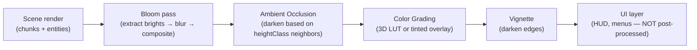

# G1 — Visual Upgrade (SUBPIX + post-processing + particles)

Goal: push the game's visual quality from "lil survival 2D game" to something the player
is proud to show. Three workstreams: SUBPIX rendering (decoupling art resolution from sim
tile size), WebGPU post-processing (bloom, AO, color grading, vignette), and a real
particle system. Each workstream has a prototype-first gate — show before building.

Prereq: N1 merged (`v0.16-n1-network-seed`) — the HUD baseline must be in place so we
can verify post-processing doesn't break UI rendering. G1 can run in parallel with N2
(touches different files: renderer vs. content).

## The prototype gate (READ THIS FIRST)

**The W1 lesson:** we built a full 360° character rig, merged it, tagged it, and THEN the
user saw it and said "I don't like it." We reverted the whole thing. Cost: ~2 sessions of
wasted work.

**The fix:** for any visual change that affects how the game LOOKS (not how it plays), we
bake a PROTOTYPE first — 2–3 representative samples — get the user's verdict, THEN build
the full pipeline. The prototype is throwaway code. The verdict is binding.

For G1, the prototypes are:
1. **SUBPIX:** render the same viewport at ×1 (current), ×2, and ×4 side-by-side. Take
   screenshots. Ask: "which looks best?" Options: ×1 (skip SUBPIX), ×2 (double res), ×4
   (quad res), or "I can't tell the difference" (skip SUBPIX — not worth the complexity).
2. **Post-processing:** render the same scene WITH and WITHOUT bloom + AO + color grading.
   Take screenshots. Ask: "does this look better?"
3. **Particles:** show a 10-second clip of the particle types in action (gather poof, fire
   embers, slash trail, build spark, night wisp). Ask: "do these add to the game?"

**If the user says "I can't see the difference" for any prototype, SKIP that workstream.**
Don't build features the player doesn't notice.

## Workstream A: SUBPIX rendering

### The concept
Current state: 1 sim tile = 1 rendered tile (32×32 pixels). The "pixel art" look is
intentional, but the tiles are blocky at close range. SUBPIX decouples rendering resolution
from sim resolution: 1 sim tile = 2×2 or 4×4 rendered "sub-tiles." The sim still operates
on the 32px grid — only the rendering changes.

### Prototype spec
- Render a single viewport (the area around the player, ~20×15 tiles) at three scales:
  ×1 (current, 32px/tile), ×2 (64px/tile, 4 sub-tiles per sim tile), ×4 (128px/tile,
  16 sub-tiles per sim tile).
- Display all three side-by-side in the browser (use CSS to scale the ×1 and ×2 canvases
  to match the ×4 physical size, so they're comparable).
- Use the SAME seed and player position for all three — the only difference is rendering
  resolution.
- Take screenshots. Present to user.

### How SUBPIX works (if approved)

At ×N SUBPIX factor, each sim tile (32×32 logical) becomes an N×N grid of "micro-tiles."
The micro-tiles are rendered at the base sprite resolution (each micro-tile is a 32×32
pixel sprite, just like a current tile — but there are N×N of them per sim tile).

**Key insight:** we don't need N×N unique sprites per sim tile. Most sim tiles are
homogeneous (all grass, all water). The SUBPIX detail only matters at EDGES — where two
materials meet. The dual-grid autotile system already knows about edges (it's how cliff
ledges and shoreline foam work). We extend it: at a grass/water edge, the micro-tiles on
the grass side get grass sprites, micro-tiles on the water side get water sprites, and
the boundary micro-tiles get transitional sprites (sand/mud/foam at the exact sub-tile
position of the edge).

### Implementation approach (×2 factor, as the most likely outcome)

1. Update `ChunkBaker` to render at 2× resolution: a 16×16 sim-tile chunk becomes a
   32×32 micro-tile render.
2. For each micro-tile at position (mx, my) within sim tile (tx, ty):
   - Determine the material at (tx, ty) — this is the "base" material.
   - Check the 8 neighboring sim tiles. If ALL neighbors have the same material, the
     micro-tile is homogeneous → render the base material's micro-sprite.
   - If neighbors differ, the micro-tile is near an edge. Determine which material
     "owns" this micro-tile based on its position within the sim tile (closer to which
     edge?). Render the appropriate transitional micro-sprite.
3. Micro-sprites: for each material, we need ~4 micro-sprite variants (center, edge-N,
   edge-W, corner-NW). The variants are chosen deterministically from (mx, my) position
   — same as current tile variant selection, just at higher resolution.
4. Cliff ledges and contact shadows are recalculated at the micro-tile level. A cliff
   at sim-tile edge (0,0)→(0,1) becomes a 2-micro-tile-high cliff with micro-tile-level
   shadow casting.

### Performance budget (SUBPIX)
- ×2: 4× the sprites per chunk (N×N = 4). Bake time target: <4ms per chunk (up from
  ~1ms current). Acceptable — bake fewer chunks per frame (4→2) or add LOD for distant
  chunks.
- ×4: 16× the sprites per chunk. Bake time target: <8ms per chunk. Likely too expensive
  without aggressive LOD. This is why the prototype gate matters — if ×4 looks amazing
  but ×2 looks "fine," ×2 wins.

### Fallback position
If SUBPIX is rejected or too expensive: keep the current ×1 rendering. The post-processing
and particle workstreams still improve visual quality significantly on their own.

## Workstream B: Post-processing pipeline

### Architecture



All post-processing is full-screen passes using PixiJS v8's `Filter` API (WebGPU shaders
with WebGL fallback). The UI layer is rendered AFTER post-processing — HUD text and menus
should be crisp, not bloomed or color-graded.

### Bloom

**What blooms:** fire glow (from R2 fire overlay), torches (from buildings with light),
tower beacons (watchtower projectiles), soul gear crit effects, rift particles (N2).

**Algorithm:**
1. Render the "bright pass" — extract pixels above a luminance threshold. Threshold: RGB
   values > (0.6, 0.6, 0.6) in linear space. Fire glow (orange/yellow) and white particles
   pass; dark terrain and entities don't.
2. Downsample the bright-pass texture to 1/4 resolution.
3. Apply two-pass Gaussian blur (horizontal then vertical) at the downsampled resolution.
   Kernel: 9-tap, sigma = 2.0. Two iterations for a soft, wide bloom.
4. Upsample back to full resolution (bilinear).
5. Composite: `finalColor = sceneColor + bloomTexture * bloomIntensity`. Bloom intensity:
   0.4 (subtle — fire should glow, not blind).

**WebGL fallback:** single-pass 5-tap blur at 1/8 resolution (faster, lower quality — still
visible, just less smooth).

### Ambient Occlusion (AO)

**What it does:** darken tiles that are adjacent to higher-height-class tiles. This creates
depth — cliffs feel tall, buildings feel grounded, entities feel like they're standing ON
the terrain, not floating above it.

**Algorithm (cheap SSAO from heightClass — NO depth pass needed):**
1. For each tile, sample the `heightClass` of the 4 cardinal neighbors (N, S, E, W).
   `heightClass` is already stored per tile (0 = water, 1 = shore, 2 = lowland, 3 = highland,
   4 = cliff-top).
2. Compute AO factor: for each neighbor with a HIGHER heightClass, add 0.03 to the darkening
   amount. Max darkening: 0.15 (15% darker — subtle).
3. Apply: `tileColor *= (1.0 - aoFactor)`.
4. This is a SIMPLE pass — no texture sampling, no blur, just reading the existing heightClass
   data. Can be done in the chunk baker (baked AO) rather than as a post-process — avoids a
   full-screen pass entirely.

**Decision: bake AO into the chunk during ChunkBaker, NOT as a post-process.** This means
AO has zero per-frame cost after the chunk is baked. The tradeoff: AO doesn't update when
the terrain changes (player digs/building is placed). Acceptable — terrain changes are rare
and trigger a chunk rebake anyway.

### Color grading

**What it does:** shift the overall color palette based on network conditions (realm, time
of day, data storm).

**Approach A — 3D LUT (WebGPU only):**
- Create an identity 16×16×16 RGB lookup table (4096 entries).
- Apply tint shifts by modifying the LUT: Ethernet realm → warm shift (R+0.05, B-0.05),
  WiFi → cool shift (B+0.05, R-0.05), Cellular → harsh shift (contrast +10%).
- Upload LUT as a 3D texture. Full-screen shader samples the LUT for each pixel.
- This is the "proper" approach but requires WebGPU and a 3D texture.

**Approach B — Tinted overlay (WebGL fallback):**
- Full-screen colored rectangle at low opacity (5–10%).
- Color determined by realm: Ethernet = warm amber (0xFFE0C0, 5%), WiFi = cool blue
  (0xC0D0FF, 5%), Cellular = harsh red (0xFFC0C0, 8%).
- Day/night time also shifts the overlay alpha (night = darker blue, 15%).
- Less flexible than a LUT but works everywhere.

**Decision: implement BOTH.** Use LUT when WebGPU is available, fall back to tinted
overlay when WebGL (`?gl` flag). The tinted overlay is 95% of the visual effect for
5% of the complexity — the LUT is polish.

### Vignette

**What it does:** darken the screen edges. Intensifies at night, during low bandwidth,
during offline mode, during data storms (N3).

**Algorithm:**
- Compute radial distance from screen center for each pixel: `d = distance(pixel, center) / maxDistance`.
- Darkening factor: `vignette = smoothstep(0.3, 1.0, d) * intensity`.
- Intensity: 0.15 (daytime, stable), 0.35 (nighttime), 0.50 (offline/storm).
- Apply: `finalColor *= (1.0 - vignette)`.
- This is a trivial full-screen shader — works identically on WebGPU and WebGL.

## Workstream C: Particle system

### Architecture

```ts
// src/engine/particles.ts

interface ParticleDef {
  lifetime: [number, number];    // [min, max] ms
  velocity: [number, number];    // [min, max] px/s (speed, not direction)
  direction: [number, number];   // [min, max] radians (0 = right, PI/2 = down)
  color: number;                 // tint (0xRRGGBB)
  alphaCurve: [number, number];  // [start, end] — linear fade
  scaleCurve: [number, number];  // [start, end] — linear shrink/grow
  gravity: number;               // px/s² downward
  spread: number;                // radians — random spread from base direction
}

interface Particle {
  x: number;
  y: number;
  vx: number;
  vy: number;
  life: number;       // remaining ms
  maxLife: number;    // total ms (for alpha/scale interpolation)
  def: ParticleDef;
  active: boolean;
}

class ParticlePool {
  particles: Particle[];  // pre-allocated, 500 entries
  container: Container;   // PixiJS ParticleContainer (fast batching)

  constructor(size: number);
  spawn(def: ParticleDef, x: number, y: number, count: number): void;
  update(dt: number): void;
  render(): void;
}
```

### Pool management
- Pool of 500 particles, allocated once at construction. Never grows.
- `spawn()` finds inactive particles (`.active === false`) and initializes them.
  If fewer than `count` inactive particles are available, spawns as many as possible
  and skips the rest (no error, no warning — particles are cosmetic).
- Priority system: when the pool is nearly exhausted (>90% active), new spawns of
  low-priority types (wisps, sparks) are dropped first. High-priority types (embers,
  slash trails) are always attempted.
- Priority order: embers (P0) > slash trails (P1) > rift particles (P2) > poofs (P3) >
  wisps (P4) > sparks (P5).

### Particle types

| Type | Def | Spawn trigger | Count | Priority |
|------|-----|---------------|-------|----------|
| **Gather poof** | lifetime: [200, 400]ms, velocity: [20, 60]px/s, direction: [0, 2π], color: 0x8B7355 (brown), alpha: [0.8, 0], scale: [1.0, 0.3], gravity: 80, spread: π | Resource node depleted | 8 | P3 |
| **Fire ember** | lifetime: [600, 1200]ms, velocity: [30, 80]px/s, direction: [π, π], color: 0xFF6600 (orange), alpha: [1.0, 0], scale: [0.8, 0.2], gravity: -20 (rise), spread: π/3 | Per burning tile, 4/sec | 4/sec/tile | P0 |
| **Slash trail** | lifetime: [100, 200]ms, velocity: [10, 30]px/s, direction: attack angle, color: 0xFFFFFF (white), alpha: [0.9, 0], scale: [1.2, 0.1], gravity: 0, spread: π/6 | Melee swing hit | 12 | P1 |
| **Build spark** | lifetime: [150, 300]ms, velocity: [50, 120]px/s, direction: [π, π], color: 0xFFDD44 (yellow), alpha: [1.0, 0], scale: [0.5, 0.1], gravity: 50, spread: π/2 | Building construction complete | 6 | P5 |
| **Night wisp** | lifetime: [2000, 4000]ms, velocity: [5, 15]px/s, direction: random, color: 0x4488FF (blue), alpha: [0.3, 0], scale: [0.6, 0.2], gravity: 0, spread: 2π | Nighttime, 2/sec near player | 2/sec | P4 |
| **Rift particle** | lifetime: [800, 1500]ms, velocity: [100, 300]px/s, direction: outward from player, color: biome accent, alpha: [0.9, 0], scale: [1.0, 0.1], gravity: 0, spread: 2π | Rift event (N2) | 100 | P2 |
| **Death poof** | lifetime: [400, 800]ms, velocity: [40, 100]px/s, direction: [0, 2π], color: 0x666666 (gray), alpha: [0.8, 0], scale: [1.5, 0.2], gravity: 30, spread: 2π | Enemy killed | 15 | P3 |
| **Heal sparkle** | lifetime: [300, 600]ms, velocity: [10, 30]px/s, direction: [π, π], color: 0x44FF44 (green), alpha: [0.7, 0], scale: [0.4, 0.1], gravity: -10, spread: π/4 | Player healed | 5 | P5 |

### Rendering
- `ParticleContainer` from PixiJS — optimized for many sprites with the same texture.
- All particles use a single 4×4 white sprite, tinted per-particle.
- Max 500 sprites — `ParticleContainer` handles this at 60fps on integrated GPU.
- WebGL fallback: same approach, cap at 200 particles (due to lower fill rate).

## Workstream D: Directional drop shadows

### Current state
Entities have a contact blob (dark ellipse directly beneath them on the terrain). This is
better than nothing but looks flat — the shadow is always directly below, regardless of
where the "light" is.

### Target state
Entities cast a shadow offset in the direction opposite the light source. The shadow is a
dark, 50%-opacity ellipse rendered on a dedicated layer BELOW the entity layer.

### Light source
- Daytime: light from top-left (direction = 225° or bottom-right shadow). This matches the
  existing cliff shading (which assumes light from top-left).
- Nighttime: light from center (omnidirectional). Shadow is directly below (like current).
  At night, shadows are softer (30% opacity instead of 50%).
- Transition: lerp shadow direction from day→night over the 5-second twilight period (G2).

### Shadow rendering
- Shadow container sits between the terrain layer and the entity layer in the display list.
- For each entity, render a dark ellipse at `entity.renderPos + shadowOffset` where
  `shadowOffset = lightDir * entity.heightClass * 2px`. Taller entities (higher heightClass)
  cast longer shadows.
- Shadow is scaled by entity width and a fixed aspect ratio (2:1 width:height ellipse).
- Building shadows are cast similarly, offset from the building's base tile.

### Performance
- One extra sprite per visible entity. Negligible — entities are already bounded (~50 max
  on screen).
- Shadows don't need per-frame recalculation — only when the entity moves or the light
  direction changes.

## Implementation order

1. **Prototypes** (ALL THREE — before any production code):
   - SUBPIX: side-by-side ×1/×2/×4 screenshots
   - Post-processing: with/without bloom+AO screenshots
   - Particles: 10s clip of particle types
   - Get user verdict on each. Document decision.

2. **Particle system** (lowest risk, biggest visual impact for effort):
   - Create `src/engine/particles.ts`
   - Integrate into render loop
   - Wire spawn hooks into systems

3. **Post-processing pipeline**:
   - Create `src/engine/postprocess.ts`
   - Implement bloom, vignette (AO is baked, not post-process)
   - Implement color grading (LUT + tinted overlay fallback)
   - Wire into render loop (after scene, before UI)

4. **Directional drop shadows**:
   - Update entity renderer in `src/game/world/art.ts`
   - Add shadow container to display list

5. **SUBPIX migration** (if approved — only after the above workstreams):
   - Update `ChunkBaker` for the chosen SUBPIX factor
   - Update autotile rules, cliff ledges, contact shadows
   - Profile and optimize

6. **WebGL fallback verification**:
   - Test with `?gl` flag
   - Verify all post-processing degrades gracefully
   - Verify particle cap at 200

7. **Performance profiling**:
   - 60-second session, Chrome Performance tab
   - Verify all pipeline stages within budget
   - Optimize any stage exceeding budget by >50%

8. **Playtest gate** — HARD STOP:
   - User plays the updated game
   - Verdict recorded: "does this look significantly better?"
   - If NO → understand why before proceeding to G2

## Acceptance checklist

### Prototype gate (before any production code)
1. SUBPIX screenshots presented to user. Verdict recorded: ×1 / ×2 / ×4 / skip.
2. Post-processing screenshots presented. Verdict recorded: yes / no.
3. Particle clip presented. Verdict recorded: yes / no.

### Static (in worktree)
4. `npm run typecheck` + `npm run build` green.
5. `cargo test` — all existing tests pass (no Rust changes expected in G1).

### Live (on main, at `?seed=1234`)
6. **Particle system:** gather a resource → poof particles visible. Start a fire → embers
   rise from burning tiles. Swing weapon → slash trail visible. Place building → sparks.
   Nighttime → wisps drift near player.
7. **Bloom:** fire glow and torches visibly bloom (soft glow extending beyond the sprite).
   Bloom is subtle (0.4 intensity) — not a flashlight effect.
8. **AO (baked):** tiles adjacent to cliffs are visibly darker on the low side. Entities
   standing near walls have a subtle darkening at their base.
9. **Color grading:** Ethernet realm = warm tint, WiFi = cool tint, Cellular = harsh tint.
   Switch connection type → tint changes (may take up to 5s for rift debounce).
10. **Vignette:** screen edges are slightly darker. More pronounced at night. More
    pronounced when `NW.NET.snap.online = false`.
11. **Drop shadows:** entity shadows offset from the entity, not directly below. Shadow
    direction matches cliff shading (light from top-left during day).
12. **WebGL fallback:** reload with `?gl` → bloom disabled, AO still works (baked), color
    grading uses tinted overlay, vignette works, particles capped at 200, drop shadows work.
    No errors.
13. **Performance:** 60fps maintained on mid-range hardware (integrated GPU, 8GB RAM) with
    all effects enabled. 30fps on WebGL fallback.
14. **SUBPIX (if approved):** tiles visibly higher resolution at the chosen factor. Edges
    between materials are smoother. Cliff ledges have sub-tile detail. Performance within
    budget.

## Explicitly OUT of scope
- Screen shake, hit-stop, knockback → G2 (Juice Pass)
- Twilight transition sequence → G2
- Sound effects → G2 (sound polish)
- Network-driven post-processing changes (realm tint shifts beyond the static per-realm
  palette) → N3
- Data storm visual (full-screen particle storm) → N3
- HUD redesign → the N1/N2 5-line HUD is unchanged by G1
