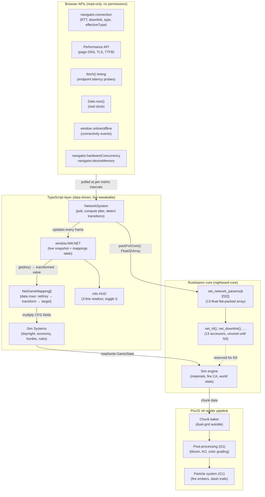
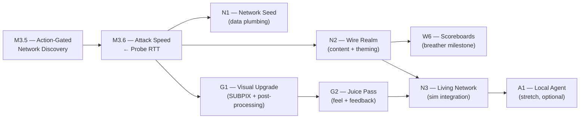

# NIGHTWARD — Roadmap (Batch 5 "The Wire" is ACTIVE)

> **Pivot (2026-07-16):** The world is no longer a dream — it's your network. Live browser
> network metrics (RTT, jitter, bandwidth, connection type, real clock) drive every game
> mechanic: terrain, spawns, day/night, resource flows, difficulty. The procgen engine stays
> — but its parameters are now live functions of your internet connection. Same tab, same
> seed, totally different world depending on where and how you're connected.

Status baseline: **`v0.16-n1-network-seed`** — N1 network data plumbing is live. Browser metrics
flow into the game as first-class parameters via `NW.NET`, surfaced in a real-time HUD, driving
sim speed, gold rate, enemy scaling, and day/night sync. Paint filter grain overlay applied.
Buildings, trees, rocks, and bushes received art upgrades (more variants, mortar lines, grain
texture, thatch highlights). All menus are keyboard-navigable (Tab/Enter, Ctrl+Tab, arrow keys).
Crafting/inventory interaction bug fixed. Building deconstruct added (press `X`).

This roadmap is the source of truth for the current batch. Each milestone is built in its
own worktree (see `docs/plans/WORKFLOW.md`) and has a detailed brief `docs/plans/<id>-*.md`
when it becomes the active task.

## Non-negotiables (keep these true)
- **100% procgen** — no hosted image/audio assets; everything is generated from seed + params.
  UI chrome (RPGUI) is the sole exception (bundled, zlib-licensed — see W4.5).
- **Data-driven** — content is a row in `src/game/data/*`; systems are generic functions over one
  `GameState`. Adding content ≠ new engine code.
- Loose-mode TS + Vite + PixiJS v8 (WebGPU, `?gl` forces WebGL). Determinism from seed.
- `npm run typecheck` clean and `npm run build` green before any merge.
- **No persistence.** No save/load, no localStorage/IndexedDB state, no login/logout. The world
  exists only in the currently-open tab; closing/reloading/rebooting loses everything. This is
  *on-theme*: your network state is ephemeral — the world lives exactly as long as your
  connection does. Scoreboard carve-out: finished-run results may persist locally (outcomes,
  not state — a run can never be resumed).
- **Browser-native only.** No native binaries, no local agent, no Node.js backend. All data comes
  from browser APIs (`navigator.connection`, Performance API, `fetch()` timing, WebRTC, real
  clock). A local agent (`nightward-agent`) is a *future stretch goal* for data the browser
  can't see (real ICMP ping, WiFi dBm, ARP table) — but the game must be complete and fun
  without it. Graceful degradation: unsupported APIs → sensible fallback defaults.
- **Static deploy.** The game is a static Vite build with zero backend — GitHub Pages hosts it.
  No server-side network monitoring, no WebSocket relay. Everything runs in the browser.

## Core concept: "The Wire" (replaces "The Dream")
Your internet connection IS the game world. The procgen engine takes a seed as always — but
every live parameter (day/night cycle, resource rates, enemy spawns, terrain properties,
difficulty scaling) is driven by real-time browser network metrics. Two people on the same
seed get totally different worlds because their connections differ.

### Data-flow architecture

**Key data paths (every frame):**
1. `NetworkSystem.update(nowMs)` — polls slow metrics on their own intervals; snap is always current
2. `worldCore.pushNetworkParams()` — uploads 13-float snapshot to Rust (52 bytes/frame, O(1))
3. Sim systems read `net.get(key)` → transform → multiply CFG field (gold rate, sim speed, enemy scale)
4. Rust stores params but does NOT consume them until N3 (same pattern as `fire_params` in R1→R2)

**Key data paths (on transition):**
5. Connection type change → `detectTransitions()` → log event → (N2: rift event + visual flair)
6. Online/offline toggle → snapshot updated → sim pauses / new realm seed

### Why this architecture works
- **Zero new allocations per frame in the hot path.** `Float32Array` is allocated once and reused.
  `NetworkSnapshot` is a plain object mutated in-place — no GC pressure.
- **Rust crossing is O(1).** One `set_network_params` call per frame, same as `set_materials` and
  `set_fire_params`. No per-tile or per-entity network calls.
- **Mappings are data, not code.** The `NetGameMapping[]` table is editable at runtime via
  `NW.NET.mappings`. Adding a new mapping is a single row — no engine changes, no Rust rebuild.
- **Degradation is structural.** If a browser API is missing, the fallback value is the default
  mapping output. The game doesn't branch on "is this API available?" — it just reads values that
  happen to be constants in unsupported browsers.

**The design question:** does driving game parameters from network metrics produce interesting
emergent behavior, or just random noise? The answer depends on the mapping functions. The rule:
every network→game mapping must be **intuitive** (bad connection = harder in a way that makes
sense) and **legible** (the player can look at the HUD and understand WHY the world changed).

**Key insight — we are NOT building a physics engine.** The sim doesn't need rigid-body
dynamics. What it needs is a *parameterized behavior system* where network conditions drive
entity movement rules, spawn rates, and resource flows through the same data-driven machinery
that already exists (`CFG` + `pushMaterials()`/`pushFireParams()` + `window.NW.NET`).

### Network → Game mechanic mapping (design reference)

| Network Metric | Source API | Game Mechanic | Intuition |
|---------------|-----------|---------------|-----------|
| **RTT** (round-trip time) | `navigator.connection.rtt` + fetch timing | Global sim speed. High RTT = slow motion ("lag compensation as game mechanic"). | Bad internet = easier game (more time to react). Good internet = hard mode. |
| **Jitter** (RTT variance) | Computed from periodic fetch samples | Entity wobble / "instability field." Attack spread angle, position jitter. | Stable connection = precise combat. Jittery WiFi = chaotic fights. |
| **Downlink** (bandwidth Mbps) | `navigator.connection.downlink` | Resource regen rate. Gold tribute, HP regen, mana — all scale with downlink. | Fast internet = your territory thrives. Throttled = scarcity mode. |
| **`effectiveType`** | `navigator.connection.effectiveType` ('4g'/'3g'/'2g') | "World tier." 4g = normal. 3g = hard (less resources, tougher enemies). 2g = nightmare. | Your connection quality IS the difficulty setting. |
| **`type`** (connection technology) | `navigator.connection.type` (wifi/ethernet/cellular) | "Realm." Ethernet = stable/civilized. WiFi = wild. Cellular = chaos realm. Switching triggers a "rift" event (world reshuffles). | Moving from desk to coffee shop changes the game world. |
| **Online/offline transitions** | `window` online/offline events | The world ends and reforms. Offline = sim pauses. Coming back = new realm seed, new layout. | Toggling airplane mode = hard reset. |
| **`hardwareConcurrency`** | `navigator.hardwareConcurrency` (CPU cores) | Max simultaneous entities / chunk activation radius. | More cores = bigger world, more enemies. |
| **`deviceMemory`** | `navigator.deviceMemory` (RAM GB) | Inventory capacity / max buildings / soul gear slots. | More RAM = more stuff you can hold. |
| **Real clock** | `Date.now()` | Day/night cycle syncs to real local time. Night = hordes. | Play at 3am = deep night. Play at noon = safe daylight. |
| **Latency to endpoints** | `fetch()` timing to public endpoints (Cloudflare, Google, etc.) | "Distance to neighboring realms." How far the nearest data center is → biome type, trade routes. | Far from internet backbone = isolated realm with unique resources. |
| **DNS resolution time** | DoH fetch timing | "Scrying" skill — reveals map by resolving domains. Fast DNS = more map revealed. | DNS infrastructure becomes a game resource. |
| **Page load Performance API** | `performance.getEntriesByType('navigation')` | "Ancestral memory" — initial page load timing becomes permanent character stats for that run. | Every tab-open is a unique character born from that moment's network conditions. |

### Browser API availability matrix

Not all browsers expose the same network APIs. This matrix documents what's available where, and
what fallback the game uses when an API is missing.

| API | Chrome/Edge | Firefox | Safari | Fallback default | Degradation impact |
|-----|------------|---------|--------|------------------|-------------------|
| `navigator.connection.rtt` | ✅ | ❌ | ❌ | 50 ms | Sim speed = 1× (neutral) |
| `navigator.connection.downlink` | ✅ | ❌ | ❌ | 10 Mbps | Gold rate = 1× (neutral) |
| `navigator.connection.effectiveType` | ✅ | ❌ | ❌ | `'4g'` (tier 1) | Enemy scale = 1× (neutral) |
| `navigator.connection.type` | ✅ | ❌ | ❌ | `'ethernet'` (realm 0) | Stable realm |
| `navigator.hardwareConcurrency` | ✅ | ✅ | ✅ | 4 cores | Moderate world size |
| `navigator.deviceMemory` | ✅ | ❌ | ❌ | 4 GB | Moderate inventory |
| `navigator.onLine` | ✅ | ✅ | ✅ | `true` | Always-online mode |
| `window` online/offline events | ✅ | ✅ | ✅ | never fires | No transition events |
| `performance.getEntriesByType('navigation')` | ✅ | ✅ | ✅ | zeros | No ancestral memory bonuses |
| `fetch()` (for endpoint timing) | ✅ | ✅ | ✅ | 30 ms | Moderate endpoint latency |
| `Date.now()` | ✅ | ✅ | ✅ | — | Always works |

**Design principle for degradation:** every fallback default is the *neutral* value — the one that
produces a 1× multiplier or the "normal" game experience. This means unsupported browsers get a
playable, balanced default game. Supported browsers get the live network-driven experience. No
player is ever locked out.

### What we CANNOT get from a browser (deferred to optional local agent)
- Raw packet capture (pcap), ARP table, LAN device enumeration, port scanning, firewall rules,
  WiFi signal strength (dBm), ICMP ping, process list, active services, DNS cache.
- These require OS-level privileges not exposed to JavaScript. A future `nightward-agent`
  (tiny Rust binary, `ws://localhost:9734`) could expose them — but the game must ship complete
  without it.

## Architectural decisions (carried forward + new)
- **360° animation — SHIPPED THEN REVERTED (2026-07-07).** 4-direction baked frames are the
  baseline. Do not rebuild the rig unless explicitly asked.
- **Weighty combat** — `windup → active(hit-window) → recovery` state machine. Spin/channel
  deferred.
- **Soul Gear** — soul-bound gear with leveling. Materials stay stackable counts.
- **Sound** — WebAudio synth, data-driven SFX recipe table.
- **Event log** — ring-buffer bus + UI panel + `window.__nw.log`.
- **"Tiles ×4" (SUBPIX)** — decouple art-resolution from the 32px sim tile. Prototype ×2/×4
  on a single chunk first, get verdict, THEN migrate the pipeline.
- **No persistence, ever.** Tab-is-the-character. On-theme: your network state is ephemeral.
- **Two-language rule** (carried forward): Rust is generic machinery only (sim engine). ALL
  content, balance, AND network→game mappings stay in TS data rows. Adding a network metric
  mapping must NEVER require touching Rust.
- **Boundary style** (carried forward): batch APIs, zero-copy typed-array views, O(1) per-frame
  crossings. Network metrics upload into the core exactly like `pushMaterials()` /
  `pushFireParams()` already do — one flat-packed `Float32Array` per frame, never per-tile calls.
- **Network params are CFG-tier:** `window.NW.NET` is live-tweakable at runtime, same as
  `NW.CFG` and `NW.MATS`. Every network→game mapping is a data row, not engine code.
- **No "dream realm" / "wire realm" split.** The wire IS the world. The old dream-world flavor
  text is replaced. When network data is unavailable (unsupported browser, offline), the game
  runs on sensible fallback defaults — "local loopback mode" — which is still a playable game,
  just a static one.

## Batch 5 success criteria (how we know we're done)

These are the exit gates for the entire Network batch — the conditions that must be true
before we consider Batch 5 shipped and move on to whatever comes next.

### Primary criteria (must-pass)
1. **The network hook is legible.** A new player can look at the HUD, see "RTT 45ms | WiFi 4g,"
   and understand that their connection is affecting the game. The cause→effect chain is visible.
2. **Different connections = different experiences.** Ethernet (stable, fast sim, normal difficulty)
   vs. throttled 3g (slow sim, hard enemies, scarce resources) vs. offline (static defaults) are
   all playable AND feel distinct. Verified by playing the same `?seed=` on different networks.
3. **Graceful degradation works.** Firefox and Safari produce the same playable game as Chrome —
   just without the live network variance. No errors, no missing UI, no NaN/undefined anywhere.
4. **All existing systems still work.** Gathering, crafting, building, combat, hordes, fire,
   soul gear — the pre-N1 game loop is intact. Network params are multipliers, not replacements.
5. **Live-tuning convention holds.** `window.NW.NET.mappings` is editable at runtime and changes
   take effect next sim tick, same as `NW.CFG` and `NW.MATS`. No reload needed.

### Secondary criteria (should-pass)
6. **The "why" is interesting.** Watching RTT spike (jitter field activates, enemies wobble)
   is more engaging than a static world. The network metrics produce *stories* — "my WiFi
   dropped to 2g and suddenly the horde was 2× size" is a memorable moment.
7. **Visual quality meets the bar.** Post-G1/G2, the game looks significantly better than the
   current `v0.15.1` build. "Better" is defined by the user's playtest verdict — there is no
   objective metric for pixel art.
8. **No performance regression.** With network polling + SUBPIX rendering + post-processing +
   particles, the game still holds 60fps on a mid-range laptop (integrated GPU, 8GB RAM).
   WebGL fallback (`?gl`) must also hold 30fps.

### Stretch criteria (nice-to-have)
9. **The local agent (A1) proves the concept.** A tiny Rust binary serving `ws://localhost:9734`
   with real ICMP ping + WiFi dBm. The game detects it and upgrades its data resolution. This
   validates the two-tier architecture (browser-only baseline + optional native agent) without
   making the agent a dependency.

## Design hypotheses (what we're testing with this batch)

Each hypothesis is falsifiable — if it turns out wrong, we adjust the design rather than
pushing through.

| # | Hypothesis | Test method | Falsification signal |
|---|-----------|-------------|---------------------|
| H1 | Network metrics produce more interesting emergent behavior than pure random seeds | Play same seed on Ethernet vs. throttled 3g; compare experiences | Both feel same-ish → network data is just noise |
| H2 | "Bad connection = easier but weirder" is a fun tradeoff, not a frustration | Playtest on intentionally bad connection; ask: "was this fun?" | Player prefers to disable network features → mapping is wrong |
| H3 | Real-time clock sync makes the day/night cycle feel more grounded | Play at different times of day; ask: "does this matter to you?" | Player doesn't notice or care → revert to fixed day length |
| H4 | Connection-type "rift" events (N2) create memorable moments, not annoying resets | Trigger a type switch mid-session; observe reaction | Player says "that's annoying" → rifts need to be opt-in or rarer |
| H5 | SUBPIX ×2/×4 + post-processing pushes the look from "lil survival game" to something the player is proud to show | Side-by-side screenshot comparison + user verdict | Player can't tell the difference → SUBPIPX isn't worth the complexity |

**When a hypothesis fails:** don't ship that feature. The batch is modular — N1, N2, G1, G2, N3
are independent enough that a failed hypothesis in one doesn't block the others. Remove the
failing mapping/feature, document the lesson, move on.

## Risk register

| Risk | Likelihood | Impact | Mitigation |
|------|-----------|--------|------------|
| `navigator.connection` is removed or restricted by browsers (it's a Chrome-only API with privacy concerns) | Medium | High — core data source gone | Fallback defaults already designed; `fetch()` timing is universal and can replace RTT estimation |
| Network polling causes perceptible jank (fetch() blocking, GC from snapshots) | Low | Medium | Polling is async + low-frequency (1–10s intervals); snap is mutated in-place; verify with profiler in N1 |
| SUBPIX rendering tanks performance (4× tiles = 16× pixels per chunk) | Medium | High — could make G1 unshippable | Prototype gate BEFORE full migration; fall back to ×2 or skip SUBPIX entirely if perf budget blown |
| The "network = world" metaphor doesn't land — players just see random difficulty changes | Medium | High — the whole concept fails | HUD legibility is the defense; if the mapping isn't visible, it's not working. Iterate on HUD + toast messages in N2 |
| WebGPU not available on target hardware (older laptops, some Linux configs) | Medium | Medium | PixiJS v8 already has WebGL fallback (`?gl`); post-processing degrades gracefully (skip bloom/AO, keep basic rendering) |
| Rust/wasm boundary becomes a bottleneck (52 bytes/frame is trivial, but future params could grow) | Low | Low | Current 13-float layout is fixed; if we need more params, use the same `pushMaterials` stride pattern — one upload, not per-entity |
| OneDrive sync corrupts git worktrees (known issue from Batch 4) | Medium | Low — annoying but recoverable | Worktrees live outside OneDrive if possible; `git worktree prune` + `rm -rf` recover; documented in WORKFLOW.md gotchas |

## Performance budget (per frame, target: 16.67ms @ 60fps)

This budget covers the full Batch 5 stack (N1 + N2 + G1 + G2 + N3). Individual milestones
have tighter budgets in their briefs.

| Pipeline stage | Budget (ms) | Notes |
|---------------|-------------|-------|
| Network polling (amortized) | <0.1 | Async fetch() doesn't block; sync polls are field reads |
| `pushNetworkParams()` (Rust crossing) | <0.05 | 52-byte Float32Array copy, O(1) |
| Sim tick (Rust CA + TS systems) | <2.0 | Existing budget from R2; network multipliers are float ops |
| Chunk baking (SUBPIX ×2/×4) | <4.0 | Target: bake 4 chunks/frame max; LOD for distant chunks |
| Post-processing (bloom, AO, grading) | <2.0 | Single full-screen pass; skip AO on WebGL fallback |
| Particle system | <1.5 | Capped at 500 active particles; recycle pool |
| Entity rendering + UI | <2.0 | Existing budget; HUD is text, negligible |
| **Total target** | **<12.0** | Leaves ~4.5ms headroom for spikes + GC |
| WebGL fallback target | **<28.0** | 30fps floor; skip bloom + AO + reduce particles to 200 |

**Profiling discipline:** after every milestone merge, run a 60-second profiled session at
`?seed=1234` with the Chrome Performance tab. If any stage exceeds its budget by >50%, that
becomes the top-priority fix before starting the next milestone.

## Expanded milestone specifications

Each milestone below includes: **dependencies** (what must be merged first), **entry criteria**
(what must be true to start), **exit criteria** (what must be true to merge), **estimated effort**
(rough, for sequencing), **sub-task breakdown** (implementation order), and **risks specific to
that milestone**.

### Milestone dependency graph

M3.5/M3.6 are the new roots — the network discovery system and attack→RTT feedback loop
must be solid before the broader N-batch work begins. They prove the core mechanic: your
connection isn't just background data, it's something you *feel* when you swing. N2 and G1
are parallelizable after M3.6 (content vs. visuals touch different files).

---

## Shipped milestones (historical record — all complete)

### Batch 1–2: Core game (M0–M3)
- **M0 — Walkable world** ✅: infinite seeded overworld, noise biomes, chunk-baked rendering,
  procgen tiles/trees/hero, camera follow, keyboard + touch input.
- **M1 — Skilling & crafting** ✅: gatherable nodes, inventory with equip slots, tools, RS-style
  per-skill leveling, 3 crafting professions, day/night cycle with ambient tint.
- **M2 — The racket** ✅: buildings (hall/hut/wall/tower), placement rules, territory score,
  population, passive tribute income.
- **M3 — Night hordes** ✅: wave spawner scaling with night # + territory value, enemies march on
  hall / chew buildings / bite player, watchtower auto-fire, player arc-melee, armor, death &
  respawn, game over.

### Batch 3: Content & feel (W0–W4.6)
- **W0** ✅ `v0.5-w0`: Foundations & fixes — build-menu input-trap fix, auto-connecting walls,
  event log, data-driven SFX table.
- **W1** ✅ `v0.6-w1-player`, then **reverted**: 360° rig animator — disliked the look, back to
  4-direction baked frames.
- **W2** ✅ `v0.7-w2-soulgear`: Soul Gear — soul-bound weapon/armor/tools with per-slot leveling.
- **W3** ✅ `v0.8-w3-combat`: Weighty combat — `windup → active → recovery` state machine;
  foe telegraph tells.
- **W4** ✅ `v0.9-w4-dayhunts`: Day hunts & balance pass — daytime prey mobs, night retune,
  ×10 xp curves.
- **Fix batches** ✅ `v0.9.1–v0.9.3`: melee aim fix, build placement rework, god mode + logging.
- **W4.5** ✅ `v0.10-w4.5-rpgui`: Pixel UI skin — RPGUI bundled, Press Start 2P font.
- **W4.6** ✅ `v0.11-trinkets`: Trinket gear slots — ring, amulet, charm; danger pass retune.

### Batch 4: The World Engine (R0–R2) — COMPLETE
- **R0** ✅ `v0.12-r0-spike`: Rust toolchain + wasm — `ping()`, zero-copy checkerboard,
  `window.__nw.core`, Vite + deploy.yml integration.
- **R1** ✅ `v0.13-r1-writable-world`: Writable world — 16 materials, sparse override store,
  chunk-slot pool, god brush, speed-from-material, feature-kill rule.
- **R1.5** ✅ `v0.14-r15-painted-world`: Painted World — dual-grid autotile, pseudo-3D cliff
  ledges, contact shadows, animated shoreline foam, material legibility re-ramp, toast fix.
  Playtest gate: user verdict on the look **recorded 2026-07-16 — "needs to look better"**.
- **R2** ✅ `v0.15-r2-fire` + `v0.15.1-r2-fire-fix`: Fire — per-chunk CA (fuel/burn/wet fields),
  wind-driven spread, burnout→override, burn damage, fire glow overlay, firemaking skill,
  campfires, charcoal. Playtest gate: user verdict recorded — fire mechanics work but the
  game still reads as "a lil survival 2D game."

### N1 — Network Seed ✅ `v0.16-n1-network-seed` (2026-07-16)
- Network data plumbing: `NetworkSystem` polls `navigator.connection`, `fetch()` timing,
  `Date.now()`, Performance API — every metric wrapped in fallback defaults
- `NW.NET` exposed at console — live-tweakable snapshot + 13 metric mappings + 5 game mappings
- Rust core: `set_network_params(&[f32])` + 13 accessors + 3 unit tests (23/23 pass)
- Real clock day/night sync (snap on first tick, smooth-lerp 0.5%/tick thereafter)
- Sim speed from RTT (lag compensation), gold rate from downlink, enemy scale from connection tier
- Network info HUD (`F1` toggle): RTT, downlink, connection type, sim×, gold×, enemies×
- Network floaters (WoW-style): floating metric numbers when gathering, gold ticks
- Harvest duration linked to network latency (RTT → gather speed)
- Connection transition logging (debounced 5s stability window)

### Session enhancements (2026-07-16, continued)

- **M1 — Mobile responsiveness** ✅: Dynamic UI scaling via CSS custom properties (`--scale`),
  touch-device detection (`data-touch` / `data-narrow`), icon/label button split for legibility,
  `dvh` viewport height support, font-size floors (`max()` guards). Full brief: `docs/plans/M1-mobile.md`.
- **Regression test suite** ✅: 19 automated tests exercising every game system from the inside
  via `window.__nw`. Run via `?test` URL param or `__nw.regression.run()`. Covers: boot state,
  inventory, world queries, gathering, crafting, building, combat, day/night, damage, god mode,
  equipment, fire, log, XP/leveling. Source: `src/game/systems/regression.ts`.
- **Bag tab navigation fix** ✅: Empty equipment slots no longer trap Tab focus — `focusNext()`
  filters to `tabIndex >= 0` elements only, with a focus-landing guard.
- **M2 — Combat Feel & Network Observatory** ✅ (2026-07-16):
  - **M2.1 — Combat XP floaters:** "+X combat xp" toast on kill, same style as gather XP toasts.
    Makes the existing combat XP system visible. File: `src/game/systems/hordes.ts`.
  - **M2.2 — Combat skill mechanical effect:** Combat level now grants +1 base damage per 5
    combat levels (configurable via `CFG.combat.dmgBonusPerLevel`). Combat skill finally matters!
    Files: `src/game/systems/combat.ts`, `src/game/data/config.ts`.
  - **M2.3 — Network Observatory panel:** New panel toggled with **O** key. Live sparklines
    (canvas-drawn) for RTT, jitter, bandwidth over last 60s. Realm card with biome name &
    stability %. Active modifiers with trend arrows. Files: `src/game/systems/network.ts`,
    `src/main.ts`.
  - **M2.4 — Balance alignment map:** Documented expected player power curve at nights 1/5/10/20.
    Identified and fixed Copper Blade gap (weaponDmg 4→6). Deferred: Iron-tier crafting weapon
    and enemy HP growth cap to M3.
  - Full brief: `docs/plans/M2-combat-network.md`.

- **M3 — Danger & Gold Economy** ✅ (2026-07-16):
  - **Gold = Danger:** Horde size scales with gold hoarded (`CFG.horde.goldThreshold` +
    `goldMultPerThreshold`). At 600+ gold, world-boss-type enemies can appear in night waves.
  - **Gold rouses bosses:** Bosses wake when gold exceeds `worldBoss.wakeGold` (350), regardless
    of territory score. The network senses your wealth.
  - **Gold generation:** Economy tribute logs bandwidth/RTT context. Jitter spikes (>25ms) generate
    bonus "packet scatter" gold. Files: `economy.ts`, `hordes.ts`.
  - **Gold spending — Scatter Cache:** Press **Shift+G** to spend 18% of current gold (min 60) to
    reduce incoming horde by 45%. File: `hordes.ts` → `scatterCache()`.
  - **Network metrics in every log entry:** Combat kills, horde spawns, gather actions, and
    economy ticks all include RTT/bandwidth/jitter context in the log. Every game event is
    traceable to a network metric. Files: `combat.ts`, `hordes.ts`, `gather.ts`, `economy.ts`.
  - **Observatory legibility:** Big-number readouts with explicit units (milliseconds, Mbps),
    danger level indicator showing gold-driven threat (Calm→BOSS), and clearer sparkline layout.
    File: `main.ts`.

- **M3.5 — Action-Gated Network Discovery** ✅ (2026-07-16):
  - **Pool-based endpoint discovery:** Replaced passive 30s auto-polling of all 14 global
    endpoints with action-gated pools. Each action category randomly picks from its themed
    pool. Attack pool: 6 endpoints (Yandex, Naver, Baidu, Yahoo JP, Cloudflare, Microsoft).
    Gather/build/craft/damage/economy/explore/survive_night each have 3–6 endpoint pools.
  - **Only attacks make HTTP requests:** `fetch()` probes fire exclusively from the attack
    action. All other actions sample passive browser APIs (zero HTTP requests).
  - **Observatory shows discovery progress:** Discovered endpoints show flag + RTT bar.
    Undiscovered show 🔒 `???` with endpoint descriptions. Network map fills in as you play.
  - Full brief: `docs/plans/M3.5-action-network.md`. Files: `network.ts` (data + system),
    `gather.ts`, `combat.ts`, `build.ts`, `crafting.ts`, `economy.ts`, `main.ts`.

- **M3.6v2 — Sync RTT → Damage + Resonance Crits** ✅ (2026-07-16, SHIPPED):
  - **DEVIATION from original M3.6:** The original M3.6 brief described attack-speed
    modulation from async probe RTT. During implementation, this felt "wonky" — the async
    probe fed back to the NEXT swing, not the current one, and speed changes were too subtle.
    **M3.6v2 replaces attack-speed modulation with:**
  - **Sync damage multiplier:** `navigator.connection.rtt` → immediate damage multiplier
    (≤20ms→1.4×, 20-40ms→1.2×, 40-80ms→1.05×, 80-200ms→1.0×, 200-400ms→0.85×, >400ms→0.7×).
    Later rebased to beacon-echo latency in N1.5-F4.
  - **Resonance crits:** Attack probe resolving <30ms during windup → 1.5× bonus
    (later gated behind route warmth in N1.5-F3).
  - **Attack volley:** Every swing fires 1 echo (was 3); full volley throttled to 1/1.5s
    (N1.5-F3).
  - **Observatory** shows ⚔ Damage Mod row with sync RTT + multiplier + resonance label.
  - Recorded here so the roadmap reflects what actually shipped.

---

## Batch 5 — The Wire (N-batch: Network-driven world) — ACTIVE (2026-07-16)

User verdict on the current state (2026-07-16): "it's just a lil survival 2D game. You can
build a house which attracts bosses, can't really see beyond that." The core loop exists but
lacks a hook that makes it *interesting to look at and think about*. The answer: **replace the
dream-world theming entirely with live network metrics as the world's driving force.**

This is not a "network hacking sim." It's a world simulator where your internet connection
IS the physics. The Rust/wasm core (R0–R2) already has the machinery: live-uploadable params
(`pushMaterials`, `pushFireParams`), a writable world with per-tile overrides, a cellular
automaton, and an event system. Network metrics are just another data feed into the same
pipes — `window.NW.NET` alongside `NW.CFG` and `NW.MATS`.

**The design bet:** driving game parameters from real network conditions produces more
interesting emergent behavior than pure random seeds, because network conditions are
*structured* (geography, time of day, ISP routing, WiFi vs. Ethernet) and *personal*
(your connection is different from everyone else's). Two players on the same world seed
get totally different experiences — and that's the point.

### Non-negotiables (this batch)
- **Browser-native network data only.** `navigator.connection`, Performance API, `fetch()`
  timing, `Date.now()`, WebRTC (local IP discovery). No native binaries — the game ships
  as a static site on GitHub Pages. A local agent is a documented stretch goal (A1), not a
  dependency.
- **Graceful degradation.** Every network metric has a documented fallback default. If
  `navigator.connection` is unavailable (Firefox), the game runs in "local loopback mode"
  with sensible static defaults — still a playable game, just not live-driven.
- **Network→game mappings are data rows.** `src/game/data/network.ts` is the single table.
  Adding a new metric mapping is a row edit, never engine code. The mappings are live-
  tweakable at runtime via `window.NW.NET`.
- **No privacy leak.** No data leaves the browser except the implicit IP in HTTP requests
  to the listed public endpoints (ipify.org, ipapi.co, cloudflare.com, and the favicon/CDN
  endpoints in action echo pools); nothing is stored server-side. Identity probes (IP, city,
  ISP, ASN) are gated behind the first `explore` action. A full endpoint disclosure is
  logged to the browser console at boot and documented in README.md.
- **Two-language rule stands.** Rust never sees network metrics directly — TS polls, packs
  into a `Float32Array`, and uploads via `core.set_network_params()` (same pattern as
  `set_materials` / `set_fire_params`).

### Re-sequencing the queue
- **Old W5–W8 and R3–R5 are shelved** (see "Shelved" section below). They were designed for
  a dream-world survival RPG — the network pivot changes what's worth building.
- **Old W5 (zoom/LOD)** is folded into G2 (SUBPIX + post-processing) since both touch the
  render pipeline.
- **W6 (scoreboards)** stays as an independent breather milestone, re-themed as "connection
  age" leaderboards.
- **G1 (graphics upgrade)** runs early — the user explicitly asked for better visuals
  ("Legion TD 2 level" is the aspiration; realistic target is high-quality 2D with post-
  processing, see the G1 brief).
- **A1 (local agent)** is the last milestone — a stretch goal that only matters once the
  browser-only experience is shipped and fun.

### Brief convention (this batch)
N-briefs follow the same implementation-grade standard as the R-briefs: exact file contents/
contracts, Acceptance checklist at the bottom, single-eval verification at `?seed=`. G-briefs
(visual) include a **prototype-first gate**: bake 2–3 representative samples, get the user's
verdict, THEN build the full pipeline — the W1 lesson applied to art.

### Milestones (one worktree each, in order)

> **Note (2026-07-16):** Early G1 (particles, postprocess) and early N2 (biomes, rift plumbing)
> are already in the tree as part of the N1-batch checkpoint (tagged `v0.16-n1-network-seed`).
> G1's remaining scope is bloom/LUT/SUBPIX-prototype/drop-shadows. N2's remaining scope is
> N2a (theming + rifts + realm HUD) and N2b (material effect hooks — real engine work).

---

#### M3.6v2 — Sync RTT → Damage + Resonance Crits ✅ SHIPPED (2026-07-16)

> **Brief:** `docs/plans/M3.5-action-network.md` (bottom section, recorded as M3.6v2)

**Shipped as M3.6v2 — sync damage multiplier + resonance crits instead of attack-speed
modulation. See deviation note in "Shipped milestones" above. Post-N1.5 cleanup applied
(F1–F9, tagged `v0.16.1-n15-ground-truth`).**

---

#### N1 — Network Seed (the data plumbing)

> **Brief:** `docs/plans/N1-network-seed.md`

**Dependencies:** none (builds on `v0.15.1-r2-fire-fix` baseline).

**Entry criteria:**
- `v0.15.1-r2-fire-fix` merged and tagged
- `npm run typecheck` clean, `npm run build` green, `cargo test` passing on main

**Exit criteria:**
- All 12 acceptance checklist items pass at `?seed=1234`
- `window.NW.NET` is live-tweakable (edit a mapping → next sim tick reflects it)
- HUD readout toggles with `I` key, shows RTT/downlink/connection type + sim/gold/enemy multipliers
- Day/night syncs to real clock (when enabled — toggled via `NW.NET.mappings` entry)
- Sim speed, gold rate, enemy scale all respond to network data within 1 sim tick
- Offline mode runs with fallback defaults — no errors, playable game
- Firefox (no `navigator.connection`) runs identically to Chrome with defaults — no errors
- `cargo test` passes (core accepts `set_network_params`, accessors return defaults)

**Estimated effort:** 2–3 sessions.

**Sub-tasks (implementation order):**
1. Create `src/game/data/network.ts` — `NetworkSnapshot`, `NetMapping`, `NetGameMapping` interfaces + `NET_METRICS` (13 metric rows) + `NET_GAME_MAP` (6 system mapping rows)
2. Create `src/game/systems/network.ts` — `NetworkSystem` class: constructor (fresh snapshot with fallbacks), `update(nowMs)` (poll cycle), `pollConnection()`, `pollEndpoint()`, `computeJitter()` (rolling window of 30 RTT samples, mean absolute deviation), `detectTransitions()` (debounced — don't fire on sub-second flaps), `get(key)`, `packForCore()` (13-float layout)
3. Add `set_network_params(&[f32])` to Rust `Core` + `net_params: Vec<f32>` field + 13 accessor methods (`net_rtt()`, `net_downlink()`, etc.) — all return `f32`, all have fallback defaults
4. Add `pushNetworkParams()` passthrough to `WorldCore` (`src/game/world/core.ts`)
5. Wire into `main.ts`: construct `NetworkSystem` after system init, expose `NW.NET`, call `net.update(nowMs)` + `worldCore.pushNetworkParams()` in render loop, apply game mappings in sim step
6. Add 3-line info HUD in `src/game/ui/ui.ts` — Press Start 2P at 8px, top-left, toggle with `I` key, shows RTT/downlink/type line + multipliers line
7. Wire sim systems: `daynight.ts` (real clock sync), `economy.ts` (gold rate × downlink mapping), `hordes.ts` (enemy scale × effectiveType mapping), `rules.ts` or sim loop (sim speed × RTT mapping), `log.ts` (new `'network'` LogKind for transitions)
8. Static verify: `npm run wasm` + `npm run typecheck` + `npm run build` green, `cargo test` green
9. Live verify all 12 checklist items, fix forward on main, tag `v0.16-n1-network-seed`

**Per-milestone risks:**
- `fetch()` to `cloudflare.com/cdn-cgi/trace` may be blocked by corporate proxies or ad-blockers → fallback endpoint list (also try `google.com/generate_204`, `azure.com`); if ALL fail, endpointLatency stays at fallback (30ms)
- `navigator.connection` may return `0` for RTT on some Chrome versions → treat 0 as "unknown," use fallback
- Jitter computation on first few frames (not enough samples) → return fallback (5ms) until ≥3 samples accumulated
- Real clock sync may feel weird if player expects fixed day length → make the `timeOfDay` mapping toggleable (set `transform` to return constant for fixed cycle)

---

> ## Direction update (2026-07-16, evening — supersedes the queue order below)
>
> N2a SHIPPED (`v0.17-n2a-veil-lens` + hotfixes; verified scrub-clean, known gaps recorded
> in `docs/plans/P1-platform-hardening.md`). User's direction after shipping:
>
> 1. **Scaling is the joy.** Feel-polish gates are RELAXED until the content batch exists —
>    we are "playing a level-1 character over and over." Content pillars (design session
>    with the user required before briefing): Vampire-Survivors-style abilities from boss
>    kills, PoE-like passive tree, Terraria-like gear tiers, **Legion TD 2-style building
>    variety** (current buildings verdict: "shit" — full rework, our own art style).
>    Endgame fantasy: a vast map covered in buildings. ⚠️ Reality check recorded: the map
>    IS infinite (worldgen pure fn of tile+seed) but `CFG.build.maxDistFromHall = 18` caps
>    building sprawl — the content batch needs a territory-extension mechanic (outposts /
>    waystones) to honor that endgame.
> 2. **D5 (recorded):** outcome modifiers widen to ~0.3–1.5× with damage as a per-swing
>    ROLL (PoE-lightning feel, width scales with flux); time-feel modifiers (simSpeed,
>    moveSpeed) deliberately stay tight — wide swings there read as lag (D4 rationale).
> 3. **QA is the answer to shipped-with-gaps:** the Gauntlet (behavioral suite — fights a
>    boss, fights each mob, walks into stuff, exercises every recipe/building/feature) +
>    a definition-of-done rule in WORKFLOW.md.
> 4. **Painterly look:** investigate a classical-painting filter over the pixel art
>    (Kuwahara-style oil-paint pass in `postprocess.ts` + canvas grain/LUT) — lives under
>    G1's prototype-first gate: 2–3 baked samples for the user's verdict BEFORE any pipeline.
>
> **P1 SHIPPED + VERIFIED (2026-07-16, `v0.18-p1-platform`):** N2a gaps closed (cold-route
> inversion, real moveSpeed/xpRate mappings, Lens inspect mode, styled feed), D5 lightning
> bands live (per-swing seeded damage roll 0.30–1.50), the Gauntlet (34 behavioral tests) +
> definition-of-done rule in WORKFLOW.md. One post-ship catch: the first `testMobBirthStats`
> was a tautology — rewritten same day to exercise the real birth path (`4915909`).
>
> **Queue now: Batch C "The Character" — taste verdicts IN (quiz 2026-07-16, see
> `C-batch-quiz.md`): fixed signature echoes · Loom points from nights survived ·
> all 4 keystones v1 · waystone loss = full collapse-decay · Cinder Trail ignites the
> REAL fire CA day one · C1 first. Order: C1 echoes (brief `C1-echoes.md`, built
> overnight on branch `c1-echoes`, awaiting user sign-off before merge) → C2 waystones
> → C3 loom → C4 armory → G1-P painterly prototype verdict → C5 buildings rework.
> N2b/G1-remainder slot in where they fit.**

---

#### N2 — split: N2a "The Veil & the Lens" ✅ SHIPPED (2026-07-16, `v0.17-n2a-veil-lens`) + N2b (material hooks)

> **N2a brief (ACTIVE, NEXT MILESTONE):** `docs/plans/N2a-veil-and-lens.md` — written
> 2026-07-16 from the user's playtest verdict on `v0.16.1-n15-ground-truth`. **Supersedes the
> theming direction in `N2-wire-realm.md`** (which put network terminology INTO the fiction —
> the verdict inverts that). N2b (material effect hooks) stays in `N2-wire-realm.md`,
> unscheduled, own playtest gate.

**Playtest verdict (2026-07-16):** network jargon leaked into the fiction (zone names, boss
toasts, skills, buildings, the death screen) and must be scrubbed to pure fantasy — while ALL
raw data (per-URL latency, bandwidth, IP/geo/ISP, device info) gets a real home in the O-key
observatory. The variables keep driving the game (naming conventions, mob hp/damage/defense/
specials derived from the operation that spawned them, move/gather/xp modifiers) but are never
*named* in fiction. Two-layer law: **the Veil** (fiction) / **the Lens** (truth panel) /
invisible bridge. Includes Lens **inspect mode** — highlight any row → SOURCE (browser API) /
ACTION (game action that drives it) / FLOWS INTO (game values it feeds).

**Parked idea (2026-07-16, user):** "network monitoring automation" as gameplay — e.g.
buildings that auto-probe routes on a schedule, threshold alerts that fire game events (build
your own monitoring dashboard out of base-building). Candidate for a post-N2a slice or N3
flavor; not scheduled, needs its own brief.

**D1 update:** Rift trigger = realm-profile change (beacon-echo median+variance band crossing,
debounced ≥30s), not connection.type. Realms derived from echo profile, not connection type.
Connection.type switches (Android only) are a bonus path.

**D3 update:** Material/skill/building rename tables (Wood→"Copper Packet" etc.) are DROPPED.
Flavor is mystical resonance; the physical world stays physical. The network theme lives in
the overlay systems: Pulse/Flow/Flux, beacons, echoes, rifts, realms, resonance crits.

**Note:** The N2 brief's claim that material `onEnter/onStay/onExit` hooks are "existing R1
infrastructure" is FALSE. R1 materials have static props like `speedMult` — active hooks do
not exist and require real engine work (N2b scope).
- Rift events on WiFi (which can flap between `wifi` and `unknown`) could fire too frequently → 30s debounce is essential; also ignore `unknown`→`wifi` transitions (only fire on actual type changes between known types)
- Material properties with `onStay` hooks could be expensive if checked every tick for every entity → only check when entity moves to a new tile; cache the material at entity's current position

---

#### G1 — Visual Upgrade (SUBPIX + post-processing)

> **Brief:** `docs/plans/G1-visual-upgrade.md` (to be created)

**Dependencies:** N1 merged (needs the HUD baseline — post-processing must not break it). Can run
in parallel with N2 (touches different files: renderer vs. content).

**Entry criteria:**
- N1 merged and tagged (`v0.16-n1-network-seed`)
- Current render pipeline understood and profiled (where does chunk baking spend its time?)
- Prototype environment ready: ability to render a single chunk at ×1, ×2, and ×4 side-by-side

**Exit criteria:**
- **Prototype gate passed:** user has seen ×1/×2/×4 side-by-side comparison screenshots and given
  a verdict on which SUBPIX factor to use (or whether to skip SUBPIX entirely)
- Chunk baker migrated to the chosen SUBPIX factor (unless skipped): tile sprites rendered at
  higher resolution, dual-grid autotile rules applied at the sub-pixel level, contact shadows
  and cliff ledges scaled accordingly
- WebGPU post-processing pipeline: **bloom** (threshold-based — fire glow, torches, tower beacons,
  soul gear crits; Gaussian blur at 2 scales, additive blend), **ambient occlusion** (cheap SSAO
  from `heightClass` — not a full depth pass, just darken tiles adjacent to higher-height-class
  tiles), **color grading** (3D LUT — 16×16×16 identity LUT with network-condition-driven tint
  shifts: warm for Ethernet, cool for WiFi, harsh for Cellular), **vignette** (darken screen
  edges at night, intensify during low-bandwidth or offline)
- Particle system: `ParticleContainer` with pool of 500 reusable particles. Particle types:
  gather poof (brown dust, 8 particles), fire ember (orange, upward drift, 4 particles/sec from
  burning tiles), slash trail (white arc, 12 particles along swing path), build spark (yellow,
  6 particles on construction complete), night wisp (blue, slow drift, spawns during night near
  player). Each particle: position, velocity, lifetime, color, alpha, scale — updated CPU-side
  (not GPU), rendered as tinted 4×4 sprite
- Entity directional drop shadows: replace current contact-blob approach with a dark 50%-opacity
  ellipse offset 2px opposite the light source (light source = top-left for daytime, center for
  night). Shadows rendered in a dedicated `Container` below the entity layer
- All post-processing degrades gracefully under `?gl` (WebGL fallback): skip bloom, skip AO,
  keep color grading (via tinted overlay instead of LUT shader), keep vignette, keep particles
  (but cap at 200), keep drop shadows
- Performance: 60fps on mid-range hardware with WebGPU; 30fps on WebGL fallback

**Estimated effort:** 4–5 sessions (largest milestone in the batch).

**Sub-tasks (implementation order):**
1. **Prototype:** bake ONE chunk at ×2 and ×4. Render the same viewport at ×1 (current), ×2, and ×4
   side-by-side. Take screenshots. Get user verdict. **Do not proceed past this step without
   explicit approval.** If SUBPIX is rejected, skip to step 4 (post-processing only).
2. **SUBPIX migration (if approved):** update `ChunkBaker` to render tiles at the chosen scale
   factor. Update dual-grid autotile rules (adjacency checks still at sim-tile resolution, but
   output sprites are scaled). Update contact shadow rendering. Update cliff ledge rendering.
   Verify tile legibility at the new resolution — if individual tiles become hard to distinguish,
   scale back. Profile chunk bake time at the new resolution; if >4ms per chunk, implement LOD
   (distant chunks baked at 1×, near chunks at chosen SUBPIX factor).
3. **Post-processing setup:** create `src/engine/postprocess.ts` — `PostProcessPipeline` class.
   Bloom: render fire/torch/beacon layer to a separate render texture, apply two-pass Gaussian
   blur (horizontal then vertical, 9-tap kernel), composite additively over main scene. AO:
   sample neighboring tile `heightClass` values in a 1-tile radius, darken tile by 0–15% based
   on neighbor height difference. Color grading: apply 3D LUT as a full-screen shader (identity
   LUT at boot, tint-adjusted per network conditions). Vignette: multiply by radial gradient
   (center-bright, edges-dark).
4. **Particle system:** create `src/engine/particles.ts` — `ParticlePool` class with `spawn(type, x, y, count)` and `update(dt)`. Each particle type has a `ParticleDef` (lifetime range, velocity range, color, alpha curve, scale curve). Pool allocates 500 particles upfront (never grows). `spawn()` finds inactive particles and initializes them. `update()` steps position + lifetime + alpha, deactivates expired particles. Rendered as `ParticleContainer` with tinted sprites.
5. **Directional drop shadows:** update `src/game/world/art.ts` — `drawShadow(entity, lightDir)`. For each entity, render a dark ellipse at `entity.pos + shadowOffset` where `shadowOffset` is opposite `lightDir`. Shadow container sits below entity container in the display list.
6. **Integration:** wire post-processing after chunk render but before UI. Wire particle spawns into system hooks (gather complete → poof, fire ignite → embers, combat hit → slash trail, building placed → sparks, night tick → wisps). Wire drop shadows into entity render loop.
7. **WebGL fallback:** detect WebGPU support at boot. If unavailable (or `?gl` flag), disable bloom, disable AO, replace LUT shader with tinted overlay, cap particles at 200, keep vignette and shadows.
8. **Performance profiling:** 60-second session at `?seed=1234`, Chrome Performance tab, verify all pipeline stages within budget. If any stage exceeds budget by >50%, optimize before merge.
9. **Playtest gate:** user verdict on the visual upgrade. Is the game no longer "just a lil survival 2D game"? Can they see the difference? This is a hard gate — if the visual upgrade doesn't land, we need to understand why before proceeding to G2.

**Per-milestone risks:**
- SUBPIX ×4 makes tiles unrecognizable (too much detail obscures the game grid) → prototype gate catches this early; fall back to ×2 or skip
- Post-processing on WebGL fallback looks bad (tinted overlay is a poor substitute for LUT) → acceptable; WebGL users are on older hardware and expect degradation
- Particle pool too small for intense scenes (boss fight + fire + multiple rifts) → cap at 500 with priority system: embers > slash trails > wisps > poofs > sparks; if pool exhausted, oldest low-priority particle is recycled
- Bloom on integrated GPU may be expensive (two-pass blur on full render texture) → reduce blur kernel to 5-tap, reduce render texture to half-resolution, or skip bloom in the "low" quality preset

---

#### W6 — Lifespan & Scoreboards (breather milestone)

**Dependencies:** N2 merged (needs the re-themed terminology for scoreboard labels).

**Entry criteria:**
- N2 merged and tagged
- Network theming is coherent (biomes, material names, log messages all use network terminology)

**Exit criteria:**
- HUD shows "connection uptime" (elapsed wall-clock since tab opened) in the info readout —
  formatted as `12h 34m 56s`
- Death screen (game over) shows a **run scorecard**:
  - Connection age (how long the run lasted)
  - Dominant connection type (ethernet/wifi/cellular — whichever had the most uptime)
  - Rifts survived (count of connection-type transitions)
  - Peak RTT / lowest downlink (network "low points" survived)
  - Buildings constructed, enemies killed, soul gear leveled
  - Final realm (the biome at time of death)
- Local leaderboard stored in `localStorage`: top 10 runs by connection age. Each entry:
  scorecard summary (the same fields as the death screen). Displayed on the title screen as
  a scrollable list
- Leaderboard data format is forward-compatible with a remote backend (each entry is a JSON
  blob with a version field — `v: 1`). No remote backend is built in W6 — this is purely
  about shaping the record format so a remote one slots in later
- Leaderboard respects the no-persistence rule: run STATE is never saved (no resume), but
  run OUTCOMES (the scorecard) may be persisted. Clear distinction: scorecard = historical
  record, not game state

**Estimated effort:** 1 session (breather — intentionally scoped small).

**Sub-tasks (implementation order):**
1. Add `connectionUptime` to `GameState` — increments by real dt each frame (not sim dt). Survives
   death (reset only on page reload — the tab-is-the-character rule).
2. Death screen: on game-over, capture a `RunScorecard` snapshot from current state + network
   history. Render as a styled panel (RPGUI frame, Press Start 2P font, scrollable if content
   overflows).
3. Network history tracking: `NetworkSystem` accumulates a ring buffer of `{timestamp, type,
   rtt, downlink}` entries (one per significant change — type switch, RTT spike >2×, downlink
   drop >50%). Used to compute "dominant connection type" and "peak/low" stats on death.
4. Local leaderboard: `localStorage.setItem('nw.leaderboard', JSON.stringify(entries))`. Read on
   title screen, display top 10. Entries are `RunScorecard[]` with a max of 50 stored (prune
   shortest runs when exceeding 50).
5. Title screen integration: add "Leaderboard" tab/section below the start button. Shows
   connection age, dominant realm, date of run.
6. Verify: play a run, die, check death screen fields are populated. Reload page, check
   leaderboard persists. Play another run, check leaderboard updates.

**Per-milestone risks:**
- `localStorage` quota exceeded (5–10MB typical) → 50 entries × ~500 bytes = ~25KB, well within
  limits. If quota is somehow hit, prune to 25 entries.
- Privacy: `localStorage` data never leaves the browser. The scorecard contains no PII — just
  connection type names and numeric stats. Document this in the scorecard UI.

---

#### G2 — Juice Pass (feel + feedback)

> **Brief:** `docs/plans/G2-juice-pass.md` (to be created)

**Dependencies:** G1 merged (post-processing pipeline must exist — juice builds on it). N2
merged (network theming needed for ambient effects).

**Entry criteria:**
- G1 merged and tagged
- N2 merged and tagged
- Post-processing pipeline, particle system, and drop shadows are functional

**Exit criteria:**
- **Screen shake:** configurable per-event (heavy hit: 3px amplitude, 100ms; boss stomp: 8px,
  300ms; building collapse: 5px, 200ms). Camera offset applied in render, not sim — doesn't
  affect gameplay. Shake decays exponentially over duration. Multiple shakes compose (max
  amplitude clamped at 12px to prevent nausea).
- **Hit-stop:** on impactful hits (player crit, boss hit, building destroyed), freeze the render
  for 50–100ms. Sim continues during freeze — only the camera/render is paused. Hit-stop
  queue: if a second hit-stop triggers during an active one, extend by the longer duration
  (don't stack).
- **Entity knockback:** on melee hit, push the hit entity away from the attacker by 1–2 tiles
  over 150ms (smooth lerp). Knockback is cosmetic — the entity's sim position snaps to the
  final tile immediately, but the render position animates. Only applies to entities that
  can be knocked back (enemies, not buildings or stationary nodes).
- **Attack trails:** procgen slash arcs — on melee swing, spawn a fading arc sprite (white→transparent,
  200ms) along the swing path. Arc shape is a quadratic bezier (start→mid→end) derived from
  the attack direction + a slight random offset for variety. Rendered in the particle container
  as a stretched/tinted 8×8 sprite.
- **Building damage states:** buildings at 50% HP show cracked-wall overlay (tint toward gray,
  add crack sprite — 2 variations, chosen deterministically from building position). At 25%
  HP: add fire/smoke particles (embers, 1/sec). At 0 HP: collapse animation (particle burst
  + screen shake + building sprite fades out over 500ms).
- **Day→night transition:** not an instant tint change — twilight shader ramp over 5 real-world
  seconds. The ambient tint lerps from day→night palette. Fire/torch glow intensity increases
  inversely. Night wisps begin spawning. Transition trigger: when `dayPhase` crosses the
  dusk threshold (configurable, default ~0.75 = 6pm in real-clock mode).
- **Sound polish:** add 10+ new SFX recipe rows: rift tear (low rumble + white noise burst),
  jitter spike (glitchy stutter), connection drop (descending tone), packet-loss zone enter
  (muffled filter on ambient), bandwidth bloom (harmonic chime), hit-stop (brief silence +
  bass hit), building crack (wood/stone crunch), day→night transition (slow chord shift).
  Add "network hum" — a low continuous synth tone (sine wave, ~60Hz) whose pitch tracks RTT
  (higher RTT = lower pitch). Hum is subtle (10% volume), can be toggled in settings.
- All juice effects respect a **"juice level" setting** (0 = none, 1 = minimal (no shake/hit-stop),
  2 = full). Default is 2. Setting persisted in `localStorage` (this is a preference, not game
  state — consistent with the no-persistence rule's carve-out for non-state UI preferences).

**Estimated effort:** 2–3 sessions.

**Sub-tasks (implementation order):**
1. Screen shake system: `Camera.shake(amplitude, durationMs)`. Shake state: current offset,
   remaining duration, amplitude. Updated each render frame (not sim frame). Multiple shakes
   compose by tracking max amplitude per axis. Rendered as a translate on the stage container.
2. Hit-stop system: `HitStop.trigger(durationMs)`. Freeze the render timestamp for the duration —
   `requestAnimationFrame` still fires, but the render pass checks `hitStop.active` and skips
   scene update (only UI updates during hit-stop). Sim continues unaffected.
3. Knockback animation: entity renderer stores `knockbackTarget` (world position) and
   `knockbackRemaining` (ms). Each render frame, lerp render position toward target. When
   remaining reaches 0, snap to sim position. Cosmetic-only: the entity's sim position is
   never modified by knockback animation.
4. Attack trails: on `combat.ts` swing event, emit a `{type: 'swing', origin, direction, weapon}`
   event. Trail renderer spawns a bezier arc particle: compute start (attacker pos), end
   (target pos + overshoot), mid (perpendicular offset × weapon weight). Arc rendered as
   8×8 sprite stretched along bezier path, 200ms lifetime.
5. Building damage states: update `world/art.ts` building renderer. Check `building.hp / building.maxHp`.
   At ≤50%: apply gray tint + crack overlay (deterministic from `(building.x * 31 + building.y * 17) % 2`).
   At ≤25%: add ember particles. At 0: trigger collapse sequence.
6. Twilight transition: update `daynight.ts` to emit `'dusk-start'` and `'dawn-start'` events
   when crossing thresholds. Renderer listens and applies a 5-second lerp on the ambient tint
   uniform + fire glow intensity.
7. Sound: add SFX rows to `src/game/data/config.ts` SFX table. Implement network hum in
   `src/engine/audio.ts` — a `OscillatorNode` (sine, ~60Hz base) + `GainNode` (0.1 volume).
   Pitch bends via `frequency.linearRampToValueAtTarget()` each frame based on `net.snap.rtt`.
8. Juice level setting: add to `NW.CFG` (or new `NW.SETTINGS`). Read at boot from `localStorage`.
   Systems check juice level before triggering effects. HUD toggle in settings panel (future
   UI task — for G2, set via console: `NW.CFG.juiceLevel = 0`).
9. Playtest gate: user verdict on feel. Are the effects satisfying? Is screen shake nauseating?
   Is hit-stop disorienting? Adjust amplitude/duration/levels based on feedback.

**Per-milestone risks:**
- Screen shake may cause motion sickness → juice level setting is the escape hatch; default
  amplitudes are conservative (3px for hits, 8px max)
- Hit-stop may feel like a bug (game freezing) → ensure the HUD continues updating during
  hit-stop so the player knows the game is still running. Hit-stop duration is capped at 150ms
  (never longer than a blink)
- Knockback animation desyncs if entity moves again before knockback completes → if a new
  knockback triggers, overwrite the previous (don't stack). Snap to sim position on new knockback
- Network hum may be annoying → very low volume (10%), toggleable, and the pitch range is
  constrained (40–200Hz, never enters piercing territory)

---

#### N3 — The Living Network (sim integration)

> **Brief:** `docs/plans/N3-living-network.md` (to be created)

**Dependencies:** N2 merged (realm theming needed for biome-driven sim params). G2 merged
(visual juice for network-driven CA effects). All previous milestones merged — N3 is the
capstone.

**Entry criteria:**
- N2, G1, W6, G2 all merged and tagged
- Rust core has `net_params` field + 13 accessors (from N1 — reserved for N3)
- Fire CA, wetness system, and wind system are functional (from R2)
- Particle system and post-processing are functional (from G1)

**Exit criteria:**
- **Jitter → fire spread:** fire CA spread probability is multiplied by `1 + (jitter / 50)`.
  High jitter = fire spreads more erratically (more rolls, but also more burnout). The "feel":
  on WiFi, fires are unpredictable — they might fizzle or explode. On Ethernet, fires are
  steady and controllable.
- **Bandwidth → wetness diffusion:** the rate at which wetness spreads to neighboring tiles is
  scaled by `downlink / 10`. High bandwidth = water flows faster. Low bandwidth = water pools
  and stagnates. (Requires R4's wetness spread to be implemented — if not, this mapping is
  deferred and documented.)
- **Connection type → wind:** wind strength is set by realm: Ethernet = calm (0.2×), WiFi =
  variable (0.5–1.5×, sinusoid over time), Cellular = gusty (1.5× with ±0.5 jitter). Wind
  direction changes on rift events. Fire spread direction is wind-biased.
- **Packet loss → dead zones:** when jitter > 50ms AND endpoint latency > 100ms, tiles within
  a radius of the player have a chance (jitter/200 per tick) of becoming "dead zones" — sim
  skips these tiles for one tick (no fire spread, no wetness diffusion, no entity movement).
  Visually: dead-zone tiles flicker with a glitch particle. Dead zones clear when network
  conditions improve.
- **Data storm weather event:** when jitter > 80ms AND packet loss (dead zones) affects >10%
  of active chunks, a "data storm" triggers. Visual: screen-wide particle storm (200+ particles,
  harsh color palette), ambient tint shifts to harsh blue/white, all entities take 1 damage
  per second (minor — storm is an atmospheric threat, not a killer). Storm ends when jitter
  drops below 40ms for 10 consecutive seconds.
- All network→CA mappings are data rows in `src/game/data/network.ts` (new `NetCAMapping`
  interface), editable at runtime via `NW.NET.caMappings`. No hardcoded mappings in Rust —
  the mapping values are uploaded as part of the network params pack and read by the CA
  systems as config.
- Rust `fire_step()` and (if implemented) `wetness_step()` read from `self.net_params` via
  the accessors. The accessors return the TS-uploaded values (not hardcoded defaults). All
  existing R2 fire tests still pass (network params default to neutral values that don't
  change fire behavior).
- Visual feedback for all CA changes: fire spread acceleration → ember particle burst;
  wetness pooling → blue particle drip; dead zone → glitch flicker; data storm → full-screen
  particle storm. All using the G1/G2 particle + post-processing pipeline.

**Estimated effort:** 2–3 sessions.

**Sub-tasks (implementation order):**
1. Data: add `NetCAMapping` interface + `NET_CA_MAP` table to `src/game/data/network.ts`.
   Each mapping: `netKey`, `caTarget` (fireSpread, wetnessRate, windStrength, deadZoneThreshold,
   stormThreshold), `transform` function. Upload CA mappings to core via an extended
   `packForCore()` that appends CA params after the 13 base fields.
2. Rust: extend `net_params` layout from 13 to ~20 floats (add fireSpreadMul, wetnessRateMul,
   windStrength, deadZoneThreshold, stormThreshold at the end). Update `set_network_params()`
   to accept the longer array (backward-compatible — if only 13 floats sent, CA params default
   to neutral). Add accessors: `net_fire_spread_mul()`, `net_wetness_rate_mul()`,
   `net_wind_strength()`, `net_dead_zone_threshold()`, `net_storm_threshold()`.
3. Rust: update `fire_step()` to read `self.net_fire_spread_mul()` and multiply spread
   probability. Update wind to read `self.net_wind_strength()`. These are one-line
   multiplications — the CA algorithm doesn't change, just its parameterization.
4. TS: update `packForCore()` in `NetworkSystem` to pack 13 base + N CA params. Update
   `WorldCore.pushNetworkParams()` to use the new length.
5. TS: implement dead zone logic in `NetworkSystem` — each tick, check jitter + endpoint
   latency against thresholds. If exceeded, compute dead-zone tiles (random subset of active
   chunks, weighted by jitter). Push dead-zone list to core (as a new `set_dead_zones()`
   method — a list of chunk indices + tile offsets, or skip if the overhead is too high
   and keep dead zones purely TS-side).
6. TS: implement data storm detection in `NetworkSystem` — track consecutive high-jitter
   seconds. When threshold crossed, emit `'data-storm-start'` event. When jitter subsides
   for 10s, emit `'data-storm-end'`. Visual system listens and triggers particles + tint.
7. Visual: add CA-driven particle effects — fire spread acceleration emits embers at the
   spread location; dead zones flicker with glitch particles; data storm triggers full-screen
   particle storm. All through the existing G1 particle pool.
8. Verify: `cargo test` — all existing fire tests pass with neutral network params. Manual
   test: inject high jitter via `NW.NET.snap.jitter = 100` → fire spreads visibly faster
   and more erratically. Inject low downlink → wetness pools (if implemented). Switch
   connection type → wind changes.
9. Playtest gate: user verdict on whether the network-driven CA feels alive and interesting.
   Can they tell the difference between Ethernet fire and WiFi fire? Is the data storm cool
   or annoying?

**Per-milestone risks:**
- Fire CA with high jitter may become uncontrollable (everything burns) → clamp fire spread
  multiplier to 3× max; ensure burnout rate also scales with jitter so fires self-limit
- Dead zones may be confusing (why can't I move here?) → visual indicator is critical
  (glitch particles + tile tint). Dead zones should be rare (jitter >50ms is uncommon on
  stable connections)
- Data storm may trigger too often on genuinely bad connections → require sustained high
  jitter (80ms+ for 30+ consecutive seconds before storm triggers); storm cooldown of
  5 minutes
- Rust `net_params` layout change must be backward-compatible → length check in
  `set_network_params()`: if len < 20, CA params stay at defaults. This means N1→N3
  upgrade doesn't break existing saves (not that we have saves — but it doesn't break
  the running game if someone hot-reloads)

---

#### A1 — Local Agent (stretch, optional)

**Dependencies:** N3 merged (needs the full network→sim pipeline to be worthwhile). All
previous milestones merged. This is a stretch goal — only build if the browser-only
experience is shipped and fun.

**Entry criteria:**
- N3 merged and tagged
- Browser-only experience is complete, fun, and playtested
- User explicitly requests the local agent

**Exit criteria:**
- `rust/nightward-agent/` — a tiny Rust binary (separate from `nightward-core` — this is
  a native binary, not wasm). Uses `tokio` + `tungstenite` for WebSocket server on
  `ws://localhost:9734`. Shares the existing `stable-gnu` toolchain.
- Agent serves a JSON message every 1 second: `{ "icmp_rtt": 12.5, "wifi_rssi": -45,
  "tcp_connections": 34, "arp_table_size": 8, "interface_rx_bytes": 1234567,
  "interface_tx_bytes": 987654 }`. ICMP ping via raw socket or system `ping` command
  (platform-dependent — Windows: `ping -n 1`, Unix: `ping -c 1`). WiFi RSSI via
  `netsh wlan show interfaces` (Windows) or `iwconfig`/`iw` (Linux) — parse CLI output.
  TCP connections via `netstat -n` count. ARP table via `arp -a` count.
- `src/game/systems/network.ts` — `LocalAgentClient` class: attempts WebSocket connection
  to `ws://localhost:9734` on boot. If connection succeeds, the agent's metrics override
  the browser-only equivalents (ICMP RTT replaces `navigator.connection.rtt`, WiFi RSSI
  adds a new `wifiRssi` field, TCP count adds `lanDevices` field). If connection fails
  or drops, gracefully falls back to browser-only metrics — no error, no interruption.
- HUD shows an indicator when the agent is connected (small green dot + "AGENT" label
  next to the RTT readout). Disconnected → dot goes gray.
- Agent is ~200 lines of Rust. It's a separate cargo project in the workspace — shares
  the same `Cargo.lock` but compiles to a native binary, not wasm. `cargo build` in
  `rust/nightward-agent/` produces `target/release/nightward-agent.exe` (or platform
  equivalent).
- Agent is NOT required to play. The README documents it as an optional enhancement.
  The game's GitHub Pages deployment doesn't include the agent binary — users who want
  it clone the repo and `cargo build` themselves.

**Estimated effort:** 1–2 sessions (only if pursued).

**Sub-tasks (implementation order):**
1. Create `rust/nightward-agent/` — `Cargo.toml` with `tokio` (full features for networking)
   + `tungstenite` (WebSocket). Add to workspace `Cargo.toml` members.
2. Implement WebSocket server: bind `127.0.0.1:9734`, accept one connection at a time,
   send JSON metrics every 1 second. Handle connection drops gracefully (re-bind).
3. Implement metric collectors: ICMP ping (spawn `ping` subprocess, parse output), WiFi
   RSSI (spawn `netsh`/`iwconfig`, parse), TCP count (spawn `netstat`, count lines),
   ARP table (spawn `arp`, count entries), interface bytes (platform-specific).
   Each collector is a separate function with a 2-second timeout.
4. Add `LocalAgentClient` to `src/game/systems/network.ts`: WebSocket connect on boot,
   JSON parse, merge into snapshot. Handle disconnect/reconnect with exponential backoff
   (1s, 2s, 4s, max 30s).
5. HUD indicator: green/gray dot + "AGENT" label in the info readout.
6. README: document the agent — what it provides, how to build, how to run, that it's
   optional.

**Per-milestone risks:**
- Platform-specific metric collection is fragile (CLI output formats change between OS
  versions) → parse defensively; if parsing fails, omit the metric rather than crashing
- Raw sockets for ICMP may require admin/root on some systems → fall back to system `ping`
  command (which is allowed without root on most systems)
- WebSocket on `localhost:9734` may conflict with other applications → make the port
  configurable via CLI arg or env var
- Security: agent binds to `127.0.0.1` only (never `0.0.0.0`). No authentication —
  localhost-only is the security boundary. Document this.

---

### Shelved (old W5, W7, W8, R3, R4, R5 — preserved for reference)

These were designed for the dream-world survival RPG. They may be revisited, re-themed, or
mined for ideas, but are not in the active queue.

- **W5 — Zoom & LOD:** folded into G1/G2 (SUBPIPX + post-processing touch the same render
  pipeline).
- **W7 — Loot economy & soul-feeding:** still conceptually sound — feed materials → soul-gear
  xp. May return as N4 if the core loop needs deepening after N1–N3.
- **W8 — Grid inventory & paper-doll:** deferred indefinitely. The current inventory works;
  a D2/PoE grid is a lot of UI work for marginal gain.
- **R3 — Physical skills:** knockback/ice slides/mud slows. The knockback half is folded into
  G2 (juice pass). The rest is shelved.
- **R4 — Water, growth & farming:** wetness spread + rain + farming. Shelved — the network
  sim is the new "living world."
- **R5 — Worldgen in Rust, flow-field pathfinding, sub-tile falling sand:** stretch that was
  always unscheduled. The learning investment in Rust paid off (R0–R2) regardless.

User verdict on the current world: too few blocks, nothing reacts — "no room for physics for
skills." Root cause: terrain is a pure function of (seed, x, y); the only runtime-mutable world
state is `depleted` + buildings. This batch makes the world **writable**, then **alive**, with a
Rust→WebAssembly core (`rust/nightward-core`) doing the heavy lifting. Rust is a deliberate
## Toolchain decisions (carried forward from Batch 4)
- rustup **`stable-gnu`** host toolchain + `wasm32-unknown-unknown` target; **wasm-pack via npm**
  (prebuilt binary — never `cargo install` it).
- **Cargo target dir = `node_modules/.cargo-target`**: OneDrive-safe, gitignored. The `wasm` npm
  script is `node scripts/wasm.mjs` — sets `CARGO_TARGET_DIR` to the absolute path and spawns
  wasm-pack (wasm-pack does NOT honour `.cargo/config.toml`'s `build.target-dir` — R0 lesson).
- `src/wasm/pkg/` and cargo build dirs are gitignored, rebuilt locally + in CI.

## Harness gotchas (accumulated — read before verifying)
- **`document.hidden === true`** in the preview tab blocks rAF entirely. `__nw.frames` stays 0,
  `render()` never fires, screenshots hang. Workaround: drive `worldCore.ensureAround` /
  `chunks.ensureAround` / `chunks.rebakeTiles` / `chunks.tickFoam(ms)` directly via console.
- **`window.__nw.step(n)`** only calls `sim()`, NOT `ensureAround`/`drainEvents`/`rebakeTiles`.
  Use real wall-clock waits for event/rebake tests, or call the render-side methods manually.
- **TS `private` is not runtime-enforced.** `__nw.chunks.chunks` (the private chunk map) is
  reachable from the console for deep pixel assertions.
- **Synthetic keydown state** does not reliably persist across real-time waits in backgrounded
  tabs — use direct `_activate()` stress for perf checks, not simulated movement.

## Verification (every milestone)
- `npm run wasm` (once) + `npm run typecheck` clean + `npm run build` green.
- `cargo test` in `rust/nightward-core/` — all Rust logic tests pass.
- Live at `?seed=<fixed>`: `window.__nw` surfaces driveable sim state; verify logic via eval +
  event log; visual check by foregrounding the preview panel.
- Determinism preserved (same seed → same world). No save/load to roundtrip — `newState()` on
  every boot is itself the correctness check.
