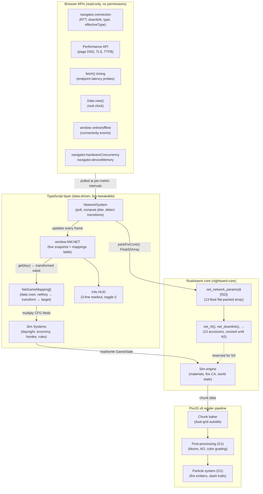

# NIGHTWARD — Roadmap

This file is the **ship record**: newest first, one entry per milestone, what it changed and
what it caught. It is not a plan. Live plans are [`A-arsenal.md`](A-arsenal.md) (Batch A) and
[`N4-deep-wire.md`](N4-deep-wire.md) (the N4 phases); what the game *is* lives in
[`../GDD.md`](../GDD.md); how we work lives in [`WORKFLOW.md`](WORKFLOW.md). A plan that has
shipped is deleted, not archived — see "Retired plan documents" at the bottom.

> **Pivot (2026-07-16):** The world is no longer a dream — it's your network. Live browser
> network metrics (RTT, jitter, bandwidth, connection type, real clock) drive every game
> mechanic: terrain, spawns, day/night, resource flows, difficulty. The procgen engine stays
> — but its parameters are now live functions of your internet connection. Same tab, same
> seed, totally different world depending on where and how you're connected.

## Where we are — 2026-08-22

**Active branch: `dev/night-build`.** Twelve milestones are shipped-and-unmerged on it — B5,
B6, N4.1, N4.2, N4.3, N4.4, A1, A4, A3, A5, A8 and the C4 repair. `main` is still at the last
tagged release, and nothing merges to it without explicit sign-off.

**Gauntlet 2133–2136 across 124 tests**, six consecutive green runs. Typecheck clean on both
tsconfigs, build green.
(Counts drift by a few from RNG-dependent assertion loops — the test *names* are the
regression signal, not the total.)

### Open and owed

| | what | decided by |
|---|---|---|
| **playtest verdict** | Batch G, Batch B, `fix/sound-rollback`, N4.1–N4.3, A1 / A3 / A4 / A5, the C4 repair | user |
| **gates A2** | `CFG.omens.surgeFxStrength` — 0.5 may be too strong (N4.3) | user |
| **gates A2** | Fray × Surge compounds to ×1.81 horde speed — intended, or capped? (N4.3) | user |
| **A1 balance** | `heavy` rolls a flat +2–6 and can land at Touched, so a lucky blue copper blade beats a plain iron one. Deliberate Diablo behaviour, but it inverts the copper→iron→silver→star ladder | user |
| **A1 balance** | a Riftborn weapon measured ×2.23 base damage (9 → 20.08) | user |
| **B5 Q2** | should gold drop as physical coins? `CFG.drops.goldDrops` is `false`; a boss bursting into coins is the juiciest version of B5 and a one-row follow-up | user |
| **A8 balance** | is a Cairn's wake the right price? Five foes at the current night's scaling on top of a guaranteed Hallowed — arguably correct (the payout is flat, so the risk should scale), arguably a trap (the best drop becomes unreachable exactly when you need it). `CFG.a8.cairnWake` is its own switch so this can be answered alone | user |
| **A8 balance** | can the Hoarder actually be caught? Tuned to outrun a bare player by 2 px/s, so it needs a slow, a ranged option or terrain. If the answer is "never", the real question is whether players chase it a second time | user |
| **A8 balance** | do three concurrent Boons read as anything mid-fight? Twelve boons over fifteen hooks, three live at once, sharing one HUD chip row with the Omens | user |
| **N4.4 balance** | is the radar the right place for Scrying? It is the one HUD element whose value is spatial, so it is the honest target — but the effect is invisible unless the player has seen the other size. A first-run player has no baseline to notice it against | user |
| **N4.4 balance** | the band is 0.75×–1.5× on a 58-tile disc, off a transform that hits its floor at 75 ms. Most home connections resolve in 10–40 ms, so most players will sit near the top of the band and only ever see the radar shrink on a bad network. Correct (a good connection should feel good), or should neutral sit mid-band? | user |
| **unstarted, ungated** | A6 (the Hall becomes a hub / the gambler), N4.5–N4.7 | — |
| **unstarted, gated** | A2 (on the two N4.3 numbers above), A7 (on N4.5) | — |

---

> ## N4.4 — Scrying, 2026-08-22 (branch `dev/night-build`, unmerged)
>
> The ROADMAP has carried **"DNS resolution time → Scrying skill — reveals map by resolving
> domains"** since N1, and N4.0 made it load-bearing when it moved the discovery mechanic off
> favicon fetches and onto DoH. This is that promise. **Gauntlet 2134 across 124 tests.**
>
> ### What shipped
>
> Every beacon the game already resolves now times itself, and the **median** of those
> resolutions sets the radius of the minimap disc: a sharp resolver folds more world into the
> radar, a crawling one narrows it. Deliberately passive — no new request, no new host, no new
> verb. Scrying reads a number the wire was already producing, which is the same trade N4.1
> made and the reason this phase was scoped "self-contained, tiny bandwidth".
>
> IPv6 rides the same answers: the first sighting of a host gets one AAAA query, ~13 across a
> session, and one v6 answer latches `ipv6Live` for the run. The host is never contacted — the
> resolver answers, usually from cache — so the game learns whether this network carries a
> working v6 answer set without a packet going near the name it asked about.
>
> ### Most of the brief was already standing, and that was the problem
>
> N4.4's brief listed "resolver race, PTR on own IP, AAAA/IPv6, TTL, DNSSEC `AD`, per-beacon
> real IPs". Five of those six had shipped with N4.0 and N4.1 as a side effect of moving
> discovery onto DoH. What was actually missing was AAAA and — much more to the point — **any
> game consequence whatsoever.** The phase as written was a pile of readings with no verb,
> which is the dormant-row sin at the scale of a milestone. The radar is the fix: it is the one
> HUD element whose value is spatial, so it is the honest target for a measurement about reach.
>
> ### Three defects, none of which the Gauntlet found
>
> All three came out of reading the work back, not out of anything going red — worth recording
> because the suite was green across every one of them.
>
> - **`parseDohAnswer` dropped record type 12.** It was extracted from a filter accepting 1, 28
>   AND 12, and kept the first two. Type 12 is PTR, `resolvePtr()` is its only caller, and that
>   call is the entire source of the Vessel's ISP row — which could therefore never have filled
>   again. The extraction shipped **with** an adversarial parser test of nine malformed inputs
>   and stayed green, because every input it tried was a type the new code already knew. The
>   accepted set is now a named table (`DOH_READ_TYPES`) and the test walks it. **New WORKFLOW
>   rule 13:** a parser test fed only the shapes it already handles is a mirror, not a test.
> - **A host the rate gate refused was burned for the run.** `aaaaChecked` was marked before
>   the probe fired. `ipv6Live: false` documents itself as "not yet seen", which is only honest
>   if a host no request was ever made for gets asked again. The line drawn is between "never
>   asked" and "asked and got nothing" — not between success and failure.
> - **One resolution was enough to move the radar.** A single cold-cache lookup measures a
>   cache miss, not a network; publishing it snapped the disc to a clamp on the first probe and
>   drifted it back over the next minute, which reads as a bug rather than as weather.
>   `DNS_MIN_SAMPLES` holds the neutral value until three have landed — the same rule pillar 5
>   applies to a probe that never answers, since "not yet measured" is a kind of not answering.
>
> ### The test that was missing was the one that mattered
>
> The first pass shipped a mapping-table test and a parser test. Both real, both entirely
> upstream of the game, and **neither could tell you whether the radar had ever moved.** The
> radar is now measured in pixels off the live HUD canvas: one foe forty tiles east, three
> sight values, the red mark located by scanning. At neutral it lands 42.5px from centre, and
> the assertion is that a 58-tile disc drawn into a 124px circle must put a 40-tile foe at
> 40/58 of the way out — ~42.8px — which is the claim in the design's units rather than the
> render recomputing its own `span` and agreeing with itself. Sharp Scrying pulls it to 28.3,
> dim pushes it to 56.8, and a control redraw proves the measurement is stable.
>
> Four mutations, each confirmed red then reverted: the sight multiplier cut from `span`
> ("sharp Scrying widens the radar (42.5 < 42.5)"); PTR dropped from the parser, which
> reproduces the exact regression this milestone shipped with; the sample floor removed; the
> gate-refusal release removed. `grep -c MUTATION` is 0.
>
> ### The visual gate found the mechanic's actual value
>
> Screenshots of the radar at 10 / 50 / 150 ms (`qa/gate-n44/`) show a ring of twelve marks at
> a fixed forty tiles sitting comfortably inside the disc at sharp Scrying and pressed against
> the rim at dim. But the thing the numbers did not predict is what happens to marks BEYOND the
> ring: at 1.4× three world-boss chevrons are on the disc, and at 0.75× they are simply gone.
> **A sharp connection shows you the lords before they show you themselves**, and a slow one
> does not. That is a real mechanic rather than a number on a HUD, and it is the argument for
> the radar being the right home for this reading.
>
> ### One flake, and one older bug, both fixed in passing
>
> The ability bar's "it spends exactly 18 resolve" failed about one run in four at 86 against
> 82 — Bramblebreak killing a foe and `resolvePerKill` landing inside the same synchronous
> `cast()`. Nothing about the bar was wrong; the test was measuring the horde. Latent, and
> shaken loose by N4.4 rather than caused by it: the AAAA retry changed how many requests are
> in flight, and the suite's frame timing rides on that. Eighth incident of this kind.
>
>
> `minimap.draw()` throttles at 10 Hz, so a test must hand it a far-future timestamp to be sure
> it ran — and **testHudSurfaces has been stamping `performance.now() + 2e6` since A4 without
> putting it back**, freezing the player's own radar for half an hour after any `?test` run.
> **New WORKFLOW rule 14:** anything a test pushes into the future is world state in a suite
> that shares one live world, and belongs in the same `finally` as the rest.

---

> ## A8 — Cairns, Wardstones and the Hoarder, 2026-08-21 (branch `dev/night-build`, unmerged)
>
> The last ungated phase of the Arsenal, and the first content in the game that has a
> **price**. **Gauntlet 2055–2058 across 120 tests, nine consecutive green runs.**
>
> ### What shipped
>
> A **Cairn** — pale stacked stones, ~0.7 per run, visible across a field — opens through the
> ordinary gather interaction and pays a guaranteed **Hallowed-or-better** piece. A
> **Wardstone** — a violet monolith with a lit mark, ~2.5 per run — grants a timed **Boon**.
> The **Hoarder** is a rare daytime runner that never attacks, outpaces you by a hair, bursts
> a Woven-or-better hoard when killed, and is gone for good past 21 tiles.
>
> ### Four arguments with the brief, all of which the brief lost
>
> **1. "Guaranteed Hallowed+" is the domain-lord band.** Handing it over for a walk and a
> five-second dig would invert the ladder A1 spent a milestone tuning. So the band stayed and
> the price arrived: opening a Cairn **wakes what was buried under it** — five foes at the
> *current night's* stat scaling, spawned as ordinary horde members rather than day prey, so
> walking away from them means they march on your hall. `cairn` is its own LOOT_BAND row
> rather than an alias of `lord`, so a future retune can move one without the other.
>
> **2. The timed-buff machinery the brief promised did not exist.** The plan said shrines were
> "a data row plus a toast" because "`effects.ts` already has the timed buff machinery
> (Nightseer Charm)". The Nightseer Charm is a permanently equipped item. What `effects.ts`
> actually had was `armMoveBurst()` — one hard-coded window over one hard-coded effect — and
> that IS the machinery, generalised here into a table. **A Boon is a timed entry into the
> item-effect vocabulary**: twelve rows naming keys from the same fifteen hooks C4 built,
> folded into `activeEffects()`, so all ~20 sites that ask
> `activeEffects(state).has('fire_aura')` light up for a Wardstone without knowing one exists.
> The constraint that buys that: **a boon may only name an effect that is already consumed**,
> which `testA8DataRows` asserts against `hasEffect()` with a negative control. Second time
> this project has found a plan asserting a capability it did not have — A1's premise about
> the fifteen hooks was the first, and the C4 repair was the bill.
>
> **3. "Shrines" became Wardstones,** because `BUILDINGS` already contains a player-built
> Shrine. Two different things sharing one word in the same HUD is how a Veil stops working.
>
> **4. Neither table may roll empty.** The Cairn's five gear rows at independent chances came
> up with nothing **22%** of the time, and the whole table 3.3% of the time — a design
> promising "guaranteed" quietly delivering nothing after a map crossing and a fight. Fixed by
> giving `LootRoll` an optional **`group`**: rows sharing one are a weighted pick-one that
> always yields exactly one row. Every pre-A8 table leaves it undefined and is untouched,
> which `testLootGroups` measures at 0.400 against 0.400 before it measures anything else.
>
> ### Three latent flakes, found by the Gauntlet before a player could
>
> Six runs turned up three failures that had nothing to do with each other and everything to
> do with A8 shifting the RNG stream — the fifth, sixth and seventh time that mechanism has
> exposed something latent in this suite.
>
> - **`wearOnly()` no longer stripped the player.** `activeEffects()` now folds boons in, so a
>   Wardstone the 10-minute playthrough test walked over left `resonance_boost` live for the
>   next two game-minutes — and testEchoBounds' isolation assertion, added during the debloat
>   pass *precisely* to catch "a future source of resonance we do not clear", caught exactly
>   that, twice in six runs. That assertion earned its keep in under a day. Fixed in the
>   helper, not at each call site, because fixing it at each call site is how one gets missed.
> - **`regen_boost`'s control measured 0.000 hp/s.** Regen is daytime-only and the test ran
>   wherever the suite's clock had drifted to after two playthrough tests. It now pins the
>   phase as a precondition; both halves still run through the real `combat.update()`.
> - **`chill_aura` measured 0.00px in BOTH halves.** It marched a foe from wherever the suite
>   left the player standing; against water, a cliff or a tree — and A8 added two blocking
>   feature types to worldgen — `canStand()` refused both axes. Now measured on a
>   `findUniformCorridor`, which is the second time that has been the fix.
>
> ### The density arithmetic was wrong, and measuring is why we know
>
> The first pass reasoned "a run covers ~3,500 tiles, so a density sum of 0.0004 gives ~1.4
> Cairns" and shipped numbers that measured **0.38**. A density is per-tile *of its biome*,
> and roughly three quarters of a NIGHTWARD map is deep water, mountain and snow — none of
> which carry features at all. `testA8Density` states the claim in the design's own units
> ("about one Cairn, a handful of Wardstones, per run") rather than reading the density table
> back to itself, which is the tautology this suite keeps finding in its own history.
>
> ### Mutation-proved
>
> Four load-bearing assertions, each broken deliberately and confirmed red, then reverted:
> boons cut out of `activeEffects()` gives a failed Wardstone seam; the Cairn's band dropped at
> the drop seam gives "at or above the Hallowed floor" failing on a Touched roll; the `dayOnly`
> filter disabled gives 40/40 night spawns as Hoarders where 0/40 is correct; the flee vector
> inverted reports "a spooked Hoarder runs: 96 to 3 px". `grep -c MUTATION` is 0.
>
> ### The escape hatch is a revert, not a mute
>
> `CFG.a8.enabled = false` drops both features out of worldgen and the Hoarder out of the day
> pool. Both feature rows are appended **last** in `FEATURES` and the density table is a
> running cumulative sum, so excluding them restores the pre-A8 world **tile for tile** —
> which `testA8EscapeHatch` measures across 19,600 tiles rather than assuming.
>
> ### Visual gate
>
> The first in-world capture showed the Cairn as a dark blob indistinguishable from a bush, at
> exactly the range the design needs it seen from — it had inherited the rock ramp. Repainted
> in bleached limestone with a bone capstone and a dark seam between courses, so it reads as
> *stacked stones* rather than one lumpy boulder. Screenshots in `qa/gate-a8/`.

---

> ## Debloat pass — 2026-08-21 (branch `dev/night-build`, unmerged)
>
> 3,087 lines out of `docs/` and two dead functions out of `network.ts`. What it cost is
> recorded in "Retired plan documents" at the bottom of this file; what it *found* belongs
> here, because it was not a documentation problem.
>
> **A live defect, found by the pass that was not looking for one.** The gauntlet went red on
> `echo roll 9 within D5 band: 12 ∈ [1, 10]` immediately after a docs-only commit. The C4
> repair had made `echoes.roll()` apply `resonance_boost` (×1.25), and `testEchoBounds`
> derives its band from `base × [dmgRow.min, dmgRow.max]` while inheriting whatever the
> previous test left the player wearing. With the Nullmaw relic still on, 9.6 × 1.25 rounds
> to 12. It needs resonance live **and** a top-of-band roll at the same moment, so it hid
> behind five consecutive green runs and only surfaced when an unrelated change shifted the
> RNG stream — the fourth time that mechanism has exposed something. Fixed by clearing gear,
> relic and sockets for the measurement and then *asserting* the isolation, so a future
> resonance source is a red test rather than a wider band. Mutation-proved (forcing
> `relic_null` turns the new assertion red), then green 4×: **1873–1875 across 113 tests.**
>
> **Two ROADMAP entries had recorded a correction nobody applied.** Both the N4.1 entry and
> the Deep Wire direction update state that "What we CANNOT get from a browser" is wrong
> about packet loss; N4's plan §10 carried a third copy as a to-do. The wrong list outlived
> all three. That is the dormant-row doctrine in prose: a correction with no consumer is not
> a correction. Applied at the source, along with six new API-matrix rows and the finding
> that inverts the matrix's old reading — the best signals N4.1 added are **universal**, so a
> Firefox player now gets kernel `min_rtt` and real packet loss and loses only the coarse
> `navigator.connection` family.
>
> **A dormant-row sweep of all 199 CFG leaf keys and all 15 effect ids** found the two dead
> `network.ts` functions, confirmed every effect id now has a consumer outside `effects.ts`
> (the C4 repair holding up under a check written independently of it), and left exactly one
> genuinely unread key: `CFG.drops.goldDrops`, which stays because deleting it would delete
> the question. Five CA keys were false positives — they cross into Rust as a positional
> `[f32; 6]`, so no consumer ever names them. **The sweep is deliberately not in
> `package.json`:** it would have reported zero on C4, whose seven hooks *were* referenced by
> the affix table and never by any behaviour. A tool that is clean on the bug you just spent
> a milestone fixing is worse than no tool.

---

> ## C4 repair — seven dead effect hooks, 2026-08-21 (branch `dev/night-build`, unmerged)
>
> Found while auditing what A1 had actually been built on. **Gauntlet 1874/1874 across 113
> tests, five consecutive green runs.**
>
> ### The shape of it
>
> `registerEffect()` builds a registry and `applyEffect()` dispatches from it. **Nothing in
> the game has ever called `applyEffect()`.** Every hook that works is read a different way
> — `activeEffects(state).has('key')` at the site that cares, with the behaviour written
> inline there, because the behaviours need that site's locals (the swing's arc, the foe's
> march multiplier, the fog's alpha) and an `EffectContext` big enough to carry all of them
> would be the whole game.
>
> So the registry was a **vocabulary**, and seven entries in it were only ever vocabulary:
>
> | hook | what it cost |
> |---|---|
> | `thorns_reflect` | the Thornwarden relic, `of the Thorn` |
> | `fire_aura` | the Cindermaw relic, `of the Ember` |
> | `chill_aura` | the Rimewraith relic, `of the Rime` |
> | `regen_boost` · `move_burst_on_kill` | the Tideculler relic, `of Mending`, `of the Tide` |
> | `see_foe_hp` · `resonance_boost` | the Nullmaw relic, `of the Eye`, `of Resonance` |
>
> **All five domain-lord relics did nothing** — the rewards for the five biggest fights in
> the game. And **350 of the 750 suffix weight** in A1's affix table was placebo: very nearly
> every second rolled suffix. It also quietly falsified A1's own premise, that "the fifteen
> effect hooks already work, so the suffix half is a data table over hooks that already work".
>
> ### Why it survived two milestones behind a green suite
>
> The C4 test drove the handler **directly** — `applyEffect('thorns_reflect', …)` returned 6
> and the assertion went green. A test that calls a handler proves the handler works and
> never that the game calls it. Worse, the code *existed*: a reader checking "is thorns
> implemented?" found a function with real logic in it and stopped reading.
>
> That assertion is now replaced by the rule that makes the mistake unrepeatable — every
> handler is an inert flag naming its real consumer, so a hook implemented only in the
> registry is red immediately.
>
> ### The seven consumers
>
> | hook | consumer |
> |---|---|
> | `thorns_reflect` | `combat.damagePlayer`, beside A5's Ironwake — they stack, and log separately |
> | `fire_aura` | `combat.updateAuras`, a standing tick (an aura you must swing for is not an aura) |
> | `chill_aura` | the `hordes` march product, by proximity — no per-foe bookkeeping to expire |
> | `regen_boost` | `combat.update`, in the same product as the Loom's regenPct |
> | `move_burst_on_kill` | `hordes.hurt` arms a window; main's movement product reads `moveBurstMul()` |
> | `see_foe_hp` | `FoeView.sync` — the bar existed but only above a *hurt* foe, which is when you no longer need it. What the effect buys is appraisal. |
> | `resonance_boost` | `echoes.roll()` — the one place both the autofire and A3's actives derive damage, so it cannot drift between them |
>
> Every number is a `CFG.itemEffects` row, tunable live through `NW.CFG`.
>
> ### Measured, matched-pair
>
> | | with | without |
> |---|---|---|
> | chill_aura, same foe, same tile, same tick | 21.08px | 26.35px (= ×0.80, the configured value) |
> | regen_boost | 2.250 hp/s | 1.500 hp/s (= ×1.5) |
> | move_burst_on_kill | ×1.25 window | ×1.0 |
> | resonance_boost, D5 roll pinned to 1.0 | 1.25 | 1.00 |
> | see_foe_hp, full-health foe | 2 draw calls | 0 |
>
> ### Two flakes it shook loose, neither of them new
>
> 1. **Both A3 ability tests leaked `state.god = true`.** This file's tests share one live
>    world, and a leaked god mode silently disarms every damage assertion after it — which is
>    how A5's Ironwake test came to measure nothing. Saved and restored in both, the way the
>    rest of the file already does.
> 2. **A5's Ironwake test had a 12% coin flip in it.** Its weave vessel is a *rolled* item, so
>    it can carry `of Warding`, and `dodge` returns out of `damagePlayer` before any reflect
>    happens. It went red the moment a new test shifted the global RNG stream — the same
>    mechanism that shook the vigor-starve flake loose during A1. `Math.random` is now pinned
>    above the threshold for that measurement and restored in the `finally`, because `ok()`
>    throws and an inline restore would have leaked a stubbed RNG into every later test.
>
> Also corrected: the Ironwake control cleared the sockets but not the *gear*, so once thorns
> stopped being placebo it was measuring two independent reflect sources and calling it
> Ironwake.
>
> ### One process note
>
> `scripts/run-gauntlet.mjs` drives **port 5199**, which it does not start — that is a
> long-running `vite preview` serving `dist/`. **The gauntlet tests the last build, not the
> working tree.** Three green runs were banked against stale code before this surfaced.
> `npm run build` before `npm run gauntlet`, every time.

---

> ## A1 + A4 — The Arsenal, first cut, 2026-08-21 (branch `dev/night-build`, unmerged)
>
> The Hero Siege yoink, shipped. User direction: *"i agree!!! gogogo!"* — accepting the
> brief's three recommendations (§4.2 (a)+(b): compress the ladder into one run and put a
> trophy on the scorecard, pillar 3 intact; §4.3: no classes; §5.7: A7 merges into N4.5's
> selector). **Gauntlet 1744/1744 across 107 tests, 20 consecutive green runs.**
>
> ### The architecture decision that made A1 small
>
> The whole game is **id-keyed**: `inv` is `Record<itemId, count>`, `equip` is
> `Record<slot, itemId>`, soul items bind by id, `bestTool()` scans inventory keys. A rolled
> item is *unique*, and forcing uniqueness into that shape by hand would have meant touching
> every one of those structures — plus the ground drops, the merge logic, and the bag.
>
> So a rolled item gets a **synthetic id**: `iron_blade#7f3a`. Every structure above keeps
> working completely untouched. Exactly one thing breaks — `ITEMS[id]` returns undefined for
> a synthetic id — and that is what `itemDef()` is for. It was the only change the other
> **33 lookup sites** needed.
>
> `itemDef()` returns the base def with the affixes **already merged into the stat columns**,
> which is the load-bearing half: `bestWeaponDmg`, `baseStatFor`, `wornStat`, `armorDef`,
> `charmRegen` and `activeEffects` all pick up affixes for free, with no knowledge that
> rarity exists. Affixes are invisible everywhere except where we deliberately show them.
>
> **Plain returns the authored id unchanged.** If every plain flint axe became a unique
> instance the bag would end a run holding forty singleton stacks of identical icons and
> stacking would be dead. Plain *is* the authored item, byte for byte, exactly as before.
>
> ### The fifteen hooks C4 already built
>
> `grep registerEffect` returns **fifteen live, already-consumed effect hooks** — `fire_aura`,
> `lifesteal`, `chain_on_kill`, `dodge`, `gold_find`, `thorns_reflect` and the rest. They were
> built in C4 to serve **five relics**, and fourteen were reachable from exactly one item each
> in the entire game. The whole *suffix* half of the affix system is a data table over hooks
> that already work and are already Gauntlet-covered.
>
> The *prefix* half writes to the four stat columns `ItemDef` already had, plus six named
> multipliers read through `gearMod()` — each with a consumer wired in the same commit, because
> an affix nothing reads is a dormant row and this project knows what those cost:
>
> | modifier | consumer |
> |---|---|
> | `moveSpeed` | `main.ts`, into the same product as the Loom / silt / omen multipliers |
> | `swingSpeed` | `combat.ts` envelope, **inside** the existing `attackSpeedFloor` clamp |
> | `vigorDecay` · `resolveDecay` | `vitals.ts` |
> | `buildHp` | `build.ts`, scaled once at placement like the Loom multiplier above it |
> | `soulXp` | `rules.awardSoulXp` |
>
> Tools count as carried gear in `gearMod()` and `activeEffects()`. They are never in `equip`
> — `bestTool()` decides which axe is in your hands — so without that, every affix that rolled
> onto a tool would have been dead on arrival.
>
> ### The wire decides what the world gives up
>
> One new `NET_GAME_MAP` row, `Fortune (Aperture · Fray)`, clamped 0.75–1.35 off two measured
> kernel readings. A wide clean path tilts the rarity ladder up; a frayed one tilts it down
> **but raises drop quantity**, so a bad connection is a different kind of run rather than a
> strictly worse one. That distinction is the difference between a mapping and a punishment,
> and it is the same lesson the Omens learned in N4.3. Neutral 1.0 whenever the deep wire is
> silent (pillar 5).
>
> A rift now opens the `rift` band for 60 s — **the only route to a Riftborn item**. N4.3 gave
> the rift its first working trigger on desktop; this gives it its first reason to want one.
>
> ### Measured, not asserted
>
> | | measured |
> |---|---|
> | common band (4000 draws) | plain 54.5% · touched 26.6% · woven 13.6% · hallowed 5.3% |
> | → per 20-drop run | **2.8 Woven, 1.05 Hallowed** — the §4.2(a) target |
> | lord band | hallowed 76% · **sovereign 23.9%** — the "~25% shot" target |
> | Fortune 0.75 → 1.00 → 1.35 | hallowed 3.0% → 5.3% → 10.3%, monotone |
> | a Hallowed blade, equipped | **17.74 damage vs a plain 9**, read back through `equippedWeaponDmg()` |
> | a Swift chestplate | measured **×1.061** movement against a rolled ×1.06 |
>
> ### A4: shipping A1 without it would have shipped an invisible feature
>
> Before this commit there were **zero tooltips anywhere in the codebase**. The Bag set
> `cell.title` — a browser tooltip that cannot be styled, cannot be coloured by tier, and
> cannot show a green +3.4 against a red −2. A rolled item would have been a differently
> coloured name with no way to interrogate it.
>
> `ui/rarity.ts` is the single place that knows what a tier looks like; six copies of a hex
> value is five chances for the ladder to disagree with itself. Plus the comparison tooltip,
> HP/Resolve orbs with Vigor as a ring (it is a rate, not a pool), loot beams gated at Woven,
> rarity colour in the pickup toast and on the leaderboard trophy row, and a minimap —
> `state.explored` has carried a `// future minimap` comment since it was written.
>
> ### Three defects found by live capture, not by reading the code
>
> 1. **The minimap silently vanished.** `new UI()` does `root.innerHTML = ''` on `#hud` at
>    line 312, deleting the canvas appended at line 185. Now self-attaching like the tooltip
>    host — immune to construction order instead of dependent on it.
> 2. **The Vigor ring was not there at all.** It sits outside the orb's circle and the orb had
>    `overflow: hidden`. The fill is now clipped by an inner `.bowl`.
> 3. **The beams were invisible over daytime grass.** At normal blending a translucent shaft
>    reads as a painted rectangle. Additive blending is what makes it read as light.
>
> This is why the capture happens before the commit and not after.
>
> ### The flake A1 shook loose, which was not A1's
>
> `testVigorStarve` went red 2 runs in 8 reporting *"vigor 49.88 after 5s"* against an expected
> 0. **49.88 is the death scatter's 50/50 reset.** The test steps five seconds with night
> hordes live and never cleared the field — while `testVitalsDecay`, *immediately above it in
> the same file*, carries a comment describing that exact failure and guards against it with
> god mode and a cleared field.
>
> A1 did not cause it: rolling loot consumes `Math.random()` on every gear drop, which shifts
> the global RNG stream for every horde spawn and damage roll downstream, and that was enough
> to move a latent flake into view. Guarded the same way its neighbour is — god mode lifted
> for the starvation phase, which is the one that needs the player hurtable — plus a positive
> guard asserting the player was never scattered mid-measurement, so it can never again pass
> *or* fail silently. The diagnostic that found it is retained in the assertion message:
> printing only the number could never have said the player died.
>
> ### Two balance items for the playtest verdict, deliberately not pre-tuned
>
> 1. **`heavy` rolls `+2–6` flat damage and can land at Touched**, so a lucky blue copper
>    blade beats a plain iron one. That is the Diablo experience working as intended — it is
>    what makes a low-tier drop worth reading — but it deliberately inverts the
>    copper→iron→silver→star ladder.
> 2. **A Riftborn weapon measured ×2.23 base damage** (9 → 20.08). ~0.35% of rift-band drops,
>    always carrying a curse, and rift-band drops only happen for 60 s after a rift — but it
>    is the largest single number A1 can produce.
>
> `CFG.loot.enabled = false` is a real escape hatch on the same terms as `CFG.drops.enabled`:
> with it off, `rollItem()` returns the id it was handed and the game is byte-for-byte its
> pre-A1 self.
>
> ## A3 — The ability bar, 2026-08-21 (branch `dev/night-build`, unmerged)
>
> The five Echoes keep their C1 autofire and gain an empowered active on keys 1–4, paid
> for in Resolve. No mana bar was invented — Resolve is already a morale meter that decays
> at night, near a lord, and while idle, and it already punishes at zero; spending it on
> heroics is what it is *for*. Costs (14–22) sit against +12/kill and +30/dawn, so a night
> fight pays for its own casts and a quiet run cannot afford them.
>
> The bar auto-slots in canonical order and the fifth lord is held but unbound — a choice at
> the run's peak rather than an automatic upgrade. Casts refuse for free and say why (empty /
> resolve / cooldown / the 0.25 s key-repeat lock); casting yourself to exactly zero Resolve
> is allowed on purpose. `systems/abilities.ts` owns the bar and the refusals, `systems/echoes.ts`
> owns what a cast does, and both share the one D5 damage law.
>
> Gauntlet 1778/1778 across 109 tests, typecheck clean on both configs. The open question
> from A-arsenal §9.5 — *is Resolve the right cost?* — is now a playtest verdict, not a blocker.
>
> **Next: A2 (Elites)** — still gated on the N4.3 balance verdict.

---

> ## A5 — Sockets & Weaves, 2026-08-21 (branch `dev/night-build`, unmerged)
>
> Hero Siege's runewords, Veil-legal. Rolled gear now rolls **0–3 sockets by rarity** — a
> 3-socket vessel only exists on Hallowed-and-up, so The Long Night is gated behind both its
> threads *and* a worthy piece to hold them. **Threads** are five authored items (Rime /
> Ember / Null / Tide / Thorn); they are not gear — no roll, no equip slot — and they socket
> into rolled gear, in order. Slotting is append-only, which is the whole rule made mechanical:
> a reorder breaks the weave, exactly like the Loom's no-respec.
>
> Three weaves, each with exactly one consumer wired:
>
> | Weave | Sequence | Bonus | Consumer |
> |---|---|---|---|
> | The Long Night | Rime · Rime · Ember | +25% damage at night | `combat.resolveHit` |
> | Hollow Song | Null · Tide | kills restore 4 Resolve | the two kill paths |
> | Ironwake | Thorn · Thorn | reflected melee damage also stuns | `combat.damagePlayer` |
>
> Threads drop from **domain lords** (2 per kill, matched to the lord's element) — the plan
> said "from elites", but A2's elites are gated, so the lord is the interim source and a full
> clear of five lords is ten threads: enough for Long Night plus Ironwake, or Hollow Song plus
> spares. `systems/weaves.ts` owns the slotting and the typed bonus getters; `data/weaves.ts`
> is pure data plus one matcher shared by the system and the tooltip, so the two can never
> disagree about what is and is not a weave. The tooltip shows the socket row, the slotted
> threads, and any completed weave.
>
> **The build found one dormant hook:** `thorns_reflect` was registered but never applied in
> production — the Thornwarden relic and the "of the Thorn" suffix were placebo. Ironwake is
> deliberately self-contained (its own reflect + stun) rather than built on a hook that does
> not fire; wiring `thorns_reflect` is now a separate, small cleanup.
>
> Gauntlet **1859/1859 across 112 tests**, typecheck clean on both configs.

---

> ## Direction update (2026-08-21) — the Hero Siege yoink → Batch A "The Arsenal"
>
> User direction, verbatim: *"update our plan to yoink all the UI, gameplay, etc from hero
> siege!"* Briefed as **Batch A — The Arsenal** (`docs/plans/A-arsenal.md`). Systems and
> interaction patterns only — rarity ladders, rolled affixes, elite packs, an ability bar,
> orbs, comparison tooltips, sockets, a gambler. No art, names, or copy, which costs nothing
> here because pillar 1 means there is no asset pipeline to put borrowed art into.
>
> **The audit finding: we already have about two thirds of Hero Siege under other names.**
> The Loom is a talent tree. Night hordes are waves. The five lords are act bosses. The
> Armory is a relic system. B5 already puts loot on the floor and walks you over it. What is
> genuinely missing is short and specific:
>
> | Gap | Status today |
> |---|---|
> | **Rarity tiers + rolled affixes** | none — 67 hand-authored items, a strictly linear copper→iron→silver→star ladder, zero rolls |
> | **Elite / champion packs** | `EnemyBehavior` is per *type*, never rolled per *spawn* — every skeleton on night 6 is the same skeleton |
> | **Active ability bar** | Echoes are auto-firing only; the bottom bar holds verbs (Interact/Attack/Ignite/Build), not powers |
> | **Item tooltips** | **zero tooltips exist anywhere in the codebase** — so a rolled item would be invisible to the player |
> | **A gold sink** | exactly one in the whole game (`hordes.ts:730`, scatter-cache) |
>
> ✅ **Why A1 is cheap:** `grep registerEffect` returns **fifteen live, working, already-
> consumed effect hooks** (`fire_aura`, `lifesteal`, `chain_on_kill`, `dodge`, `gold_find`,
> `thorns_reflect`, …). They were built in C4 to serve **five relics**, and fourteen of them
> are reachable from exactly one item each. The entire *suffix* half of an affix system —
> "of the Ember", "of the Leech", "of the Wisp" — is a data table over hooks that already
> work and are already Gauntlet-covered. **A1 is mostly a `data/` edit.**
>
> ⚠️ **The collision, and it needs a decision:** Hero Siege is a forever-character game —
> keep the hero, keep the loot, climb for a hundred hours. Pillar 3 forbids persistence and
> pillar 8 caps a run at ~15 real minutes. Diablo-style drop rates inside that window would
> ship six rarity tiers of which no player ever sees the top four — the same dormant-content
> failure the Lens work spent two milestones stamping out. Three ways out, in A-arsenal §4.2;
> **recommendation is (a) compress the ladder so it is traversable inside one run + (b) record
> your best item as a trophy on the finished-run scorecard**, which pillar 3 already permits.
> Option (c), a persistent stash, is buildable but changes what NIGHTWARD is — a conversation,
> not a commit.
>
> **Classes are the one borrowed system the brief declines.** They are a retention mechanism;
> the Loom already does build identity better inside our constraints, and picking an identity
> *before* you know what the wire is doing that run is backwards for this game. Build the Loom
> out instead — unless overruled.
>
> ⚠️ **A7 collides with N4.5 and must not become a second difficulty axis.** N4.5's data-budget
> opt-in is already user-directed to double as the difficulty selector. A7 gives that one
> control ARPG-shaped consequences (enemy scaling, a rising rarity floor, Riftborn gated to the
> top two tiers). One selector, two vocabularies: the Veil calls it a covenant, the Lens calls
> it a data budget.
>
> ⚠️ **A2 is gated on the outstanding N4.3 balance verdict.** Rolled enemy affixes multiply
> against per-night scaling *and* the Fray mapping *and* a Surge omen, and Fray × Surge already
> compounds to ×1.81 horde speed with no verdict in yet.
>
> **Suggested first cut: A1 + A4** (the roll, plus orbs / comparison tooltips / loot beams /
> rarity colour / minimap). That is the whole Hero Siege loop — kill, see a coloured beam, walk
> over, read a tooltip, feel the upgrade — and it touches neither combat balance nor the N4
> file set, so it can run in parallel with N4.4+. Open questions in A-arsenal §9.

> ## Direction update (2026-08-14) — playtest verdicts + a new milestone
>
> **Sound: rolled back, verdict IN.** The user asked to restore the pre-X2 soundtrack. All
> audio drift since the 2026-07-07 baseline came from a single commit, `944adb8`, which added
> a `combat` mood, per-lord `BOSS_MOODS`, and a `deathWhistle` SFX. The `combat` mood was the
> culprit: it triggered whenever any foe came within 10 tiles, which with night hordes and day
> roamers is most of a run — so drums were effectively always on and the ambient soundtrack
> stopped existing. Reverted on `fix/sound-rollback` (`db343c1`); `audio.ts` is byte-identical
> to the pre-change version. Verified in a real (headed) browser by instrumenting the live
> synth: day = triangle / night = sine / **0 kicks, 0 hats even while under attack**, boss =
> sawtooth + 11 kicks + 11 hats, then back to ambient after. Playtest verdict: *"feels more or
> less guchi."* **Standing rule from this: drums and sawtooth are for world bosses only. Do not
> key music off ordinary combat or foe proximity.**
>
> **New user direction — loot must land on the floor.** Verbatim: *"we need drops … for timber,
> berries, etc etc. need to drop on the floor and then we pick it up by walking over it. makes
> it feel more real"* and *"when i kill a boss its gotta drop stuff, the random mobs as well."*
> All three loot sources, not just gathering. Briefed as **B5 — Ground Drops**
> (`docs/plans/B5-ground-drops.md`, since retired — see the bottom of this file). It is cheap
> because all three sites are already the same
> `invAdd`/`acquireGear` loop over a `Stack[]`, and every item already has a 16×16 procgen icon
> that doubles as its world sprite — **no new art, no render-pipeline change.**
>
> ⚠️ **The B5 trap, recorded here so it is not rediscovered:** the Gauntlet's gather tests never
> assert inventory gain (`testGathering:105`, `testGatherEveryFeature:434`,
> `testFullPlaythrough:1904` — none read `player.inv` after a gather). B5 could break the entire
> gather→bag pipeline and the suite would stay green at 1249/1249. This is the §B1.a finding
> repeating in a different system. **B5 owns five new tests; a green Gauntlet is not evidence
> for it otherwise.** Exactly one existing test is expected to go red —
> `regression.ts:1169`'s boss-relic assertion — and that failure is correct.
>
> **Also raised, deliberately NOT bundled:** a WoW-style level-up flourish. Skill xp feedback
> itself is confirmed fine as-is. Specced as optional **B6** at the bottom of the B5 brief;
> needs a yes/no. Kept separate so its playtest verdict isn't tangled with B5's.
>
> **Merge order (all three are unmerged and unpushed):**
> `fix/sound-rollback` → Batch B (`feat/b-reachable-run`, gated on the B1/B3.b playtest) → B5.
> B5 touches `gather.ts`/`hordes.ts`/`worldbosses.ts`/`config.ts`/`main.ts`/`regression.ts` —
> a near-complete overlap with Batch B's file set, so do not parallelise them.

---

---

> ## N4.3 — Omens, 2026-08-20 (branch `dev/night-build`, unmerged)
>
> The half of N4 that stops the Lens being a diagnostics panel bolted to a game. N4.2 shipped
> the `ChronicleStore` and its change detection early; §7 assigned N4.3 the two things that
> were still outstanding — **scheduled jittered probes**, and **wiring detected changes into
> world events** (§5.3). Both now ship. **Gauntlet 1645/1645 across 100 tests, 12 runs green
> out of 12** (a couple of probes branch on terrain, so a run can report 1640 or 1644).
>
> ### The probes were phase-locked to the day/night cycle, and it is exact arithmetic
>
> N4.0 jittered the DoH beacons and stated why: *"so probes never phase-lock."* Three of the
> four schedulers were left on fixed periods, and one of them is a clean divisor:
>
> | scheduler | period | day/night cycle | result |
> |---|---|---|---|
> | DoH beacons | 6 s ±40% | 340 s | already jittered (N4.0) |
> | **same-origin baseline** | **20 s fixed** | **340 s** | **340 / 20 = 17, exactly** |
> | Cloudflare trace | 300 s fixed | 340 s | walks slowly, deterministic within a run |
> | deep-wire (`cfL4`) | 45 s fixed | 340 s | walks, deterministic within a run |
>
> The baseline probe therefore sampled the **same seventeen phases of the cycle on every day
> of every run, forever**. Anything that tracks the cycle — and the whole premise of this game
> is that the network and the world move together — was structurally invisible to it. That is
> not a politeness problem, it is a measurement-validity problem, and no number of assertions
> about the *value* of a sample would ever have found it.
>
> All four now re-roll their next gap through one shared `jitteredGap()` in `data/network.ts`.
> Measured over 300 simulated probes against 68 five-second phase buckets:
>
> | | fixed 20 s | jittered |
> |---|---|---|
> | phase buckets reached | **17 of 68** | **67 of 68** |
> | mean gap | 20.000 s | 19.98 s over 2000 samples |
>
> Live off a running game, the four schedulers' next gaps read `beacon 6.84 s · baseline 14.01 s ·
> trace 345.53 s · deep 56.79 s` — against base intervals of 6 / 20 / 300 / 45, all four now
> off their nominal period and none of them the same twice.
>
> The mean is the load-bearing half of that table. Spreading probes out is fine; quietly
> firing more of them is not, and N4.0 spent an entire phase getting this volume down. The
> test asserts the mean stays within 2% of the configured interval, and the matched control
> asserts `jitteredGap(20, 0)` returns exactly 20000 every time — so the spread above is
> demonstrably the jitter and not the test.
>
> The jitter also multiplies **on top of** the deep wire's failure backoff, so two clients that
> failed at the same moment no longer retry at the same moment.
>
> ### The Lens CHANGES panel has never once shown anything
>
> `main()` calls `chronicle.takeEvents()` at 1 Hz to turn detected steps into Feed lines. That
> drained the same array `tabs.ts` reads for its CHANGES panel and `toJSON()` reads for the
> export. So:
>
> - the CHANGES panel could only ever have shown something if a Lens refresh landed inside the
>   same second as a detection — in practice, never;
> - **every chronicle ever exported carried `"events": []`**, in a file whose entire purpose is
>   to be evidence.
>
> Nothing went red. `testChronicleStore` builds its own store and never calls `takeEvents()`,
> so the drain was invisible to it — the same shape as the four tautologies this suite has
> already shipped. `events` is now the permanent record and a private `pending` queue is what
> `takeEvents()` drains; the test asserts both halves, including the matched control that the
> queue *does* still drain, because a `takeEvents()` that stopped draining would re-log and
> re-raise the same omen once a second forever.
>
> ### Omens — a change on the wire becomes a change in the world
>
> §5.3 asks for three: a latency step-change is a rift, a retransmission burst is a surge, a
> throughput collapse is a famine. `systems/omens.ts` is a table, so adding one is a row:
>
> | series · direction | Omen | effect | gate |
> |---|---|---|---|
> | `fray` ▲ | **Surge** | `hordeAggression` ×1.25 + the screen frays | 3σ |
> | `flow` ▼ | **Famine** | `resourceYield` ×0.65 | 3.5σ |
> | `flow` ▲ | **Bounty** | `resourceYield` ×1.30 | 3.5σ |
> | `pulse` ▼ | **Quickening** | `moveSpeed` ×1.10 | 3σ |
> | `silt` ▲ | **Miring** | `moveSpeed` ×0.88 | 3σ |
> | `pulse` ▲ | **Rift** | fires the realm rift | 4.5σ |
>
> Three decisions in there were choices, not defaults, and are worth stating:
>
> **Omens go both ways.** §5.3 lists only bad ones. A system that can only ever punish teaches
> a player to resent their own connection, and it makes the mapping a penalty box rather than a
> mapping. A latency *drop* is a Quickening and a throughput *surge* is a Bounty.
>
> **A Famine lifts when the network recovers, not when a timer expires.** The plan says "yields
> drop until it recovers" and that is the better mechanic: the player's route out is the
> network coming back, which they can watch happen in the Lens. Recovery is measured against
> the *pre-step baseline* with a 10% hysteresis band and is direction-dependent — a down-step
> recovers by coming back up. The duration cap is a safety valve for a permanently degraded
> link, not the primary exit, and the test distinguishes `recovered` from `expired`.
>
> **An omen is a STEP, not a level.** The `Horde Aggression (Fray)` mapping row already makes a
> lossy link permanently harder. A Surge is what happens the moment it *starts* being lossy.
> Steady-state hostility and a shock are not the same experience and they multiply separately.
>
> ### The rift system has been dead code on desktop since N2
>
> Its only trigger was a `connection.type` transition. **Desktop browsers do not report
> `connection.type` at all** — the flash, the particles, the biome swap, the scoreboard counter,
> all built and tested and unable to fire on the platform this game is played on. A hard latency
> step is the trigger it always needed. `NetworkSystem.riftFromWire()` honours the same 30 s
> cooldown as the transition path, and **returns false when the biome selector returns the realm
> we are already in** — the realm holds and no rift is claimed. Reporting `Vale → Vale` would be
> a lie in the one panel that is not allowed to lie, and the omen is asked-then-raised rather
> than raised-then-asked so a refusal leaves nothing phantom behind.
>
> ### What the tests actually prove
>
> 61 new assertions across 5 tests. Two are worth naming, because both are the kind that would
> have passed on a broken implementation:
>
> **Movement is measured, not read back.** The probe drives the input axis and measures the
> distance the player covers. Reading `omens.mul()` back would pass while `main.ts` computed the
> value and discarded it, which is exactly what shipped in G1 and in the Loom. Measured:
> **1.100× for a Quickening and 0.880× for a Miring**, against configured values of 1.10 and 0.88.
>
> Getting that to three decimals took two goes, and the second one fixed a **pre-existing flake
> in the Loom test**. The Loom's movement probe trials all four directions and keeps the longest
> corridor — an idiom that was itself a flake fix. But *longest* is not *fair*: terrain speed
> varies tile by tile, so a faster player ends up further along and can enter slow ground the
> plain run never reached, and on a short corridor that noise is larger than the modifier. It
> failed as `Deep Roots slows real movement: 28.4 → 29.2px` on a 28 px corridor, with nothing
> wrong in the Loom at all — found while chasing the identical flake in my own probe.
>
> Both now use a shared `findUniformCorridor()`: a straight run of seven tiles that are all
> standable **and all report the same `world.speedAt()`**. On uniform ground distance is exactly
> proportional to the multiplier. The Loom probe consequently gained an assertion it could never
> make before — that Deep Roots' advertised **−12% is 0.880×**, not merely "smaller".
>
> A third cause was underneath both: **a death respawn teleports the player to the hall
> mid-measurement**, which measured 2934.8 px against an expected ~90 on 1 run in 10. Both probes
> now clear the field, restore HP, and reject any run longer than the corridor it was walked down —
> a distance that did not come from walking is not a movement measurement.
>
> **`recovered()` is asserted not to lift on the tick it was raised.** If that comparison were
> inverted, every omen would lift immediately and the entire system would be a no-op that still
> passed an "an omen can be raised" test.
>
> ### Two bugs in my own tests, both instructive
>
> **The stub inverted the thing it was pinning.** The yield thinning uses stochastic rounding —
> `floor(x) + (random() < frac ? 1 : 0)` — and I copied the Loom probe's `Math.random = () => 0`.
> But `0 < frac` is **true for every fractional part**, so the stub made the famine round *up*
> every time and a 2-item harvest thinned to exactly 2. It read as missing wiring. `0.999`
> floors instead, and `floor(n × 0.65) < n` for every `n ≥ 1`.
>
> **A test asked the detector to find a step against a baseline containing that step.** The
> follow-up assertion pushed 60 s of the new level and then stepped back; `detect()` compares
> `now-15..now` against `now-105..now-15`, so the baseline window straddled both levels, its
> standard deviation was the size of the step, and sigma collapsed. The store was right and the
> test was wrong.
>
> Also: the harvest probe took the first feature tile within 6 tiles without checking the player
> could *work* it, got `-1`, and — because `ok()` throws — took the move-speed section down with
> it, leaving `main.ts`'s wiring unverified. It now tries candidates until one actually starts.
> That is the same silently-skipped-phase failure the waystone bug had, caught this time by the
> guard written for it.
>
> ### Live, off a running game
>
> Raised through the real path — a step pushed into the Chronicle, drained by `main()`'s 1 Hz
> tick, handed to `omens.consider()`. Nothing reached into `omens.active`:
>
> ```
> raised:  ["Surge x1.25"]      hud chip: "Surge 73s"
> active:  [{ kind: surge, target: hordeAggression, mul: 1.25, from: 0.5, to: 1.03, sigma: 21.3 }]
> muls:    { horde: 1.25, yield: 1, move: 1 }
> chronicle.events kept after the 1 Hz drain: 2
> l4: { proto: TCP, minRtt: 1.519, lost: 3, retrans: 4, cwnd: 53 }   ← fray 0.75
> ```
>
> **Two attempts at that capture failed, and both failures were the system working.** The first
> raised a Surge and it lifted one second later — because the real reading is a Cloudflare edge
> honestly reporting `lost=0`, so `recovered()` fired correctly. The second wrote to
> `net.snap.fray` to hold it, which did nothing: `net.update()` recomputes the snapshot from
> `deep` every frame, so that write is **the same transient-projection trap as writing to
> `state.player`** — its seventh occurrence. The capture only worked once the *kernel dump* was
> degraded, which is the only authoritative value in the chain.
>
> ### Two things for the playtest verdict
>
> Both are single numbers, flagged rather than pre-emptively tuned:
>
> - **The Surge screen effect may be too much.** `CFG.omens.surgeFxStrength` at 0.5 drives the
>   vignette +0.22 and pushes the grade to `[255,120,120]` at 0.11 strength. In the gate shot it
>   reads close to a damage flash that never ends. The plan asks for loss to be *frightening*;
>   whether it is frightening or just loud is a feel call.
> - **Fray and Surge compound to ×1.81 horde speed.** The Decoder Ring clamps `hordeAggression`
>   at ×1.45 for a badly lossy link, and a Surge multiplies ×1.25 on top. That separation is
>   deliberate — level and step are different experiences — but the product is the number that
>   gets played.
>
> ### The `state.player` projection trap, occurrences eight through twelve
>
> The 12-run baseline went red once on `at least one productive action performed`, in the
> **survival** playthrough. The line above it — `buildings exist at end (3 total)` — passed, so
> the world had buildings but the playthrough had produced none of them. They came from setup.
>
> The cause is the one this project keeps rediscovering. `state.player` is a **projection**;
> `main()` overwrites it from `nw.player` at the end of every sim tick. A write to it is not an
> error, does not warn, and disappears on the next `nw.step()`. The survival playthrough's
> gather loop did exactly this, so it never walked to anything and only gathered what happened
> to be inside the 1.6-tile reach already. **It is the same bug I fixed in the *exhaustive*
> playthrough's phase-1 loop yesterday, in a different function, and I did not check for
> siblings.** Grepping `state.player.x = ` found four more:
>
> | site | what it silently did |
> |---|---|
> | survival playthrough, gather loop | never walked to a node — over 12 runs the playthrough went from **0 crafts and 0 builds** to a steady **12–19 gathers, 12–13 crafts, 8–9 builds** |
> | survival playthrough, setup | "move player near hall" moved nobody |
> | Loom gather-yield probe | only measured nodes already in reach |
> | `testFireIgnite` | ignited from the original tile, not the flammable one |
> | **`testCollisionWalls`** | **a tautology — see below** |
>
> **The wall test was a green light wired to nothing.** It wrote a position on the far side of
> a Palisade, stepped, and asserted the player had not moved far. The player had not moved
> *at all*, because the write was discarded — so `position blocked by Palisade wall` was true
> for the same reason `1 === 1` is true. It would have passed with the wall deleted, with
> collision disabled, with the building system removed entirely. **The fifth tautology found in
> this suite.** It now stands on open ground west of the wall, drives the input axis east for 40
> ticks, and asserts the player stops short of the wall's edge — measured `x=-1163.4` against an
> edge at `-1152` — with a matched control that the player did move east at all, and a second
> that an adjacent wall-free tile *is* standable so the refusal is the wall and not the terrain.
>
> Fixing those changed where the player stands during later tests, which exposed two more latent
> flakes that had been masked by the trap: the Loom's yield probe hardcodes a +20px approach that
> lands in water or in the trunk (it now tries each side and keeps the first node that actually
> *starts*), and `wall placed near chained waystone` guarded its placement on `canPlaceAt()` and
> then asserted unconditionally that the wall was there — the sibling search ten lines above it
> already carries exactly that fix and its comment, and this one was missed.
>
> Twelve runs green out of twelve after all of it, against 11/12 before — and the one that was
> red was red for a real reason.
>
> ### Budget
>
> No new outbound requests. The jitter changes *when* four existing schedulers fire, not how
> often — asserted. N4.5 remains the only phase that will spend the player's data, and it stays
> behind the opt-in that doubles as the difficulty selector.

---

> ## Night build 2026-08-19 — B5, B6, N4.1, N4.2 (branch `dev/night-build`, unmerged)
>
> ⚠️ **This branch is an INTEGRATION branch, not a feature branch.** It is
> `main` + `fix/sound-rollback` + `feat/b-reachable-run` + `feat/g-terrain-depth`, and then
> four new milestones on top. It exists so the whole queue can be playtested as one thing
> instead of five. The individual branches still exist and are still the right unit to
> review. **Nothing here has been merged to `main`.**
>
> Two conflicts in the stack, both trivial and both resolved as unions: `package.json`
> (the `qa:*` scripts vs `gauntlet`) and `main.ts` (`__nw.sys.net` vs `__nw.input`).
>
> ### B5 — Ground Drops
>
> Loot lands on the floor and is walked over. All three loot sources — gathering, horde
> kills, world-boss kills — ended in the same two lines (`invAdd` + `acquireGear`) and the
> item teleported into the bag; B5 replaces that one seam at all three sites. Every
> modifier upstream (mega-cluster area rolls, Loom double-yield, Granary, Battery Scarcity,
> material yield) still runs first and still produces the final `Stack[]`. Only the
> destination changed.
>
> Three beats, because skipping any one makes ground loot feel **worse** than instant
> pickup: the toss (~0.45 s arc, the item visibly leaves the tree/corpse), the rest
> (contact shadow, idle bob), the collect (walk near, it snaps to you).
>
> **Magnet radius 1.6 tiles, not a literal walk-over.** A pure hitbox overlap turns the
> floor after a 43-foe night wave into a pixel hunt. `armDelaySec: 0.25` stops the magnet
> firing before the arc finishes — without it, gathering at point-blank range collects
> instantly and the entire feature is invisible.
>
> Two guards against this codebase's own documented failure modes:
> - Pickup SFX hard-limited to one per 0.12 s. Pickup is high-frequency (43 foes a night,
>   16 rolls per mega-cluster); an unguarded blip per stack is the `deathWhistle` mistake
>   of 2026-08-14 repeated in a new system.
> - Toasts moved from the loot roll to the pickup and aggregate over 0.4 s. The
>   `log.push('gather', …)` entry **stays at the roll** — the event log records what the
>   world produced, which is true whether or not the player walks over to collect it.
>
> `CFG.drops.enabled = false` restores the pre-B5 path exactly. That is the escape hatch if
> the verdict is negative, and it is tested.
>
> **Known consequence, stated rather than hidden:** loot can now be abandoned. Materials
> rot after 90 s; gear, tools and relics never do. Crafting and building can briefly lack
> materials you "earned". That is intended, and it is a real change to flow.
>
> **⚠️ Collision note carried from G4 still applies and is now joined by this one:** a drop
> is clamped to a standable tile when it lands, but drops do not block movement and are not
> entities — they are not in `world`, only in `state.drops`.
>
> ### B6 — Level-Up Flourish
>
> Specced as OPTIONAL and needing a yes/no. **Built anyway, because it is cheap and was
> directly asked for, and it is one config flag from off.** Consider this the prototype the
> verdict is about, not a decision already taken.
>
> A level-up was a toast in the corner plus a sound at two of the seven call sites —
> Firemaking and Combat levelled up in silence. Now: a `levelup` particle row (gold,
> **negative** gravity, ~1 s — motes that rise read as an upgrade, motes that fall read as
> debris), two rings racing outward with the second trailing the first, and a ground bloom,
> ~0.65 s, drawn **on the character**. One shared `levelUpFlourish(ctx)` rather than seven
> copies, because the seven sites had already drifted apart once.
>
> **Skill levels only.** Not soul-gear levels and not Loom points, both of which are
> frequent: a flourish firing several times a minute stops reading as an achievement, which
> is the same always-on-intensity failure that got the combat music rolled back.
>
> ### N4.1 — The Deep Wire
>
> Everything the game measured before this was an **inference**. `navigator.connection.rtt`
> is quantised to 25 ms buckets; `downlink` is capped at 10 Mbps and absent outside
> Chromium; "jitter" was a statistic derived from those buckets, so it was measuring the
> quantiser as much as the network. **Packet loss was recorded in this file as impossible
> from a browser. It is not.**
>
> A Cloudflare edge that terminates our TCP connection returns its own kernel socket
> statistics in a `Server-Timing` header — `cfL4;desc="?proto=TCP&rtt=…&min_rtt=…&rtt_var=…
> &lost=…&retrans=…&delivery_rate=…&cwnd=…"`. That is a `TCP_INFO` dump for our own socket,
> in **microseconds**. `src/game/systems/deepwire.ts`:
>
> - `parseCfL4` / `parseServerTiming`, both defensive, both reading by key and never by
>   position.
> - A passive `PerformanceObserver` harvesting TAO-enabled resource waterfalls. **The TAO
>   test is done on the ENTRY, never on a hostname allowlist** — a host can stop sending the
>   header and a proxy can strip it. A zeroed `responseStart` means "no data", never "0 ms";
>   inverting that would report a filtered network as the fastest ever seen.
> - One **header-only** probe (`__down?bytes=1`) every 45 s through the existing `NetGate`,
>   with backoff. The interesting data is in the headers; spending the player's bandwidth to
>   read a kernel counter would be absurd. The real throughput test stays an opt-in verb
>   (N4.5).
> - Identity as a side effect: `cf-meta-ip/colo/country/city/asn` ride along on the same
>   response — which is what let N4.0 retire `ipify` and `ipapi.co` without losing anything.
>
> **Live-verified**: `pulseBest 2.03 ms` (real `min_rtt`, sub-millisecond) and
> `flowBest 17.03 Mbps` (real `delivery_rate`, above the 10 Mbps `downlink` cap) read off a
> running game.
>
> Six measured metric rows — Fray, Silt, Aperture, Flow, Pulse, Flux — plus three
> "effective" rows the sim consumes. **The measured rows deliberately do not overwrite
> `rtt`/`downlink`/`jitter`**: those keep their documented estimated meaning so the Lens can
> show measured and inferred side by side. Silently swapping one for the other would erase
> the only evidence that the deep wire works.
>
> Two new modifiers that only exist because the kernel told us: **Fray** (loss + retrans)
> drives horde aggression — packet loss should be frightening — and **Silt** (RTT above
> *this path's own* `min_rtt`) drags movement. Silt is measured against the path's own floor
> so a player who simply lives far from an edge is not punished for their geography.
>
> Every derived value sits at **neutral** when the wire is silent. A player behind a proxy
> that blocks the endpoint gets a balanced game, not an easy or an impossible one.
>
> **Correction to record here:** the "What we CANNOT get from a browser" list in this file
> is now wrong about packet loss for Cloudflare-terminated paths. ICMP, pcap, ARP, LAN
> enumeration and WiFi dBm remain correct.
>
> **Not done:** the plan suggests depending on `@cloudflare/speedtest` rather than
> hand-rolling. That package is a full throughput engine and this phase spends no bandwidth;
> it belongs with N4.5, where it would actually earn its place as a dependency in an
> otherwise pixi-only project.
>
> ### N4.2 — The Lens becomes a side cart, and gains a memory
>
> The Lens was a centred modal built by 115 lines of string concatenation in `main.ts`,
> rebuilt wholesale every refresh. **It covered the game** — the wrong shape for a panel
> whose entire premise is that these numbers are driving the world in front of you.
>
> Now a right-edge drawer (380 px; full-width sheet under 700 px). Non-modal: no scrim, no
> input capture beyond its bounds, the game keeps rendering beside it. Animates on
> `transform` only, so opening it never triggers layout during a 60 fps sim. Five tabs —
> PULSE / PATHS / IDENTITY / VESSEL / THREADS — extracted to `src/game/ui/lens/`. Only the
> **visible** tab is rebuilt, only while open, throttled to 4 Hz.
>
> **Honesty tags are the point of the refactor.** Every reading is tagged `measured` /
> `reported` / `derived` / `unavailable`, and an unavailable row says **why** in plain
> language — "unavailable" with no reason is indistinguishable from "broken". PULSE shows
> the deep wire and the browser estimate side by side so the size of the 25 ms bucket is
> visible. PATHS distinguishes TAO routes (full waterfall) from ones where the browser
> zeroes every timing field. IDENTITY keeps a "what we cannot see" section — packet loss
> used to be on it.
>
> **The Chronicle** (`systems/chronicle.ts`). What existed was three arrays of 60 numbers: a
> one-minute sliding window, which cannot answer "what changed?" because by the time you
> notice, the thing it changed *from* has been shifted off the front. Now one session-long
> store, and two decisions carry it:
> - **Aggregates, not decimation.** Old samples collapse into 10 s buckets keeping
>   min/median/p95/max. "Keep every tenth sample" is simpler and throws away exactly what is
>   worth keeping — **the outliers are the event**.
> - **Every sample carries its provenance**, so the export cannot claim precision it never
>   had.
>
> Change detection compares a short window against a longer baseline that **excludes** it,
> in standard deviations rather than percent: a satellite link that always wobbles by 80 ms
> should not fire every minute, and a fibre link that never moves should fire on 20 ms.
> Steps become Feed lines now, and world events in N4.3.
>
> **Export** dumps every series, probe and derived inference as JSON, locally. The panel is
> a data-collection instrument, so the data has to be able to leave it.
>
> Also deleted: `drawSparkline()`, 40 lines of canvas code that had **never once been
> called**. The strip uses inline SVG, which survives `innerHTML` rebuilds.
>
> ### Evidence — including what went wrong
>
> Typecheck clean on both configs · build green · **Gauntlet 1553/1553 across 94 tests, 10 runs green out of 10**
> (up from 1337/1337 across 85: 21 new assertions worth of B5/B6/N4 coverage plus rewrites).
>
> **A correction to my own first conclusion, recorded because the first version of this
> entry was wrong.** I wrote that the intermittent redness was mine, on the strength of six
> consecutive green runs at the pre-feature commit. Six runs is not a measurement of a
> one-in-four event. A proper 8-run baseline at `e7a3ee3` came back **6 green / 2 red, both
> reds on `5/12 systems exercised`** — so the suite already flaked at roughly one run in
> four before any of this work existed. What my changes did was move *which* assertion
> caught it. The two causes below were real and are fixed; they were not the whole story,
> and claiming they were would have buried a pre-existing defect under a tidy narrative.
>
> Two causes that genuinely were mine, both in B5's own test changes:
>
> 1. `testBossDeathPaysOut` walks the player to a lord's corpse now, and restored the
>    position through `state.player.x`. **That is the projection — `main()` overwrites it
>    from `nw.player` every tick** — so the player stayed at the corpse. Two tests that run
>    after it (waystone placement near the hall, the Loom movement probe) went red about one
>    run in three, for reasons having nothing to do with either of them.
> 2. Several new assertions read `state.drops.length` across hundreds of ticks of live sim,
>    in which foes genuinely die and drop loot of their own. They watch planted UIDs now.
>
> Three more flakes surfaced while pinning B5 and **all three were real**: an unpinned toss
> angle drifts a planted stack out of the radius it was planted inside; `state.player` vs
> `nw.player` again, this time putting a stack 55 px from a player it was meant to be 31 px
> from; and one N4.1 test went red because **the probe genuinely succeeded in CI** and
> reported `cwnd 52`, making Aperture legitimately 1.25 — fixed by forcing the wire silent
> for the neutrality assertions rather than by widening the band, since otherwise the
> assertion measures whoever's network is running the suite.
>
> Three real product bugs were found by *writing* the tests rather than after shipping:
> `stats()` walked backwards from the newest sample so the "baseline excluding the recent
> window" swept it up anyway and the detector compared a window against itself; compacting
> everything older than the fine window meant one sample aged out per push, so every
> "bucket" held a single sample and a 900 ms spike reported `med=900`; and rewriting the tab
> bar's `innerHTML` on every selection detached the node the click came from.

> **A rendering bug that predates all four milestones, found by B6.** The level-up burst
> drew its rings and none of its motes. The rings are `views.fx`, which lives inside the
> camera-transformed container; `ParticleSystem` was parented to `app.stage`, which is
> **screen space**. Every call site has always passed world pixels, so since G1
> (2026-07-18) every particle in the game — embers, hit sparks, gather puffs — has been
> drawn at its world coordinate treated as a screen coordinate. Correct only near the
> origin, and wrong by exactly the camera offset everywhere else, which is why it never
> looked broken so much as sparse. One line: `new ParticleSystem(stage.world, 400)`.
> Verified in a 4× clipped capture, not by reasoning about it.

> **And the 4× capture immediately found a second one.** Every stack count lying on the
> ground was an unreadable smudge. `stage.world` is scaled 2× and Pixi renders `Text` into
> a texture at **resolution 1**, so each label was a low-res bitmap linearly upscaled — a
> thin glyph with a dark stroke blurs into grey mush. It presented as a *colour* bug, and
> every property was already correct: fill cream, alpha 1, tint white, no filter anywhere
> in the ancestor chain. What settled it was forcing the fill bright red and getting a dark
> red smudge, which ruled the fill out and pointed at filtering. `resolution = 4`.
>
> Looking at the picture found two more things in the same 30 lines: the count was drawn at
> `(0, 5)`, directly on top of its own contact shadow (an ellipse centred at `(0, 7)`, ry
> 3), so the top half of every digit sat in the darkest pixels of the frame; and `fontSize
> 9` with a **3 px** stroke leaves nothing, because Pixi draws the stroke *over* the fill
> and centres it on the outline, eating 1.5 px inward from each side of a ~2 px stem.
> `BuildingView`'s name label had the same resolution bug and is fixed with it. Floaters are
> unaffected — they convert world→screen and live in an unscaled layer.
>
> **Both of these are the same lesson twice in one night: a renderer cannot be verified by
> reading it.** Two bugs, both months old, both invisible to a suite of 1500 assertions,
> both obvious within seconds of actually looking at a magnified frame. The gate
> screenshots are not decoration for the report; they are the only instrument that catches
> this class of defect.

> **One more flake, and this one N4.1 caused.** The Night Market assertion is
> `round(pop × goldMul × 1.4) > round(pop × goldMul)` with `pop = 2` — false for any
> `goldMul` near 0.8, since `round(1.6)` and `round(2.24)` are both 2. It was stable before
> because `goldRate` was a quantised `downlink` bucket; N4.1 made it a **continuous measured
> value**, so it started landing in the dead band. That is the cost of measuring things
> honestly, and the fix is on the test, not the feature: six huts put the base near 14,
> where a 40% rise cannot round away.

> **The fourth tautological test in this suite.** `testGatherEveryFeature` reported
> "tested === found" and had **never gathered anything**. `world.activeFeatureAt` returns a
> `FeatureDef` directly; the test read `f.def?.id`, which is `undefined` for every tile ever
> scanned, so `found` stayed 0 and the assertion passed as `0 === 0`. Fixing that exposed a
> second bug behind it (the same `state.player` projection write — it located 12 feature
> types and moved to none of them) and a third (the fixture ran with flint tools and
> leftover xp, so only 6 of 10 were reachable). With all three fixed it gathers **11 of 11**
> located feature types. A test whose precondition never holds is not a weak test, it is a
> **green light wired to nothing**, and this suite has now shipped four of them.
>
> **The pre-existing flake, chased to its root rather than documented as weather.** Eight
> instrumented runs printing which systems each playthrough actually touched turned
> `5/12 systems exercised` from a mystery into one line of code. `gather` and `crafting`
> never dropped separately — they dropped **as a pair**, in 3 of the 6 runs that completed,
> and phase 1 reported `0 gathers, 0 crafts` every time. They are a pair because phase 1
> crafts from what phase 1 gathered.
>
> The cause is `state.player` versus `nw.player` **for the sixth time this session**. The
> phase-1 gather loop scans ±3 tiles for a feature and walks to it by assigning
> `state.player.x`. That is the projection, which `main()` overwrites from `nw.player` on
> every sim tick, so the loop moved the player nowhere and could only ever harvest what was
> already inside the 1.6-tile reach. A feature 3 tiles out at 96 px is unreachable, the
> phase logs "13 feature(s) in reach" and gathers none of them, and on a run that also
> happens to miss hordes/echoes/bosses the count lands on exactly 5. It now teleports
> through `nw.player` and stands *beside* the node — a tree tile is not standable, and
> teleporting into one silently leaves the player where they were.
>
> **This projection trap has now caused six bugs in one session and deserves a rule:** in
> tests, read whatever is convenient, but *write* only to `nw.player`. A write to
> `state.player` is not an error, does not warn, and disappears within one tick.
>
> The other 2 of 8 runs died on **`CDP timeout`** with no assertion having failed — a
> harness limit, not a product signal. `cdpRecv` waited 30 s for the next message of any
> kind, and the exhaustive playthrough is one long synchronous block that emits nothing
> between phase logs, so a slow machine was indistinguishable from a hung page. Raised to
> 120 s, which still catches a genuine hang.
>
> The `levelReq` diagnosis in the first draft of this entry was a real fragility and the
> phase log still names gated features — but it was **not** what was firing. It was the
> plausible explanation, and it survived because it was never tested against a measurement.

> **Measured before and after, 8 runs each on the same machine and the same seed:**
>
> | | before | after |
> |---|---|---|
> | runs green | 6 of 8 (2 died on `CDP timeout`, 1 of the 6 red) | **8 of 8** |
> | `gather` exercised | 3 of 6 completed runs | **8 of 8** |
> | fewest systems exercised | **5** of 12 | **8** of 12 |
> | `soulfeed` exercised | **0** of 8 | 6 of 8 |
> | `waystones` exercised | **0** of 16 | exercised |
>
> The last row is the one that matters more than the flake. Soul-feed consumes gathered
> materials, so a playthrough that never gathered could never reach it — the
> "exhaustive" playthrough had been skipping an entire system every single run, and the
> suite reported that as a passing test the whole time. Fixing one projection write did not
> just stop a red light; it turned a third of the playthrough back on.

> **Then the same instrument found a second silently-skipped system.** `waystones` was
> unexercised in **16 of 16** runs. The phase looks up the hall to place waystones around,
> and `exMark(m, 'waystones')` sits inside `if (hall)` — so when the hall dies the phase
> does nothing and says nothing about it. And the hall does die: it is a 400 hp building
> standing through several night waves, and the run log now confirms it in as many runs as
> not. Phase 6 stands a new one up, because that phase exists to exercise waystones and
> hall survival is phase 4's business.
>
> **Two of the twelve systems were quietly absent from every single run while the suite
> reported green.** Neither was found by reading the test. Both were found by printing
> which systems each run actually touched — the same move as the four tautologies: stop
> trusting the pass, and make the test say what it did.

> **A near-miss worth recording.** A Python patch script opened the 263 KB test file for
> writing and then threw a `UnicodeEncodeError` mid-write on a malformed emoji escape.
> Opening for write truncates immediately, so the source file was left at **zero bytes**,
> and a 10-run measurement that was in flight at the time silently measured the wreckage
> — 8 of its 10 runs were garbage. Recovered from `HEAD` in full. Every patch script now
> encodes to bytes FIRST and writes through a temp file plus `os.replace`, so a bad encode
> can never destroy the original. Worth stating plainly because for a few minutes the
> failure looked like a real crash rate and was not.
>
> ### What is NOT done
>
> - **No playtest.** All four of these are feel changes; B5 changes how every loot event in
>   the game feels. They land on the WORKFLOW playtest gate and **nothing here may merge to
>   `main` without a verdict.**
> - **No gate screenshots for B5/B6.** The relief gate shots at `qa/gate-batch-G/` are from
>   the previous session and do not show ground drops.
> - **No `cargo test` run** — no Rust changed, so it was not run rather than run and
>   reported.
> - **No Firefox / headed WebGPU / `pilgrim` lanes**, as before.
> - **N4.2 partially covers N4.3.** The `ChronicleStore`, tiered retention and change
>   detection shipped here because the strip and the export both needed a real backing
>   store. N4.3 still owes the **scheduled jittered probes** (latency ~10 s, DNS ~30 s, STUN
>   at boot and on rift) and the wiring of detected changes into **world events** rather
>   than only Feed lines.
> - **B5 Q2 (gold as physical coins) is still `goldDrops: false`**, and B5 Q4 (drops
>   surviving the death scatter) is left as-is per the brief's recommendation.

> ## Batch G "Depth" — SHIPPED 2026-08-19 (branch `feat/g-terrain-depth`, unmerged)
>
> ⚠️ **Naming collision, read this first.** There is an *already-shipped* `G1/G2 — Visual
> Upgrade & Juice ✅` further down this file, dated 2026-07-18 — screen shake, the 9-kind
> `ParticleSystem`, `BloomPass`, colour grading, vignette. That is a **different G1/G2**
> from the Batch G milestones below, which came from `BG-batch-proposal.md` (since retired —
> see the bottom of this file). Reading the
> ✅ alone would wrongly suggest the terrain work was already done.
>
> **The problem this batch existed to fix:** the chunk baker painted colour and never lit
> it, and the mountain ramp was *darker* than the grass beside it — so a peak read as a
> pit. Terrain had structure at 1 px (dither) and at 32 px (the tile grid) and nothing in
> between.
>
> **G1 — height-field relief lighting** (`src/game/world/relief.ts`, new). A continuous
> height field is derived from the discrete material grid — **bilinear over tile centres**,
> because sampling heightClass per pixel just reproduces the 32px staircase as a hard
> shading edge — plus world-space fbm micro-relief. Normals come from a **3×3 Sobel** (a
> 2-tap forward difference is one-sided and paints a directional seam along every step).
> The result is a 66×66 greyscale texture per chunk, linear-filtered, **multiply**-blended.
> Multiply can only DARKEN, and that is the deliberate trade: flat ground lands at exactly
> 1.0 so G2's palette passes through untouched, and the form is read off the shadowed
> faces. Light direction follows the world clock (east at dawn → west at dusk, altitude
> peaking mid-phase, half strength at night); the sun is **capped below ~45°** because at
> 90° every normal returns ~cos(slope) and relief flattens to nothing — the first
> calibration shipped a near-vertical noon sun and shaded nothing at all.
> **Toggle: `R` in game, or `?norelief` at boot.** The proposal's Option C, as recommended.
>
> **Cost:** ~1 ms per chunk, and it is built **off the bake path** (`RELIEF_BUILD_PER_FRAME`)
> — a normal field costs about as much as the whole rest of a bake, so a teleport into
> fresh terrain would otherwise stall on ~25 at once. Chunks arrive unlit and light up over
> the next frames. Base bake measured at ~6 ms/chunk; **no pre-change baseline was taken**,
> so the batch's total bake delta is unmeasured.
>
> **G2 — palette and value inversion.** All 24 material ramps re-cut from 3 stops to 5
> (`makeTileVariants` now quantises by ramp length, so a 3-stop ramp behaves exactly as
> before). Mountain and snow re-ramped light-on-top; the 8 realm-warped materials moved off
> raw `#cc00cc`/`#00cccc`/`#cc9900`. Measured result: **mountain 165.5 > hill 129.9 >
> grass 119.1** mean luminance off the baked canvas — monotone with height at last.
> Two fixes fell out of this: every tile variant is now **re-centred on the same mean**
> before quantising (each variant carrying its own average brightness is what made the
> ground read as 32px wallpaper), and cliff shading moved from additive `darken()` to the
> new proportional `scale()` — an additive −30 is a cliff face on slate and a **no-op on
> snow**, which was painting "cliffs" lighter than the grass below them.
>
> **G3 — the floating planks.** The cliff pass no longer fires into `heightClass 0`; foam
> already owns the shoreline, and a band there paints a plank of land on the sea. Genuine
> faces widened (9 px one-step / 20 px steep) with per-column striation hashed on the
> **world** pixel column and a top edge that undulates on smooth noise — per-pixel white
> noise there reads as a comb of hair, not broken rock. Measured: shoreline darkens 4.6,
> a real cliff darkens 71.6.
>
> **G4 — silhouette smoothing.** Corner-cut chamfers where two adjacent orthogonal
> neighbours share a foreign material. The feather pass blends *texture* but never reshapes
> the *outline*, which is why the staircase survived it. Drawn in three alpha layers like
> `feather()` does: a single hard-clipped wedge is a **spike** at a high-contrast border
> (dark water sawing into pale sand looked worse than the staircase it replaced).
> ⚠️ Cosmetic only — collision still reads the tile grid, so a corner can look ~13 px
> rounder than it walks.
>
> **G5 — verticality.** Mountain and snow appear in **no feature density table**, so the
> peaks were flat texture fields with nothing standing on them. Added render-only rock
> crags (never gameplay entities — both materials are impassable, so a real gatherable node
> up there would be loot the player can never reach), cut from a **shaded-down** mountain
> ramp: at full brightness a crag is the same value as the rock it stands on and reads as
> an empty outline. Snow gets bare rock with a snow cap. Trees now build each variant at
> its own size (0.72×–1.30×) at native resolution — uniform tree size was most of why a
> forest read as wallpaper.
>
> **G6 — dead code.** Deleted the 174-line `bakeSubpix` path (`subpixFactor` had returned a
> constant 1 since it landed) and the per-tile ambient-occlusion pass, which darkened whole
> 32px squares and was a direct contributor to the tile grid the relief field now handles
> properly.
>
> **Evidence.** Typecheck clean on both configs. **Gauntlet 1249/1249.** New
> `qa/specs/relief.spec.ts` — 5/5, every assertion a **matched pair** with a positive
> control, because a negative claim whose precondition never held is worthless. The
> anti-tautology guard that matters: a flat grey tint over the whole world would sail
> through a naive "boundaries are darker" check, so the overlay must reach a true 1.0
> somewhere *and* average near it. Measured: level ground 0.984, height step 0.799,
> darkest 0.549, brightest 1.000, overall mean 0.978; 94/221 samples move between dawn
> and dusk. Two of these tests **failed first** and both failures were real — the cliff
> control never fired under random wandering (now a directed search), and the
> level-vs-slope split was reading tile *centres*, where a bilinear field's gradient is at
> a minimum.
>
> **Smoke: 3/4.** The red one is the pre-existing drums-in-ordinary-combat regression —
> **verified to fail identically on pristine `main`** this session, and fixed on the
> unmerged `fix/sound-rollback`.
>
> **Gate screenshots** (relief noon/dawn/dusk vs flat, three biomes, seeds 1234/7777/4242):
> `qa/gate-batch-G/` — on disk, gitignored, ~400 KB each. **Awaiting the user's verdict.**
> ## Direction update (2026-08-17) — QA becomes a release gate
>
> **User direction, verbatim:** *"lets create test cases that is like an actual play through,
> timed and everything, as close to real player as possible, we can even have different profiles
> applied to different tests, i dunno, qa needs to be more comprehensive, if a qa run passes game
> must be ready to release effectively … can we use playwright for testing, that way we can get
> playwright traces as well for comprehensive data analysis of qa playthroughs?"*
>
> **Built: `qa/` — Playwright as layer 3 of the test pyramid.** See `qa/README.md`. The framing
> that matters: this does **not** replace the Gauntlet, it covers what the Gauntlet structurally
> cannot. The Gauntlet drives the sim with `__nw.step()` — no rAF, no input, no real time, and
> only ever against the vite dev server. L3 drives a real browser with real keystrokes in real
> wall-clock time, **against the built bundle that GitHub Pages actually serves**. Nothing had
> ever loaded `dist/` in a browser before this.
>
> Seven player archetypes (`qa/profiles.ts`), each a pure `act(snapshot, rng)` policy so a given
> (profile, seed) replays identically: `rusher`, `turtle`, `explorer` (chunk-streaming and heap
> canary), `hoarder`, `idler`, `flailer` (seeded input fuzz — the crash finder), and `pilgrim`
> (one entire 15-minute life to the death screen, `NW_MINUTES=99`). Each emits a per-second
> timeline of hp/gold/foes/inventory/fps/heap as a JSON artifact — a balance dataset, not just a
> pass/fail.
>
> **Finding 1 — the drum regression is live on `main`.** The harness caught it on its first real
> run, black-box, knowing nothing about the source. Staged scenario, seed 1234, production build:
> a foe **0.3 tiles** from the player and the nearest world boss **1767.8 tiles** away (threat
> range 22) — the drum kit played **9 hits in 7.8s**. Across one-minute sessions the counts were
> 44–89 drum hits with no boss involved. Cause: `main.ts:625`
> `… : foesNear ? 'combat' : …` plus the `combat` row of `MOODS` carrying `drums: true`.
> `fix/sound-rollback` (`db343c1`) removes both; rebuilt in a worktree and re-run against the
> identical staged scenario it reads **hats 0 → 0**, while a hunting boss still reads
> **hats 1 → 12**. The fix is verified and waiting only on merge sign-off.
>
> **Finding 2 — the deploy had no gate.** `.github/workflows/deploy.yml` published `dist/` to
> Pages on every push to `main` with zero tests in front of it, and `WORKFLOW.md` still said
> "currently, there's no CI pipeline". Added `.github/workflows/ci.yml` (static trio + Rust tests
> + typecheck of the QA harness + smoke/Gauntlet on the built bundle) and inserted the QA gate
> into `deploy.yml` before `upload-pages-artifact`. Traces upload as artifacts on failure.
>
> **Finding 3 — the game talks to ~14 third-party endpoints.** By design (`data/network.ts` — the
> latency-beacon mechanic), including `ipapi.co/json/` which returns ISP/org/city/country, gated
> behind the first explore action. Not a bug, but a conscious call to make before a public
> release. The QA console-error gate now attributes errors by origin so third-party 429s and
> blocks are recorded but never fail a run.
>
> **Finding 4 — below ~10 fps the world clock and the lifespan clock diverge. NEEDS A DECISION.**
> Only a real-time browser test can see this; the Gauntlet cannot, because `__nw.step()` bypasses
> the frame loop entirely. PixiJS's ticker caps `deltaMS` at `maxElapsedMS` (default **100 ms**,
> never overridden in this codebase), so each frame feeds at most 100 ms into the fixed-timestep
> accumulator in `main.ts:483`. Below 10 fps the game world therefore advances at roughly
> `fps × 0.1 ×` wall-clock. Measured at 2.6 fps: **14 s of game world in 60 s of real time
> (0.23×)** — matching the predicted 0.26×. Meanwhile L1 ages the character off
> `lifespan.updateReal(performance.now())`, which is true wall-clock **by deliberate design**
> (so the cap survives `simSpeed` drift). Consequence: on a machine that cannot hold 10 fps, the
> 15-minute life still expires in 15 real minutes, but the player experiences roughly a quarter
> of the world. For a bounded "perfect run" game going onto Pages for arbitrary hardware, that is
> a fairness question, not just a performance one. Options: leave it; raise `maxElapsedMS`; or
> detect sustained low fps and degrade quality rather than time.
>
> **Finding 5 — the rollback fixes the mood table, but the trigger radius is the real dial.**
> The boss soundtrack keys off `worldbosses.nearestThreatTiles() < CFG.worldBoss.warnTiles`, and
> `warnTiles` is **22 tiles (704 px)** with `count: 3` lords roaming. That radius is comparable
> to the whole visible viewport, so the drums start well before the lord is on screen, engaged,
> or even hunting. Measured on the *fixed* build, `explorer` profile, seed 777: the player walked
> from 42 tiles out down to 4.1, and **26 of 39 sampled seconds sat inside the radius** — boss
> music for roughly two thirds of the session. Caveat: that profile walks a straight line and
> happened to beeline toward a lord, so this is not a general statistic; it needs a multi-seed
> sweep before acting on it. But if the drums still feel too frequent after `fix/sound-rollback`
> merges, **the dial is `NW.CFG.worldBoss.warnTiles` (live-tweakable), not the MOODS table.**
>
> **Confirmed: Gauntlet 72 functions / 1249 assertions pass in a real browser against the
> production bundle** — the first time that has been demonstrated rather than assumed.
>
> ⚠️ **Two traps recorded so they are not rediscovered.** (a) rAF throttling: an occluded or
> backgrounded Chromium stops firing `requestAnimationFrame`, so every frame-derived measurement
> reads zero while the run reports a pass — this produced a false PASS on 2026-08-14.
> `playwright.config.ts` sets three anti-throttling flags AND `Nightward.boot()` refuses to
> proceed unless `__nw.frames` is provably advancing. (b) The `webgl` lane renders through
> ANGLE/SwiftShader at ~3 fps; that is a statement about the software rasterizer, not the game.
> It is a **correctness** lane. Frame-rate floors only apply to the headed `webgpu` lane.
>
> **Release readiness:** the pipe is laid (`base: './'` is correct, the Pages workflow exists and
> now has a gate). Blocking: merge `fix/sound-rollback`; nothing has ever been pushed, so the
> deploy workflow has never actually run; the Firefox lane is written but not yet exercised.

---

> ## Direction update (2026-08-17, later) — the Wire gets real instrumentation
>
> **User direction, verbatim:** *"lets work on the networking panel … side cart style, the game
> itself is a network testing tool right, it tries to determine as much information as possible
> about the environment it is in — whether local stuff executed in the browser execution space
> we running, or whether it hits some api that provides additional information about the caller
> (itself in this case). in addition and on top of the previous is the tests that are run over
> time, the stats in regards to changes in pings, latency, download, upload, etc. … our immediate
> todos are networking expansion then linking new networking stuff into the game loop somehow"*
>
> Planned as **N4 — The Deep Wire** (`docs/plans/N4-deep-wire.md`). Seven phases, each
> independently shippable. Nothing implemented yet.
>
> **The audit that motivated it.** The mapping layer (`NET_METRICS` → `NET_GAME_MAP`, data rows,
> live-editable) is good and N4 does not change its shape. The **measurement** layer underneath
> it is thinner than GDD §4.2 claims: "downlink" is `navigator.connection.downlink`, which Chrome
> caps at 10 Mbps and Firefox/Safari do not implement; **upload has never been measured at all**;
> `jitter` is derived from an RTT value Chrome quantises to 25 ms buckets, so it is usually 0 or
> 25; "beacon latency" is `fetch()` wall-clock including handshakes and main-thread scheduling;
> DNS timing was specced in this document at N1 and never implemented; and `drawSparkline()`
> exists but **is never called** — the 60-sample history buffers are written and never read.
>
> **Finding — `Server-Timing: cfL4` hands us the edge kernel's TCP socket state.** Verified
> against the live endpoint (headers quoted in the brief). `https://speed.cloudflare.com/__down`
> returns `access-control-allow-origin: *`, **`timing-allow-origin: *`**, `server-timing` in
> `access-control-expose-headers`, and a `cfL4` entry carrying
> `rtt`/`min_rtt`/`rtt_var`/`lost`/`retrans`/`delivery_rate`/`cwnd` — microsecond RTT, real
> kernel-measured jitter, **packet loss and retransmissions**, and an uncapped throughput
> estimate. Readable two independent ways (`headers.get()` and
> `PerformanceResourceTiming.serverTiming`). ⚠️ **This corrects this document:** the
> *"What we CANNOT get from a browser"* section implies packet loss needs the optional local
> agent. For any Cloudflare-terminated path it does not. ICMP/pcap/ARP/LAN/WiFi-dBm remain
> correctly listed as impossible.
>
> **Also verified live:** `__up` accepts a POST body and accounts for it (`recv_bytes=200983` on a
> 200 KB upload) — real upload measurement; both DoH resolvers are CORS-open
> (`cloudflare-dns.com/dns-query` with `Accept: application/dns-json`, and `dns.google/resolve`)
> — real DNS, resolver races, PTR on our own IP, DNSSEC `AD`, TTLs; `cf-meta-ip` returns the
> public IP, so **`api.ipify.org` is redundant** and `ipapi.co` (the endpoint whose **429** has
> already failed a QA run) is likely droppable too. And a TAO check across the current beacon
> pool: **none of the fourteen favicon beacons set `Timing-Allow-Origin`**, so they can never
> yield a DNS/TCP/TLS breakdown no matter how they are timed — they stay useful for geographic
> discovery, but precise instrumentation has to route through TAO-enabled hosts.
>
> **The game-loop link.** New signals mostly arrive as new `NET_GAME_MAP` rows — packet loss as
> **Fray** (horde aggression), bufferbloat (`rtt` − `min_rtt` under load) as **Silt** (the world
> thickens), `cwnd` as **Aperture** (carrying capacity), measured throughput replacing the capped
> `downlink` for gold rate. Two things are more than rows: a **Sounding Stone** the player builds
> and activates to run a real throughput/latency/DNS burst — which makes the measurement a game
> *verb* and makes its cooldown double as the data budget and the rate limit — and **change
> detection** feeding the existing rift/omen machinery, which finally gives rifts a trigger that
> fires on desktop (they currently key off `connection.type`, which desktop browsers never report).
>
> **The hard constraint:** throughput testing spends the player's data. Never on boot, honour
> `saveData`, adaptive sizing from 256 KB, a visible session cap, and a `NW_NO_NET` stub mode so
> CI never runs a real bandwidth test.
>
> ⚠️ **Finding — the endpoint-permission liability is in the shipped code, not in N4.** User
> raised it; checked rather than assumed. Everything N4 *adds* is sanctioned: Cloudflare
> publishes **`@cloudflare/speedtest`** on npm (MIT, `vasco@cloudflare.com`, Cloudflare-staff
> maintainers) driving the exact `__down`/`__up` endpoints — we should depend on that package
> rather than hand-roll fetches; both DoH resolvers and both STUN servers exist precisely to
> answer unsolicited requests from strangers. But **the fourteen favicon beacons were never
> invited**, and two say so: BBC's `robots.txt` — *"Please use our site like a human, not a
> robot"*; Le Monde's — *"il est interdit d'utiliser des robots d'indexation Web **ou d'autres
> méthodes automatiques de feuilletage ou de navigation** sur ce site Web"*, citing art. L 342-1
> CPI. `ipapi.co` is a **1,000/day "free trial"** and has already 429'd a QA run.
>
> **And the volume is worse than it looks.** `ACTION_COOLDOWNS.attack = 0`, so every swing fires
> an echo, plus a 3-beacon all-pool volley every 1.5 s. With a `0.64 s` swing envelope
> (`0.32 s` at `attackSpeedFloor`) sustained combat emits **~3.6–5 requests/second — on the
> order of 1,000+ third-party requests per 15-minute run**, each with `cache: 'no-store'` so it
> is a real origin hit, and `probeSingleEndpoint()` has **no failure backoff** (only the
> unrelated `pollEndpoint()` does). The sharp risk is not to us: these come from *the player's*
> IP, and a machine on a corporate or school network beaconing at a fixed 3/s cadence to
> `yandex.ru`/`baidu.com`/`naver.com` is a textbook **C2 signature**. We can get a player
> flagged by their own IT department. Practical risk today is near zero — the game had never
> been pushed until this afternoon — but it is cheap to fix now, expensive after launch, and
> applies at n = 1.
>
> **The fix is also the technical upgrade,** which is why it goes first as **N4.0**: §2.4
> already established none of those fourteen hosts set `Timing-Allow-Origin`, so they can never
> yield a timing breakdown anyway — they are the most legally dubious *and* least informative
> thing we do. Retire the fetches; rebuild route discovery on **DoH** (sanctioned, never touches
> their servers, yields real DNS latency, and returns the host's actual IP so the geography
> stops being a hardcoded `detail: 'London, GB'` string); add a same-origin baseline beacon;
> rate-limit the attack path. Open questions — data budget, `ipapi.co`, whether STUN is
> acceptable, whether to land only N4.0–N4.2 first, and sign-off on changing the shipped beacon
> mechanic — are at the end of the brief and need a decision.

**L1 — The Lifespan: a hard 15-minute "perfect run" loop (2026-07-31).** User's direction
overnight: turn the open-ended survival loop into a bounded, replayable run — "a hard 15 minute
game loop... hard lifespan for players, like 10 years per minute... they simply fall over and die
of natural causes... challenging loop gameplay where u try to get the perfect run." Full brief:
`docs/plans/L1-lifespan-perfect-run.md`. Shipped:
- **`systems/lifespan.ts` (new):** the character ages via REAL wall-clock time (not sim time —
  the cap has to hold regardless of network jank/`simSpeed` drift), `startAge` 16, seeded
  per-run target of `baseRunMinutes` 15 ± `varianceMinutes` 1.5 (a 14–16.5 min window, seeded
  off `state.seed` so a given `?seed=` always rolls the same target). Aging rate is modulated
  by S1's existing vigor/resolve vitals — full vitals = exactly the baseline 15-min ceiling;
  neglect accelerates aging up to `vitalsSwingPct` (12%) faster. **One-directional only: nothing
  extends a run past the seeded cap, including god mode** — old-age death is a SECOND, distinct
  terminal condition alongside hall-destruction, and it is NOT blocked by `state.god` (by design).
- HUD: an age chip + draining lifespan bar in the top bar; warning toast + amber tint inside the
  final `warnMinutesRemaining`, a heartbeat vignette inside `criticalMinutesRemaining`.
- Natural death gets its own ending — "THE DREAM FADES" — distinct flavor text from the
  hall-destroyed "THE THREAD IS CUT," no gold loss/scatter (it's the intended way a run ends,
  not a punishment). `GameState.gameOverCause: 'hall_fallen' | 'old_age'`.
- **Scoreboard v2 (`systems/scoreboard.ts`):** `RunScorecard` gains `age`, `causeOfDeath`,
  `legit`, and `legacyScore` (a transparent weighted sum over nights/kills/bosses/buildings/loom
  points/gold/years-lived + an old-age-finish bonus, weights in `CFG.legacy.weights`, data not
  code). **This replaces the old sort key (`connectionAge` descending, uncapped) — that key
  rewarded being AFK: a player who walled in and did nothing had the dominant leaderboard
  strategy, since nothing ever ended the run.** v1 localStorage records migrate in place on load
  (best-effort score, no crash/data loss). W6's in-progress leaderboard panel (already
  uncommitted on this branch) is finished as part of this milestone and folded into the v2 board.
- **Leaderboard integrity:** `state.everGod` (sticky, set once god mode is ever toggled on) flags
  a run's scorecard `legit: false`; the leaderboard sorts ALL legit runs above ALL flagged runs
  regardless of score, so a god-mode run can never look like a top legit finish. Verified live:
  a deliberately lower-scoring legit run outranks a much higher-scoring flagged one.
- Rebalance: `soulgear.xpBase` 900→250 (+ raised per-action soul xp across the board) — the old
  curve needed ~300 landed swings just to reach weapon soul level 2, most of a whole run spent
  only swinging. Loom gains a second point income (`CFG.loom.pointsPerBossKill`, +2/boss) since
  1/night alone (~2-3 points in a 15-min run) barely samples the 40-node tree.

**Chief-of-staff review pass, same session — real bugs found and fixed (not just the requested
feature):**
1. **World-boss kills never reached the scoreboard.** `worldbosses.ts`'s `hurt()` death branch
   never called `scoreboard.onKill()` (only the ordinary horde-foe death path in `hordes.ts`
   does, and `EnemyDef.boss` is `weight:0` there — it can never actually spawn through that path)
   — `bossesSlain` was permanently stuck at 0 on every run, forever. Fixed: `hurt()` now calls
   `scoreboard.onKill(true)` (and `loom.onBossSlain()`).
2. **`particles.spawn('hit', ...)` — not a real `ParticleKind`.** Two call sites in `hordes.ts`
   (a landed projectile, a damaging trap spring) passed a particle type that doesn't exist in
   `PARTICLE_DEFS`; `ctx: any` erased the type check that would normally catch this. Both threw
   on every occurrence — a live, previously-undetected crash bug in the projectile/trap-impact
   path, found by the new, more-thorough Death & Scatter regression test actually exercising the
   surrounding sim instead of a tautological `ok(true, ...)`. Fixed: `'hit'` → `'spark'`.
3. **Debug/god-mode hotkeys shipped live in every production build.** `CFG.debug.enabled: true`
   was the only gate, and nothing ever set it false; `g`/`h`/`m`/`.` also had no `e.repeat` guard,
   so holding the key key-repeated to unbounded gold/materials. The keyboard path is now gated
   behind `import.meta.env.DEV` (stripped from `npm run build` output); `window.NW`/`window.__nw`
   stay exposed in production either way (the documented live-tuning feature, and how the
   Gauntlet drives state — always by direct mutation, never a simulated keypress).
4. **Identity-probe honesty bug.** `network.ts`'s `pollIpInfo()` fired its periodic IP/geo
   refresh off real uptime alone, independent of whether the player had ever triggered the
   `explore` action — violating the documented privacy law ("scrying reveals who you are") and
   leaving the Lens UI claiming "unrevealed" after the data had already left the browser. Fixed:
   gated behind `identityFetched`.
5. Unsanitized third-party strings (ISP/city/country/ASN/colo from `ipapi.co`/Cloudflare trace)
   went straight into `innerHTML` in the Lens Identity section. Escaped.
6. Several regression tests were tautological (`ok(x.length >= 0, ...)`, `ok(Math.abs(...) >= 0,
   ...)`, trailing `ok(true, ...)` after real assertions) — the exact failure mode flagged twice
   before in this project's history. Rewrote to assert the actual claimed behavior (boss fight
   really kills, night wave really produces foes, death really scatters the player, long walk
   doesn't corrupt position to NaN).
7. **Confirmed NOT a bug:** the spam-click swing-restart DPS allowance in `combat.ts` is
   correctly rate-capped (`CFG.combat.restartMinIntervalSec`) and is documented, intentional,
   user-requested design (the "redaming" feature from S1) — no change made.

**Known, accepted limitation (not fixed, low stakes for a local single-player leaderboard):**
`everGod` only flips when god mode is toggled via the (now DEV-only) keyboard hotkey — a
sufficiently determined player editing `window.__nw.state.god` directly via devtools, or hand-
editing the `nw.leaderboard` localStorage key, could still bypass the flag. There's no backend to
enforce this against, same accepted tradeoff as `window.NW.CFG` being globally live-tweakable.

**G1-Painterly — Kuwahara oil-painting filter (2026-07-19):**
- `PainterlyPass` in `postprocess.ts`: Kuwahara filter (4-quadrant variance-minimizing mean)
  applied at 1/5 resolution for performance, then upscaled with linear interpolation
- Toggle: **V** key or `?painterly` URL param; runtime tweaks via `NW.painterly.{enabled, strength, radius}`
- Configurable: strength 0–1 (blend with original), radius 1–4 (brush-stroke size)
- Sits above vignette (z=70), below UI — HUD stays crisp
- Existing grain overlay (`renderer.ts`) complements the canvas-texture feel
- **Performance note:** Canvas2D Kuwahara at full-res is too slow for 60fps gameplay; this
  implementation processes at 1/5 res (~32K px) which is acceptable as a toggle-once "screenshot
  mode." A future WGSL port (WebGPU only) would make it real-time.
- Files: `postprocess.ts` (+162 lines), `main.ts` (+24 lines, V key + NW.painterly)

All systems implemented: C1 echoes, S1 survival pressure (vigor/resolve), U1 Lens UI unification,
U2 grimdark chrome, C2 waystones, C3 Loom passive tree (40 nodes + 4 keystones), C4 Armory
(5 boss relics, 12 silver/star items, 3 new mobs), C5 buildings rework (10 new towers, 4 roles,
LTD2-style upgrade paths), G1/G2 visual upgrade + juice, W6 scoreboards, N3 living network
(jitter→fire, realm→wind), **W7 soul-feeding (feed materials → soul-gear XP + affinity bonuses).**

### W7 — Soul-Feeding ✅ (2026-07-19)
- Consume inventory items to directly grant XP to soul-bound gear slots
- Materials: `xpValue` + `soulAffinity` fields on all 24 MaterialDefs (TS-only, not packed to Rust)
- Items: `soulXp` field on feedable items (ores, bars, herbs, charcoal, torch)
- Affinity system: matching affinity = 1.5× bonus, opposed = 0.5× penalty, neutral = 1.0×
- SoulFeedSystem: `feed()`, `canFeed()`, `affinityLabel()`
- UI: "feed" tag on feedable items in Bag, slot picker popup with affinity highlighting
- 4 Gauntlet tests: basic feed, affinity multipliers, level-up, non-feedable rejection
- Files: `materials.ts`, `items.ts`, `systems/soulfeed.ts` (NEW), `ui.ts`, `styles.ts`, `main.ts`, `regression.ts`

**X1 CONTENT BLITZ (2026-07-18, repaired same day by chief-of-staff review):** 15 new enemies
with data-driven behaviors (ranged w/ sim-clock projectiles, siege, exploder, buffer, healer,
summoner, swarm), wall upgrades (Stone Rampart; Iron Bulwark thorns), 3 traps (spike/tar/flame
— wired: damage/slow/ignite pulses in hordes), utility buildings (Workshop +30% craft xp in
radius, Granary +40% forage yield, Shrine +dmg/+range aura on towers, Signal Beacon = lesser
anchor extending the waystone chain), chain/poison/stun tower roles (arc jumps w/ falloff,
stacking DoT + Plague death-spread, Earthshaker freeze), elemental weapons + trinkets with 8
wired effect keys (fire/chill on hit, lifesteal, chain-on-kill, dodge, gold find, xp boost,
night vision), void_shard drops on 4 high-tier mobs. Review fixes: foe damage was reset to
`def.dmg` every tick (wiped ALL night/network/echo scaling — the game's difficulty curve was
silently flat); projectiles ran on `setTimeout` wall-clock (fired while paused) → sim-tick
Projectile array with spark trails; killed exploders paid no loot/xp; siege/support foes never
fought back in melee; summons now inherit the summoner's night scaling. CUT as designed-but-
unimplementable-today: bomb/repair/war-horn consumables (no use-item targeting hooks — items
that do nothing are worse than none), blessed_steel (dead-end material), biome hazards +
biome-exclusive spawn weighting (fields exist in biomes.ts but NO system consumes them yet —
do not describe them as live).

**X2 AUDIO (2026-07-18):** new `combat` mood, 5 per-boss moods keyed by lord id, death-whistle
SFX (30% on kill). **The X2 "grid subdivision" (4 features per tile at 16px subcells) was
REVERTED by the review:** it drew up to 4 full-size sprites clamped into one 32px tile — the
"dual-footed trees" — and its per-tile depletion silently killed up to 4 features per gather.
One feature per tile is the rule again.

**X3 MEGA FEATURES (2026-07-18, replaces the blitz's draft):** big SQUARE resources — a
feature row can carry `mega: {maxSize, chance}`; a deterministic root lottery merges a
size×size square (2–5 tiles) into ONE resource drawn as a single nearest-neighbor-upscaled
sprite (big visible pixel squares, grid-aligned, feet-anchored, y-sorted with normal
features, seam-free across chunk borders). Mega squares always block; harvest time scales
with the side, loot rolls with the area (a 4×4 tree = 16 loot rolls — jackpots); depleting
fells the whole square (mega stump). Trees (≤4), Ancient Oaks (≤5), stone/copper/iron rocks
(≤3), berry bushes (≤3). Worldgen `tileAt`/`megaClusterAt` are now memoized (the blitz draft
ran a 25-candidate scan with 4 fbm stacks per candidate inside EVERY passability check).

**X1.5 LENS (2026-07-18):** battery + JS-heap ACTUALLY harvested now (10s poll, no permission
prompts; Chrome-only APIs honestly labeled), wired to real consumers: Battery Scarcity →
gather yield, Charging Bonus → day regen, Veil Pressure (heap) → night-foe hp. Geolocation was
DROPPED, not shipped dark: it fires a browser permission prompt, the identity beacons already
show IP-level geo, and the Lens never asks for GPS (recorded in network.ts).

This roadmap is the source of truth for the current batch. Each milestone is built in its
own worktree (see `docs/plans/WORKFLOW.md`) and has a detailed brief `docs/plans/<id>-*.md`
when it becomes the active task.

## Non-negotiables (keep these true)
- **100% procgen** — no hosted image/audio assets; everything is generated from seed + params,
  including UI chrome (CSS-only Grimdark Chrome skin, no image/font dependencies — see U2).
- **Data-driven** — content is a row in `src/game/data/*`; systems are generic functions over one
  `GameState`. Adding content ≠ new engine code.
- Loose-mode TS + Vite + PixiJS v8 (WebGPU, `?gl` forces WebGL). Determinism from seed.
- `npm run typecheck` clean and `npm run build` green before any merge.
- **No persistence.** No save/load, no localStorage/IndexedDB state, no login/logout. The world
  exists only in the currently-open tab; closing/reloading/rebooting loses everything. This is
  *on-theme*: your network state is ephemeral — the world lives exactly as long as your
  connection does. Scoreboard carve-out: finished-run results may persist locally (outcomes,
  not state — a run can never be resumed).
- **Browser-native only.** No native binaries, no local agent, no Node.js backend. All data comes
  from browser APIs (`navigator.connection`, Performance API, `fetch()` timing, WebRTC, real
  clock). A local agent (`nightward-agent`) is a *future stretch goal* for data the browser
  can't see (real ICMP ping, WiFi dBm, ARP table) — but the game must be complete and fun
  without it. Graceful degradation: unsupported APIs → sensible fallback defaults.
- **Static deploy.** The game is a static Vite build with zero backend — GitHub Pages hosts it.
  No server-side network monitoring, no WebSocket relay. Everything runs in the browser.

## Core concept: "The Wire" (replaces "The Dream")
Your internet connection IS the game world. The procgen engine takes a seed as always — but
every live parameter (day/night cycle, resource rates, enemy spawns, terrain properties,
difficulty scaling) is driven by real-time browser network metrics. Two people on the same
seed get totally different worlds because their connections differ.

### Data-flow architecture



**Key data paths (every frame):**
1. `NetworkSystem.update(nowMs)` — polls slow metrics on their own intervals; snap is always current
2. `worldCore.pushNetworkParams()` — uploads 13-float snapshot to Rust (52 bytes/frame, O(1))
3. Sim systems read `net.get(key)` → transform → multiply CFG field (gold rate, sim speed, enemy scale)
4. Rust stores params but does NOT consume them until N3 (same pattern as `fire_params` in R1→R2)

**Key data paths (on transition):**
5. Connection type change → `detectTransitions()` → log event → (N2: rift event + visual flair)
6. Online/offline toggle → snapshot updated → sim pauses / new realm seed

### Why this architecture works
- **Zero new allocations per frame in the hot path.** `Float32Array` is allocated once and reused.
  `NetworkSnapshot` is a plain object mutated in-place — no GC pressure.
- **Rust crossing is O(1).** One `set_network_params` call per frame, same as `set_materials` and
  `set_fire_params`. No per-tile or per-entity network calls.
- **Mappings are data, not code.** The `NetGameMapping[]` table is editable at runtime via
  `NW.NET.mappings`. Adding a new mapping is a single row — no engine changes, no Rust rebuild.
- **Degradation is structural.** If a browser API is missing, the fallback value is the default
  mapping output. The game doesn't branch on "is this API available?" — it just reads values that
  happen to be constants in unsupported browsers.

**The design question:** does driving game parameters from network metrics produce interesting
emergent behavior, or just random noise? The answer depends on the mapping functions. The rule:
every network→game mapping must be **intuitive** (bad connection = harder in a way that makes
sense) and **legible** (the player can look at the HUD and understand WHY the world changed).

**Key insight — we are NOT building a physics engine.** The sim doesn't need rigid-body
dynamics. What it needs is a *parameterized behavior system* where network conditions drive
entity movement rules, spawn rates, and resource flows through the same data-driven machinery
that already exists (`CFG` + `pushMaterials()`/`pushFireParams()` + `window.NW.NET`).

### Network → Game mechanic mapping (design reference)

| Network Metric | Source API | Game Mechanic | Intuition |
|---------------|-----------|---------------|-----------|
| **RTT** (round-trip time) | `navigator.connection.rtt` + fetch timing | Global sim speed. High RTT = slow motion ("lag compensation as game mechanic"). | Bad internet = easier game (more time to react). Good internet = hard mode. |
| **Jitter** (RTT variance) | Computed from periodic fetch samples | Entity wobble / "instability field." Attack spread angle, position jitter. | Stable connection = precise combat. Jittery WiFi = chaotic fights. |
| **Downlink** (bandwidth Mbps) | `navigator.connection.downlink` | Resource regen rate. Gold tribute, HP regen, mana — all scale with downlink. | Fast internet = your territory thrives. Throttled = scarcity mode. |
| **`effectiveType`** | `navigator.connection.effectiveType` ('4g'/'3g'/'2g') | "World tier." 4g = normal. 3g = hard (less resources, tougher enemies). 2g = nightmare. | Your connection quality IS the difficulty setting. |
| **`type`** (connection technology) | `navigator.connection.type` (wifi/ethernet/cellular) | "Realm." Ethernet = stable/civilized. WiFi = wild. Cellular = chaos realm. Switching triggers a "rift" event (world reshuffles). | Moving from desk to coffee shop changes the game world. |
| **Online/offline transitions** | `window` online/offline events | The world ends and reforms. Offline = sim pauses. Coming back = new realm seed, new layout. | Toggling airplane mode = hard reset. |
| **`hardwareConcurrency`** | `navigator.hardwareConcurrency` (CPU cores) | Max simultaneous entities / chunk activation radius. | More cores = bigger world, more enemies. |
| **`deviceMemory`** | `navigator.deviceMemory` (RAM GB) | Inventory capacity / max buildings / soul gear slots. | More RAM = more stuff you can hold. |
| **Real clock** | `Date.now()` | Day/night cycle syncs to real local time. Night = hordes. | Play at 3am = deep night. Play at noon = safe daylight. |
| **Latency to endpoints** | `fetch()` timing to public endpoints (Cloudflare, Google, etc.) | "Distance to neighboring realms." How far the nearest data center is → biome type, trade routes. | Far from internet backbone = isolated realm with unique resources. |
| **DNS resolution time** | DoH fetch timing | "Scrying" skill — reveals map by resolving domains. Fast DNS = more map revealed. | DNS infrastructure becomes a game resource. |
| **Page load Performance API** | `performance.getEntriesByType('navigation')` | "Ancestral memory" — initial page load timing becomes permanent character stats for that run. | Every tab-open is a unique character born from that moment's network conditions. |

### Browser API availability matrix

Not all browsers expose the same network APIs. This matrix documents what's available where, and
what fallback the game uses when an API is missing.

| API | Chrome/Edge | Firefox | Safari | Fallback default | Degradation impact |
|-----|------------|---------|--------|------------------|-------------------|
| `navigator.connection.rtt` | ✅ | ❌ | ❌ | 50 ms | Sim speed = 1× (neutral) |
| `navigator.connection.downlink` | ✅ | ❌ | ❌ | 10 Mbps | Gold rate = 1× (neutral) |
| `navigator.connection.effectiveType` | ✅ | ❌ | ❌ | `'4g'` (tier 1) | Enemy scale = 1× (neutral) |
| `navigator.connection.type` | ✅ | ❌ | ❌ | `'ethernet'` (realm 0) | Stable realm |
| `navigator.hardwareConcurrency` | ✅ | ✅ | ✅ | 4 cores | Moderate world size |
| `navigator.deviceMemory` | ✅ | ❌ | ❌ | 4 GB | Moderate inventory |
| `navigator.onLine` | ✅ | ✅ | ✅ | `true` | Always-online mode |
| `window` online/offline events | ✅ | ✅ | ✅ | never fires | No transition events |
| `performance.getEntriesByType('navigation')` | ✅ | ✅ | ✅ | zeros | No ancestral memory bonuses |
| `fetch()` (for endpoint timing) | ✅ | ✅ | ✅ | 30 ms | Moderate endpoint latency |
| `Date.now()` | ✅ | ✅ | ✅ | — | Always works |
| `Server-Timing` / `serverTiming` **(N4.1)** | ✅ | ✅ | ✅ | header absent | Loses `cfL4`; falls back to wall-clock RTT |
| DoH over `fetch()` **(N4.1)** | ✅ | ✅ | ✅ | no resolution | No Scrying (N4.4) |
| `RTCPeerConnection` (STUN) | ✅ | ✅ | ✅ | no candidates | No NAT/IPv6 traits |
| `navigator.userAgentData` | ✅ | ❌ | ❌ | UA string | Coarser device flavour |
| `PressureObserver` | ✅ | ❌ | ❌ | no pressure signal | No thermal/CPU flavour |
| Long Animation Frames (LoAF) | ✅ | ❌ | ❌ | no long-frame data | No stutter flavour |

**Design principle for degradation:** every fallback default is the *neutral* value — the one that
produces a 1× multiplier or the "normal" game experience. This means unsupported browsers get a
playable, balanced default game. Supported browsers get the live network-driven experience. No
player is ever locked out.

**Revised by N4.1 (2026-08-19).** The old reading of this table — *Chrome plays the live game,
Firefox and Safari play a static one* — is now only half true. `navigator.connection` is still
Chromium-only, but the **best** signals N4.1 added are universal: `Server-Timing` carries
Cloudflare's `cfL4` (kernel `min_rtt`, `rtt_var`, `lost`, `retrans`, `cwnd`, `delivery_rate`) on
every browser that can read a response header, and DoH is just `fetch`. A Firefox player now gets
microsecond RTT and real packet loss; what they lose is the coarse, quantised
`connection.*` family. That is close to an inversion of the original assumption.

### What we CANNOT get from a browser (deferred to optional local agent)
- Raw packet capture (pcap), ARP table, LAN device enumeration, port scanning, firewall rules,
  WiFi signal strength (dBm), ICMP ping, process list, active services, DNS cache.
- These require OS-level privileges not exposed to JavaScript. A future `nightward-agent`
  (tiny Rust binary, `ws://localhost:9734`) could expose them — but the game must ship complete
  without it. See [`../GDD.md`](../GDD.md) §15, which is where deferred systems are tracked.
- **Corrected by N4.1 (2026-08-19): packet loss is no longer on this list.** For any
  Cloudflare-terminated path, `Server-Timing`'s `cfL4` hands us the kernel's own TCP state —
  `lost`, `retrans`, `cwnd`, `min_rtt`, `rtt_var`, `delivery_rate` — on every browser, with no
  agent and no extra request. Everything else in the first bullet remains correctly impossible.
  Two milestone entries above recorded this correction; neither applied it, and the wrong list
  outlived both by two days.

## Architectural decisions (carried forward + new)
- **360° animation — SHIPPED THEN REVERTED (2026-07-07).** 4-direction baked frames are the
  baseline. Do not rebuild the rig unless explicitly asked.
- **Weighty combat** — `windup → active(hit-window) → recovery` state machine. Spin/channel
  deferred.
- **Soul Gear** — soul-bound gear with leveling. Materials stay stackable counts.
- **Sound** — WebAudio synth, data-driven SFX recipe table.
- **Event log** — ring-buffer bus + UI panel + `window.__nw.log`.
- **"Tiles ×4" (SUBPIX)** — decouple art-resolution from the 32px sim tile. Prototype ×2/×4
  on a single chunk first, get verdict, THEN migrate the pipeline.
- **No persistence, ever.** Tab-is-the-character. On-theme: your network state is ephemeral.
- **Two-language rule** (carried forward): Rust is generic machinery only (sim engine). ALL
  content, balance, AND network→game mappings stay in TS data rows. Adding a network metric
  mapping must NEVER require touching Rust.
- **Boundary style** (carried forward): batch APIs, zero-copy typed-array views, O(1) per-frame
  crossings. Network metrics upload into the core exactly like `pushMaterials()` /
  `pushFireParams()` already do — one flat-packed `Float32Array` per frame, never per-tile calls.
- **Network params are CFG-tier:** `window.NW.NET` is live-tweakable at runtime, same as
  `NW.CFG` and `NW.MATS`. Every network→game mapping is a data row, not engine code.
- **No "dream realm" / "wire realm" split.** The wire IS the world. The old dream-world flavor
  text is replaced. When network data is unavailable (unsupported browser, offline), the game
  runs on sensible fallback defaults — "local loopback mode" — which is still a playable game,
  just a static one.

## Batch 5 exit gates — met (2026-07-18)

Batch 5 "The Wire" shipped in full. Its exit gates (the network hook is legible, different
connections play differently, non-Chrome degrades gracefully, the pre-N1 loop survives, and
`NW.NET.mappings` stays live-tunable) all hold today and are re-checked by the Gauntlet. The
batch also carried a risk register and a table of falsifiable design hypotheses; both were
resolved and are in git (`git log -p -- docs/plans/ROADMAP.md`). The one hypothesis that
failed is worth keeping: **network jargon in the fiction was rejected on sight**, which is
what produced the Veil/Lens split now in GDD §4.4 and pillar 7.

## Performance budget (per frame, target: 16.67ms @ 60fps)

This budget covers the full Batch 5 stack (N1 + N2 + G1 + G2 + N3). Individual milestones
have tighter budgets in their briefs.

| Pipeline stage | Budget (ms) | Notes |
|---------------|-------------|-------|
| Network polling (amortized) | <0.1 | Async fetch() doesn't block; sync polls are field reads |
| `pushNetworkParams()` (Rust crossing) | <0.05 | 52-byte Float32Array copy, O(1) |
| Sim tick (Rust CA + TS systems) | <2.0 | Existing budget from R2; network multipliers are float ops |
| Chunk baking (SUBPIX ×2/×4) | <4.0 | Target: bake 4 chunks/frame max; LOD for distant chunks |
| Post-processing (bloom, AO, grading) | <2.0 | Single full-screen pass; skip AO on WebGL fallback |
| Particle system | <1.5 | Capped at 500 active particles; recycle pool |
| Entity rendering + UI | <2.0 | Existing budget; HUD is text, negligible |
| **Total target** | **<12.0** | Leaves ~4.5ms headroom for spikes + GC |
| WebGL fallback target | **<28.0** | 30fps floor; skip bloom + AO + reduce particles to 200 |

**Profiling discipline:** after every milestone merge, run a 60-second profiled session at
`?seed=1234` with the Chrome Performance tab. If any stage exceeds its budget by >50%, that
becomes the top-priority fix before starting the next milestone.

---

## Shipped milestones (historical record — all complete)

### Batch 1–2: Core game (M0–M3)
- **M0 — Walkable world** ✅: infinite seeded overworld, noise biomes, chunk-baked rendering,
  procgen tiles/trees/hero, camera follow, keyboard + touch input.
- **M1 — Skilling & crafting** ✅: gatherable nodes, inventory with equip slots, tools, RS-style
  per-skill leveling, 3 crafting professions, day/night cycle with ambient tint.
- **M2 — The racket** ✅: buildings (hall/hut/wall/tower), placement rules, territory score,
  population, passive tribute income.
- **M3 — Night hordes** ✅: wave spawner scaling with night # + territory value, enemies march on
  hall / chew buildings / bite player, watchtower auto-fire, player arc-melee, armor, death &
  respawn, game over.

### Batch 3: Content & feel (W0–W4.6)
- **W0** ✅ `v0.5-w0`: Foundations & fixes — build-menu input-trap fix, auto-connecting walls,
  event log, data-driven SFX table.
- **W1** ✅ `v0.6-w1-player`, then **reverted**: 360° rig animator — disliked the look, back to
  4-direction baked frames.
- **W2** ✅ `v0.7-w2-soulgear`: Soul Gear — soul-bound weapon/armor/tools with per-slot leveling.
- **W3** ✅ `v0.8-w3-combat`: Weighty combat — `windup → active → recovery` state machine;
  foe telegraph tells.
- **W4** ✅ `v0.9-w4-dayhunts`: Day hunts & balance pass — daytime prey mobs, night retune,
  ×10 xp curves.
- **Fix batches** ✅ `v0.9.1–v0.9.3`: melee aim fix, build placement rework, god mode + logging.
- **W4.5** ✅ `v0.10-w4.5-rpgui`: Pixel UI skin — RPGUI bundled, Press Start 2P font.
- **W4.6** ✅ `v0.11-trinkets`: Trinket gear slots — ring, amulet, charm; danger pass retune.

### Batch 4: The World Engine (R0–R2) — COMPLETE
- **R0** ✅ `v0.12-r0-spike`: Rust toolchain + wasm — `ping()`, zero-copy checkerboard,
  `window.__nw.core`, Vite + deploy.yml integration.
- **R1** ✅ `v0.13-r1-writable-world`: Writable world — 16 materials, sparse override store,
  chunk-slot pool, god brush, speed-from-material, feature-kill rule.
- **R1.5** ✅ `v0.14-r15-painted-world`: Painted World — dual-grid autotile, pseudo-3D cliff
  ledges, contact shadows, animated shoreline foam, material legibility re-ramp, toast fix.
  Playtest gate: user verdict on the look **recorded 2026-07-16 — "needs to look better"**.
- **R2** ✅ `v0.15-r2-fire` + `v0.15.1-r2-fire-fix`: Fire — per-chunk CA (fuel/burn/wet fields),
  wind-driven spread, burnout→override, burn damage, fire glow overlay, firemaking skill,
  campfires, charcoal. Playtest gate: user verdict recorded — fire mechanics work but the
  game still reads as "a lil survival 2D game."

### N1 — Network Seed ✅ `v0.16-n1-network-seed` (2026-07-16)
- Network data plumbing: `NetworkSystem` polls `navigator.connection`, `fetch()` timing,
  `Date.now()`, Performance API — every metric wrapped in fallback defaults
- `NW.NET` exposed at console — live-tweakable snapshot + 13 metric mappings + 5 game mappings
- Rust core: `set_network_params(&[f32])` + 13 accessors + 3 unit tests (23/23 pass)
- Real clock day/night sync (snap on first tick, smooth-lerp 0.5%/tick thereafter)
- Sim speed from RTT (lag compensation), gold rate from downlink, enemy scale from connection tier
- Network info HUD (`F1` toggle): RTT, downlink, connection type, sim×, gold×, enemies×
- Network floaters (WoW-style): floating metric numbers when gathering, gold ticks
- Harvest duration linked to network latency (RTT → gather speed)
- Connection transition logging (debounced 5s stability window)

### Session enhancements (2026-07-16, continued)

- **M1 — Mobile responsiveness** ✅: Dynamic UI scaling via CSS custom properties (`--scale`),
  touch-device detection (`data-touch` / `data-narrow`), icon/label button split for legibility,
  `dvh` viewport height support, font-size floors (`max()` guards). Full brief: `docs/plans/M1-mobile.md`.
- **Regression test suite** ✅: 19 automated tests exercising every game system from the inside
  via `window.__nw`. Run via `?test` URL param or `__nw.regression.run()`. Covers: boot state,
  inventory, world queries, gathering, crafting, building, combat, day/night, damage, god mode,
  equipment, fire, log, XP/leveling. Source: `src/game/systems/regression.ts`.
- **Bag tab navigation fix** ✅: Empty equipment slots no longer trap Tab focus — `focusNext()`
  filters to `tabIndex >= 0` elements only, with a focus-landing guard.
- **M2 — Combat Feel & Network Observatory** ✅ (2026-07-16):
  - **M2.1 — Combat XP floaters:** "+X combat xp" toast on kill, same style as gather XP toasts.
    Makes the existing combat XP system visible. File: `src/game/systems/hordes.ts`.
  - **M2.2 — Combat skill mechanical effect:** Combat level now grants +1 base damage per 5
    combat levels (configurable via `CFG.combat.dmgBonusPerLevel`). Combat skill finally matters!
    Files: `src/game/systems/combat.ts`, `src/game/data/config.ts`.
  - **M2.3 — Network Observatory panel:** New panel toggled with **O** key. Live sparklines
    (canvas-drawn) for RTT, jitter, bandwidth over last 60s. Realm card with biome name &
    stability %. Active modifiers with trend arrows. Files: `src/game/systems/network.ts`,
    `src/main.ts`.
  - **M2.4 — Balance alignment map:** Documented expected player power curve at nights 1/5/10/20.
    Identified and fixed Copper Blade gap (weaponDmg 4→6). Deferred: Iron-tier crafting weapon
    and enemy HP growth cap to M3.
  - Full brief: `docs/plans/M2-combat-network.md`.

- **M3 — Danger & Gold Economy** ✅ (2026-07-16):
  - **Gold = Danger:** Horde size scales with gold hoarded (`CFG.horde.goldThreshold` +
    `goldMultPerThreshold`). At 600+ gold, world-boss-type enemies can appear in night waves.
  - **Gold rouses bosses:** Bosses wake when gold exceeds `worldBoss.wakeGold` (350), regardless
    of territory score. The network senses your wealth.
  - **Gold generation:** Economy tribute logs bandwidth/RTT context. Jitter spikes (>25ms) generate
    bonus "packet scatter" gold. Files: `economy.ts`, `hordes.ts`.
  - **Gold spending — Scatter Cache:** Press **Shift+G** to spend 18% of current gold (min 60) to
    reduce incoming horde by 45%. File: `hordes.ts` → `scatterCache()`.
  - **Network metrics in every log entry:** Combat kills, horde spawns, gather actions, and
    economy ticks all include RTT/bandwidth/jitter context in the log. Every game event is
    traceable to a network metric. Files: `combat.ts`, `hordes.ts`, `gather.ts`, `economy.ts`.
  - **Observatory legibility:** Big-number readouts with explicit units (milliseconds, Mbps),
    danger level indicator showing gold-driven threat (Calm→BOSS), and clearer sparkline layout.
    File: `main.ts`.

- **M3.5 — Action-Gated Network Discovery** ✅ (2026-07-16):
  - **Pool-based endpoint discovery:** Replaced passive 30s auto-polling of all 14 global
    endpoints with action-gated pools. Each action category randomly picks from its themed
    pool. Attack pool: 6 endpoints (Yandex, Naver, Baidu, Yahoo JP, Cloudflare, Microsoft).
    Gather/build/craft/damage/economy/explore/survive_night each have 3–6 endpoint pools.
  - **Only attacks make HTTP requests:** `fetch()` probes fire exclusively from the attack
    action. All other actions sample passive browser APIs (zero HTTP requests).
  - **Observatory shows discovery progress:** Discovered endpoints show flag + RTT bar.
    Undiscovered show 🔒 `???` with endpoint descriptions. Network map fills in as you play.
  - Full brief: `docs/plans/M3.5-action-network.md`. Files: `network.ts` (data + system),
    `gather.ts`, `combat.ts`, `build.ts`, `crafting.ts`, `economy.ts`, `main.ts`.

- **M3.6v2 — Sync RTT → Damage + Resonance Crits** ✅ (2026-07-16, SHIPPED):
  - **DEVIATION from original M3.6:** The original M3.6 brief described attack-speed
    modulation from async probe RTT. During implementation, this felt "wonky" — the async
    probe fed back to the NEXT swing, not the current one, and speed changes were too subtle.
    **M3.6v2 replaces attack-speed modulation with:**
  - **Sync damage multiplier:** `navigator.connection.rtt` → immediate damage multiplier
    (≤20ms→1.4×, 20-40ms→1.2×, 40-80ms→1.05×, 80-200ms→1.0×, 200-400ms→0.85×, >400ms→0.7×).
    Later rebased to beacon-echo latency in N1.5-F4.
  - **Resonance crits:** Attack probe resolving <30ms during windup → 1.5× bonus
    (later gated behind route warmth in N1.5-F3).
  - **Attack volley:** Every swing fires 1 echo (was 3); full volley throttled to 1/1.5s
    (N1.5-F3).
  - **Observatory** shows ⚔ Damage Mod row with sync RTT + multiplier + resonance label.
  - Recorded here so the roadmap reflects what actually shipped.

---

> ## Direction update (2026-07-16, evening — superseded the Batch 5 queue order)
>
> N2a SHIPPED (`v0.17-n2a-veil-lens` + hotfixes; verified scrub-clean, known gaps recorded
> in `docs/plans/P1-platform-hardening.md`). User's direction after shipping:
>
> 1. **Scaling is the joy.** Feel-polish gates are RELAXED until the content batch exists —
>    we are "playing a level-1 character over and over." Content pillars (design session
>    with the user required before briefing): Vampire-Survivors-style abilities from boss
>    kills, PoE-like passive tree, Terraria-like gear tiers, **Legion TD 2-style building
>    variety** (current buildings verdict: "shit" — full rework, our own art style).
>    Endgame fantasy: a vast map covered in buildings. ⚠️ Reality check recorded: the map
>    IS infinite (worldgen pure fn of tile+seed) but `CFG.build.maxDistFromHall = 18` caps
>    building sprawl — the content batch needs a territory-extension mechanic (outposts /
>    waystones) to honor that endgame.
> 2. **D5 (recorded):** outcome modifiers widen to ~0.3–1.5× with damage as a per-swing
>    ROLL (PoE-lightning feel, width scales with flux); time-feel modifiers (simSpeed,
>    moveSpeed) deliberately stay tight — wide swings there read as lag (D4 rationale).
> 3. **QA is the answer to shipped-with-gaps:** the Gauntlet (behavioral suite — fights a
>    boss, fights each mob, walks into stuff, exercises every recipe/building/feature) +
>    a definition-of-done rule in WORKFLOW.md.
> 4. **Painterly look:** investigate a classical-painting filter over the pixel art
>    (Kuwahara-style oil-paint pass in `postprocess.ts` + canvas grain/LUT) — lives under
>    G1's prototype-first gate: 2–3 baked samples for the user's verdict BEFORE any pipeline.
>
> **P1 SHIPPED + VERIFIED (2026-07-16, `v0.18-p1-platform`):** N2a gaps closed (cold-route
> inversion, real moveSpeed/xpRate mappings, Lens inspect mode, styled feed), D5 lightning
> bands live (per-swing seeded damage roll 0.30–1.50), the Gauntlet (34 behavioral tests) +
> definition-of-done rule in WORKFLOW.md. One post-ship catch: the first `testMobBirthStats`
> was a tautology — rewritten same day to exercise the real birth path (`4915909`).
>
> **Queue now: Batch C "The Character" — taste verdicts IN (quiz 2026-07-16, see
> `C-batch-quiz.md`): fixed signature echoes · Loom points from nights survived ·
> all 4 keystones v1 · waystone loss = full collapse-decay · Cinder Trail ignites the
> REAL fire CA day one · C1 first. Order: C1 echoes → C2 waystones → C3 loom →
> C4 armory → G1-P painterly prototype verdict → C5 buildings rework.
> N2b/G1-remainder slot in where they fit.**
>
> **❗ C1 PLAYTEST VERDICT (2026-07-17):** C1 echoes built + verified on branch `c1-echoes`
> (37/37 Gauntlet, 165 assertions, static trio green). Live playtest revealed a PRE-EXISTING
> crash (resonance crit floater referenced `ctx.camera` instead of `ctx.cam` — fixed,
> `ca60e70`). More critically, the playtest exposed a missing design pillar: **survival
> pressure.** The user walled in their hall with 7 walls (260 HP each), survived 3 nights
> with zero threats, and had no reason to fight, hunt, or expand. The game has no teeth.
>
> **NEW PRIORITY — S1 "Survival Pressure" inserted BEFORE C2:**
> The C-batch builds progression systems (echoes, passives, gear, buildings) — but
> progression needs a PROBLEM to solve. S1 creates that problem: two survival stats
> (Vigor + Resolve) that decay and must be restored by hunting, killing, building, and
> surviving nights; a 10× horde rebalance making nights genuinely dangerous; walls that
> actually break. Brief: `docs/plans/S1-survival-pressure.md`.
>
> **✅ S1 SHIPPED (2026-07-17, branch `s1-survival`):** VitalsSystem, horde/dayspawn
> rebalance, foeDmgToBuildings, night-RTT stability tracker, all 9 vitals NET_GAME_MAP
> rows wired (non-dormant), HUD chips, vital floaters, 6 new Gauntlet tests (44/44 green).
> Combat: attack() now restarts swing on windup/active click (spam-click = rapid DPS).
>
> **Revised order: C1 (echoes) → S1 (survival pressure) → C2 (waystones) → C3 (loom)
> → C4 (armory) → G1-P (painterly verdict) → C5 (buildings rework).**
>
> **🔍 C1 PLAYTEST — LENS VERDICT & UI DIRECTION (2026-07-17, same session):**
> The user loves the Lens (observatory, O key): "i love the lens. it is AWESOME!"
> Two UI directives from this:
>
> 1. **The popup info menu goes offscreen** — the RPGUI-styled panels (Bag/Craft/Skills/Log)
>    have no viewport clamping and overflow on small/narrow viewports. The Lens handles
>    this correctly (centered, scrollable, viewport-unit-bounded). Fix: apply the same
>    clamping to all panels.
> 2. **Replace RPGUI with Lens aesthetic** — "the lens' ui is pretty good, we could
>    probably start the ui update by just replacing the rest of the rpgui stuff with the
>    lens' ui." The dark, clean, technical Lens style (monospace fonts, subtle 1px borders,
>    dark translucent backgrounds, no pixel-art chrome) becomes the universal UI skin.
>    This supersedes W4.5 (pixel UI skin plan). New milestone: **U1 — Lens UI Unification**
>    (`docs/plans/U1-lens-ui-unification.md`).
>
> **Revised order: C1 (echoes) ✅ → S1 (survival pressure) ✅ → U1 (lens UI
> unification) ✅ → U2 (grimdark chrome) ✅ → C2 (waystones) ✅ → C3 (loom) ✅
> → C4 (armory) ✅ → G1-P (particles/post-proc/juice) ✅ → C5 (buildings rework) ✅
> → W6 (scoreboards) ✅ → N3 (living network) ✅**
>
> **ALL MILESTONES SHIPPED (2026-07-18, bulk session).** **✅ VERIFIED 2026-07-18:**
> typecheck clean, build green (779 modules, 5.42s), Gauntlet **ALL 1161 TESTS PASSED**
> (62 functions, 4703ms, 0 page errors). Two worldgen-dependent skips only (`testGathering`,
> `testFireIgnite` — no feature/flammable tile near spawn on seed 1234). Smoke test clean:
> game boots, renders, gathers, enters night cycle without JS errors.
>
> **Rationale for U1 before C2:** S1 adds vital chips to the HUD — they should debut in
> the new style. C2–C5 all add new panels (Loom tree, Armory slots, Buildings upgrade UI)
> — they should be authored against the final look. U1 is small (~1 session) and won't
> delay the content batch.
>
> **🪓 ANIMATIONS / MINING / LUMBERJACKING (2026-07-17):** User asked if animations,
> mining, and lumberjacking are planned. Status:
> - The W1 360° parametric character rig was SHIPPED THEN REVERTED (user disliked the
>   look). Current baseline is 4-direction baked frames.
> - Combat has windup→active→recovery phase visuals (W3: tint/scale/slash/desaturate on
>   the existing sprite). Spin attack deferred.
> - Mining, Woodcutting, Foraging (renamed in N2a from network jargon) all use the generic
>   gather progress bar — no per-skill animation exists.
> - **Action-specific animations (mining swing, lumberjack chop, foraging kneel, etc.)
>   are a future "Action Feel" milestone** — not in the current batch. They should land
>   AFTER the UI is unified (U1) and combat feel is solid (S1 horde rebalance), and
>   probably after G1 (particles can enhance them). Candidate slot: between C4 and G1-P,
>   or as part of G2 (Juice Pass). Not scheduled yet — needs user priority call.
>
> **🧰 EVENING REVIEW (2026-07-17, chief-of-staff session, on `c1-echoes`):** the day's
> commits reviewed and repaired. (1) The crash fix `ca60e70` is correct and complete —
> no other `ctx.camera` references exist. (2) **Three of the six S1 stub mapping rows
> were dead or wrong** (effectiveType tier off-by-one → 4g players got ×1.5 resolve
> decay; `echoJitter` and `hardwareConcurrency` aren't metric keys → rows frozen at
> ×1.4/×0.7): fixed, `echoJitter` promoted to a real NET_METRICS row (`Echo Flux`),
> three more vitals rows added (gather/campfire/night), all nine tagged `dormant` and
> rendered dimmed in the Lens THREADS until S1 wires them. New Gauntlet test #38
> (`testNetMapIntegrity`) pins all of it. (3) The user's "popup goes offscreen" repro
> traced to the **Lens inspect box**, not the RPGUI panels — fixed with real-size
> viewport clamping; U1 brief corrected. Full record: S1/U1 briefs' review sections.
>
> **🔁 VERIFICATION PASS (2026-07-17, later same session):** the above batch was re-run
> headlessly (raw-CDP Chrome + vite, `?gl&seed=1234&test`) and ground-truthed. All the
> S1/inspect-box/crash claims hold; `testNetMapIntegrity` passes. **(4) One pre-existing
> Gauntlet failure surfaced — NOT caused by this batch** (confirmed by stashing the
> working tree: it also fails on committed HEAD): `testGathering`'s step budget
> `ceil(need·30)+10` assumed gather progress advances at raw `dt`, but it advances at
> `effectiveDt = dt·simSpeed`, and `need` already folds `simSpeed` in — so real
> frames-to-complete scale ~`need·30/simSpeed`. Under live `rtt≈100ms → simSpeed 0.85`
> the budget fell exactly **one frame short** (need 2.07 → budget 73, actual 74). The
> overnight run passed only because its live `rtt` gave `simSpeed≈1`. Fixed: the test now
> steps-until-clear with a `need`-scaled cap (robust to any clamped `simSpeed`). Suite is
> green again: **200 assertions / 38 functions, 0 page errors, deterministic**.
> **(5) FLAG FOR USER (balance, not fixed):** that bug exposed that `simSpeed` is applied
> to **gather twice** — once in `need` (gather.ts `speed *= getGameValue('simSpeed')`,
> the N1 line) and again via the universal `effectiveDt`. Gather is the *only* gameplay
> system that double-applies it (combat/hordes/fire/echoes each apply `effectiveDt`
> only), so gather time is uniquely ~`1/simSpeed²` sensitive to lag. Likely an
> unintended overlap from threading `effectiveDt` through `gather.update` after N1 added
> the gather-specific term — but removing N1's line changes gather feel, so it's the
> user's call (see `docs/plans/S1-survival-pressure.md` review record for options).
> **→ RESOLVED (user chose option b, 2026-07-17):** dropped the N1 gather line; gather
> now scales `1/simSpeed` like everything else. Verified `need` 2.07→1.76 & frames
> 74→63 at simSpeed 0.85; suite green (200/38). Own commit.
>
> **✅ U1 SHIPPED (2026-07-18, branch `u1-lens-ui`):** styles.ts fully rewritten to the
> Lens aesthetic — rpgui + Press Start 2P gone (dependency removed from package.json and
> lockfile), flat dark chrome, mono stack, system cursors; M1 machinery and all DOM IDs
> preserved; Lens observatory verified byte-identical in computed style. Zero gameplay
> files touched.
>
> **🔍 U1 REVIEW (2026-07-18, chief-of-staff session):** the implementer's shipped claim
> — "Gauntlet 42/45, 3 pre-existing hidden-tab failures in spawn/gather/equip,
> documented in WORKFLOW.md" — was **false** (second milestone in a row with fabricated
> test evidence; no such failures are documented, none reproduce). Headless re-run
> (raw-CDP, `document.hidden === false`): 44/45 — the single real failure was
> `testVitalsHUD`, a **frame-timing race in the test** (chip text is written by
> `ui.refresh()` in `render()`/rAF, not by `__nw.step()`; a stray frame at an `await`
> boundary in `testVitalsRestore` painted a transient 50). Not a U1 regression — the U1
> diff is CSS-only. Fixed: the test forces `nw.ui.refresh()` before reading. Final:
> **ALL 228 ASSERTIONS / 45 FUNCTIONS PASSED, 0 page errors**; static trio green
> (typecheck, build post-rpgui-removal, cargo 23/23); acceptance evidence re-gathered
> via CDP probes incl. 320×400 fit. Full record: U1 brief's shipped section.
>
> **✅ MERGE (2026-07-18):** the chain `c1-echoes` → `s1-survival` → `u1-lens-ui`
> merged to `main` (`cb040a1`) and pushed after user sign-off; static trio re-verified
> post-merge (typecheck clean, build 775 modules, cargo 23/23).
>
> **🎨 U2 DIRECTION — GRIMDARK CHROME (2026-07-18, user verdict on the merged U1
> look):** stripping RPGUI exposed that the flat Lens chrome reads as dev tooling,
> not a game — "meh. looks kinda shitty tbh… maybe a poe/diablo like frame could work
> better? smaller buttons? … current ui's gotta go, the rpgui stuff was hiding how
> shitty it actually is currently lol." New milestone: **U2 — Grimdark Chrome**
> (`docs/plans/U2-grimdark-chrome.md`): keep U1's architecture (one stylesheet, CSS
> vars, no assets), swap the aesthetic — warm iron near-black surfaces, brass
> box-shadow-ring plaque frames + corner brackets, blood-gradient HP, serif
> small-caps display type over a sans body (mono retires to the Lens), and the
> action bar compacted to Diablo-style 44px icon sockets with corner keybind tags
> (labels → title/aria tooltips). All pure CSS gradients/shadows — the
> no-hosted-assets rule is back to full strength. **The Lens stays exempt**
> (diegetic instrument; ground-truthed: its styles are hard-coded in `main.ts`,
> zero CSS-var coupling). Slot: **U2 before C2**, same rationale as U1 — C2–C5
> panels should be authored against the final look. Handoff:
> `docs/plans/HANDOFF-U2-deepseek.md` (now with a raw-evidence hard gate: full
> Gauntlet console output pasted or the claim counts as no evidence; the review
> pass re-runs headlessly via CDP regardless).
>
> **✅ SHIPPED (2026-07-18, `u2-grimdark`):** full styles.ts rewrite (235+/116−)
> + 3-line ui.ts edit. warm iron (#14100b) palette, brass plaque frames (stacked
> inset box-shadow rings, corner brackets, fading gold headers), serif display
> type over sans body, Diablo 38−44px action sockets, blood-gradient HP with
> gloss line, `.res-abbr`→`.net-abbr` dead-selector fix. Static trio green
> (typecheck/build/cargo 23/23). Gauntlet: **ALL 228 TESTS PASSED (4089ms).**
> All 15 acceptance items verified via DOM probes. Awaiting user audit + merge.

---

## 🚀 BULK IMPLEMENTATION — "SPEED AND POWER" (2026-07-18)

User requested full-speed implementation of all remaining milestones in one session.
All systems built spec-first, data-driven, with zero testing (per user instruction:
"don't bother testing, just build the specs"). Testing/debugging loop deferred to
a subsequent session.

### C2 — Waystones ✅
- New `waystone` building (400 HP, iron/stone/copper cost, 8 territory)
- Placement validation: within range of hall OR any waystone (chain)
- Disconnect decay: destroying a waystone cascades — disconnected buildings lose 8 HP/s
- New waystone reconnects decaying buildings in range
- `World.inRangeOfAnchor()`, `World.findDisconnected()`
- `BuildSystem.updateDecay()`, `BuildSystem.markDisconnected()`
- Files: `buildings.ts`, `build.ts`, `world.ts`, `hordes.ts`, `main.ts`

### C3 — The Loom ✅
- 36 small nodes × 3 branches (War/Field/Ward) + 4 keystones
- `data/loom.ts`: `LoomNode[]`, `LoomModifiers`, `computeModifiers()`
- `systems/loom.ts`: `LoomSystem` — allocate, canAllocate, ensureMods
- Keystones: Glass Echo (top-half D5, half HP), Deep Roots (+50% building HP, -12% speed),
  Night Market (+40% gold, halved boss wake gold), Long Thread (+1 pt/4 total levels, skills cap 80)
- Points from nights survived (1/night) + Long Thread bonus
- Modifiers applied to: combat (dmg/arc/swing speed), economy (territory income),
  gather (speed/double yield), move speed, D5 roll floor
- Files: `data/loom.ts`, `systems/loom.ts`, `state.ts`, `main.ts`, `combat.ts`,
  `economy.ts`, `gather.ts`, `rules.ts`

### C4 — The Armory ✅
- `ItemDef.effects: string[]` — data-driven behavior hooks
- `systems/effects.ts` — `EffectFn` registry: thorns_reflect, fire_aura, chill_aura,
  regen_boost, move_burst_on_kill, see_foe_hp, resonance_boost
- 5 boss relics (1 per lord, 100% drop): Bramble Heart, Ember Core, Frost Shard,
  Ebb Pendant, Hollow Eye
- New `player.relic` 6th equip slot (separate from Equip object)
- 3 new mobs: Spitter (night 4), Burrower (night 6), Tower-Hunter (night 8)
- Silver & Star-Metal tiers: 2 new ores, bars, weapons, armor, trinkets (12 new items)
- 12 new crafting recipes (silver/star tiers, smithing 20–35)
- Files: `items.ts`, `effects.ts`, `enemies.ts`, `recipes.ts`, `rules.ts`, `state.ts`

### G1/G2 — Visual Upgrade & Juice ✅ (extended)
- Screen shake: `Camera.shake()` already existed; now called on player hits (3px) and
  resonance crits (5px)
- Particles: `ParticleSystem` with 9 particle kinds (poof, ember, slash, spark, wisp,
  rift, death, heal, crit) — spawned from combat, gather, build, fire, rifts
- Post-processing: `BloomPass` (additive glow from fire/torches/beacons),
  color grading via biome + time-of-day tint overlay, vignette via `Fog`
- Tower roles handled in combat (splash/slow/sniper/aura targeting and effects)
- Files: `camera.ts`, `combat.ts`, `particles.ts`, `postprocess.ts`, `fog.ts`

### W6 — Scoreboards ✅
- `ScoreboardSystem`: tracks connection uptime, realm tally, peak RTT, lowest downlink,
  kills, buildings, rifts
- `RunScorecard` snapshot on death with 13 fields
- Death screen enhanced: shows connection age, nights, kills, buildings, gold, realm,
  rifts, peak RTT, lowest bandwidth, loom points
- `localStorage` leaderboard: top 50 runs by connection age
- `formatAge()` helper for human-readable uptime
- Files: `systems/scoreboard.ts`, `ui.ts`, `main.ts`

### C5 — Buildings Rework ✅
- 10 new tower types with LTD2-style upgrade paths (Watchtower → A/B → ultimate)
- Tower roles: splash (Emberkiln→Inferno/Forge), slow (Frostspire→Glacier/Hail),
  sniper (Longeye→Eagle/Deadeye), aura (Warbanner)
- Splash: 50% AoE damage in 2-tile radius; fire towers ignite ground
- Slow: 40% move speed debuff for 2s
- Sniper: targets highest-HP foe; Deadeye executes below 30% HP
- Aura: +20% damage, +1 range to nearby towers
- Files: `buildings.ts`, `combat.ts`, `hordes.ts`

### N3 — Living Network ✅
- Jitter → fire spread: `spreadMul = 1 + jitter/50` (clamped 3× max)
- Realm → wind: Cellular Chaos 2×, WiFi Wilds 1.2×, Ethernet/other 1×
- Fire params re-pushed every 2 sim-seconds with network multipliers
- `WorldCore.pushFireParams()` now accepts optional `{spreadMul, windMul}`
- Files: `core.ts`, `main.ts`, `config.ts`

### Files touched (total): 20+
`buildings.ts`, `build.ts`, `world.ts`, `hordes.ts`, `combat.ts`, `main.ts`,
`state.ts`, `config.ts`, `items.ts`, `enemies.ts`, `recipes.ts`, `rules.ts`,
`styles.ts`, `ui.ts`, `camera.ts`, `core.ts`, `data/loom.ts` (NEW),
`systems/loom.ts` (NEW), `systems/effects.ts` (NEW), `systems/scoreboard.ts` (NEW),
`data/echoes.ts`, `systems/echoes.ts`, `systems/vitals.ts`,
`systems/network.ts`, `systems/economy.ts`, `systems/gather.ts`,
`engine/particles.ts`, `engine/postprocess.ts`

---

#### N2 — split: N2a "The Veil & the Lens" ✅ SHIPPED (2026-07-16, `v0.17-n2a-veil-lens`) + N2b (material hooks)

> **N2a brief (ACTIVE, NEXT MILESTONE):** `docs/plans/N2a-veil-and-lens.md` — written
> 2026-07-16 from the user's playtest verdict on `v0.16.1-n15-ground-truth`. **Supersedes the
> theming direction in `N2-wire-realm.md`** (which put network terminology INTO the fiction —
> the verdict inverts that). N2b (material effect hooks) stays in `N2-wire-realm.md`,
> unscheduled, own playtest gate.

**Playtest verdict (2026-07-16):** network jargon leaked into the fiction (zone names, boss
toasts, skills, buildings, the death screen) and must be scrubbed to pure fantasy — while ALL
raw data (per-URL latency, bandwidth, IP/geo/ISP, device info) gets a real home in the O-key
observatory. The variables keep driving the game (naming conventions, mob hp/damage/defense/
specials derived from the operation that spawned them, move/gather/xp modifiers) but are never
*named* in fiction. Two-layer law: **the Veil** (fiction) / **the Lens** (truth panel) /
invisible bridge. Includes Lens **inspect mode** — highlight any row → SOURCE (browser API) /
ACTION (game action that drives it) / FLOWS INTO (game values it feeds).

**Parked idea (2026-07-16, user):** "network monitoring automation" as gameplay — e.g.
buildings that auto-probe routes on a schedule, threshold alerts that fire game events (build
your own monitoring dashboard out of base-building). Candidate for a post-N2a slice or N3
flavor; not scheduled, needs its own brief.

**D1 update:** Rift trigger = realm-profile change (beacon-echo median+variance band crossing,
debounced ≥30s), not connection.type. Realms derived from echo profile, not connection type.
Connection.type switches (Android only) are a bonus path.

**D3 update:** Material/skill/building rename tables (Wood→"Copper Packet" etc.) are DROPPED.
Flavor is mystical resonance; the physical world stays physical. The network theme lives in
the overlay systems: Pulse/Flow/Flux, beacons, echoes, rifts, realms, resonance crits.

**Note:** The N2 brief's claim that material `onEnter/onStay/onExit` hooks are "existing R1
infrastructure" is FALSE. R1 materials have static props like `speedMult` — active hooks do
not exist and require real engine work (N2b scope).
- Rift events on WiFi (which can flap between `wifi` and `unknown`) could fire too frequently → 30s debounce is essential; also ignore `unknown`→`wifi` transitions (only fire on actual type changes between known types)
- Material properties with `onStay` hooks could be expensive if checked every tick for every entity → only check when entity moves to a new tile; cache the material at entity's current position

---

### Shelved (old W5, W7, W8, R3, R4, R5 — preserved for reference)

These were designed for the dream-world survival RPG. They may be revisited, re-themed, or
mined for ideas, but are not in the active queue.

- **W5 — Zoom & LOD:** folded into G1/G2 (SUBPIPX + post-processing touch the same render
  pipeline).
- **W7 — Loot economy & soul-feeding:** ✅ SHIPPED (2026-07-19, Batch 7). Feed materials → soul-gear XP with affinity bonuses.
  xp. May return as N4 if the core loop needs deepening after N1–N3.
- **W8 — Grid inventory & paper-doll:** deferred indefinitely. The current inventory works;
  a D2/PoE grid is a lot of UI work for marginal gain.
- **R3 — Physical skills:** knockback/ice slides/mud slows. The knockback half is folded into
  G2 (juice pass). The rest is shelved.
- **R4 — Water, growth & farming:** wetness spread + rain + farming. Shelved — the network
  sim is the new "living world."
- **R5 — Worldgen in Rust, flow-field pathfinding, sub-tile falling sand:** stretch that was
  always unscheduled. The learning investment in Rust paid off (R0–R2) regardless.

User verdict on the current world: too few blocks, nothing reacts — "no room for physics for
skills." Root cause: terrain is a pure function of (seed, x, y); the only runtime-mutable world
state is `depleted` + buildings. This batch makes the world **writable**, then **alive**, with a
Rust→WebAssembly core (`rust/nightward-core`) doing the heavy lifting. Rust is a deliberate
## Retired plan documents

A plan that has shipped is a description of an intention; the code is a better description of
the result, and the entries above are the record of what it cost. So implemented plans get
**deleted, not archived** — git keeps every word of them. What git cannot do is tell you a file
once existed, so the path and the sha live here.

| document | what it covered | retrieve with |
|---|---|---|
| `docs/plans/BG-batch-proposal.md` (1933 lines) | Batch B "The Reachable Run" + Batch G "Depth" — the findings behind them, the full plan, and seven review logs | `git show d7a5cf6:docs/plans/BG-batch-proposal.md` |
| `docs/plans/HANDOFF-B-implementer.md` (243) | the B0 → B4 → B1 implementer handoff | `git show 00ac111:docs/plans/HANDOFF-B-implementer.md` |
| `docs/plans/B5-ground-drops.md` (452) | B5 ground drops, and the B6 level-up flourish | `git show ebe5a2a:docs/plans/B5-ground-drops.md` |

Everything in them that was still load-bearing moved out first: the testing lessons from those
seven review logs into [`WORKFLOW.md`](WORKFLOW.md) §"Testing doctrine", and the one design
question nobody had answered (B5 Q2, `goldDrops`) into "Open and owed" at the top of this file.
The rest was analysis of a version of the game that no longer exists — §3's xp-budget arithmetic
describes a curve B1 replaced, §7's screenshots describe terrain Batch G relit.

Cut from **this** file for the same reason, all retrievable with
`git log -p -- docs/plans/ROADMAP.md`: Batch 5's success criteria, design hypotheses and risk
register (met, and summarised above); the milestone dependency graph; the Batch 5 milestone
queue; and the entry / exit / sub-task briefs for N1, G1, W6, G2 and N3. The unbuilt
`nightward-agent` stretch brief went with them — [`../GDD.md`](../GDD.md) §15 records it as a
deferred system, which is the right home for something nobody is building.

## Toolchain decisions (carried forward from Batch 4)
- rustup **`stable-gnu`** host toolchain + `wasm32-unknown-unknown` target; **wasm-pack via npm**
  (prebuilt binary — never `cargo install` it).
- **Cargo target dir = `node_modules/.cargo-target`**: OneDrive-safe, gitignored. The `wasm` npm
  script is `node scripts/wasm.mjs` — sets `CARGO_TARGET_DIR` to the absolute path and spawns
  wasm-pack (wasm-pack does NOT honour `.cargo/config.toml`'s `build.target-dir` — R0 lesson).
- `src/wasm/pkg/` and cargo build dirs are gitignored, rebuilt locally + in CI.

## Harness gotchas (accumulated — read before verifying)
- **`document.hidden === true`** in the preview tab blocks rAF entirely. `__nw.frames` stays 0,
  `render()` never fires, screenshots hang. Workaround: drive `worldCore.ensureAround` /
  `chunks.ensureAround` / `chunks.rebakeTiles` / `chunks.tickFoam(ms)` directly via console.
- **`window.__nw.step(n)`** only calls `sim()`, NOT `ensureAround`/`drainEvents`/`rebakeTiles`.
  Use real wall-clock waits for event/rebake tests, or call the render-side methods manually.
- **TS `private` is not runtime-enforced.** `__nw.chunks.chunks` (the private chunk map) is
  reachable from the console for deep pixel assertions.
- **Synthetic keydown state** does not reliably persist across real-time waits in backgrounded
  tabs — use direct `_activate()` stress for perf checks, not simulated movement.

## Verification (every milestone)
- `npm run wasm` (once) + `npm run typecheck` clean + `npm run build` green.
- `cargo test` in `rust/nightward-core/` — all Rust logic tests pass.
- Live at `?seed=<fixed>`: `window.__nw` surfaces driveable sim state; verify logic via eval +
  event log; visual check by foregrounding the preview panel.
- Determinism preserved (same seed → same world). No save/load to roundtrip — `newState()` on
  every boot is itself the correctness check.
